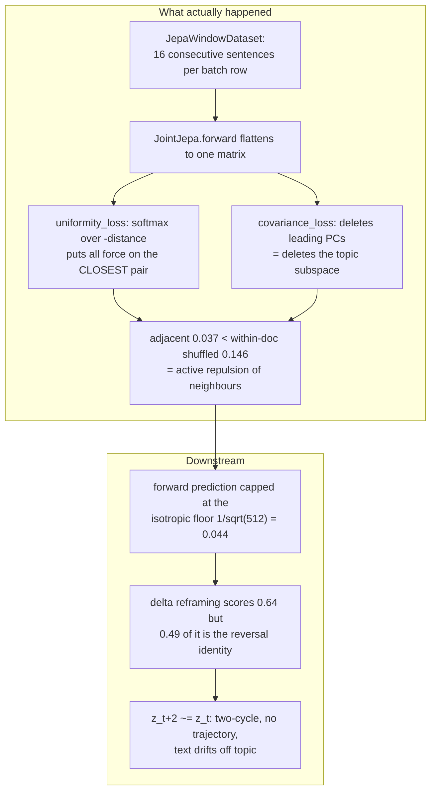

# Breaking the 0.05 Adjacent-Cosine Wall in Lucid

## A divergent menu of solution directions for the reasoner bottleneck

Repo: `/home/jpearce/Documents/Lucid`. Encoder `src/conceptpoc/jepa/encoder.py`, joint objective `src/conceptpoc/jepa/joint_model.py`, losses `src/conceptpoc/jepa/losses.py`, batching `src/conceptpoc/jepa/dataset.py`, predictor `src/conceptpoc/predictor/`, writer `src/conceptpoc/writer/model.py`.

---

# Part 0. Re-diagnosis: three measured facts, re-read

Before the menu, three corrections to the framing. Each is derived from numbers already in the repo, and each changes which ideas are worth trying. The single most important claim in this document is in 0.1: **the 0.05 wall is very probably manufactured by the training setup, not a property of language.**

## 0.1 The wall is not orthogonality — it is *targeted local repulsion*

The prompt states adjacent cosine ~0.05 and shuffled ~0.05, i.e. "indistinguishable." But the repo's own Round-1 measurement is sharper and worse:

> `experiments/test_targets2.py`, docstring: *"Round 1 showed exact-next has NEGATIVE signal (adj 0.037 < shuffled 0.146)"*

Here `shuffled` is a permutation **within the same document** (`T[ridx]` in `run()` of `test_targets.py`). So on the Austen corpus with the `jepa_v3_128t` encoder, a sentence is measurably *less* similar to its own successor (0.037) than to a random other sentence from the same document (0.146). That is not "no signal." That is **anti-signal**: a systematic force pushing neighbours apart harder than non-neighbours.

Two mechanisms in the current code produce exactly this, and both are structural rather than incidental:

**Mechanism 1 — the anti-collapse negatives *are* the neighbours.**

`JepaWindowDataset` (`src/conceptpoc/jepa/dataset.py:20-29`) makes every batch element a window of up to `window` (= `context_len`, default 16) **consecutive sentences from one document**. `JointJepa.forward` then flattens all valid slots into one `(B*S, dim)` matrix and hands it straight to the regularizers:

```110:124:src/conceptpoc/jepa/joint_model.py
            pred_z = z_v[:, :cd]          # normalized corr channel
            anti = raw_v[:, cd:]          # unnormalized spread channel
        else:
            pred_z = z_v
            anti = raw_v

        # Anti-collapse regularization on the *spread channel* (or the whole
        # vector when not split). Variance keeps per-dim spread; uniformity
        # spreads directions. Reconstruction anchors the corr channel against
        # collapse, so we don't need to push corr apart (which killed adjacency).
        var = variance_loss(anti, self.cfg.var_margin)
        cov = covariance_loss(anti)
        std_z = mean_dim_std(anti)
        unif = uniformity_loss(anti)
```

With `batch_size=16` and `window=16`, `anti` is 256 rows of which every block of 16 is a contiguous passage. The regularizer's negatives are drawn overwhelmingly from within-document, mostly-adjacent pairs.

**Mechanism 2 — `uniformity_loss` concentrates all its force on the closest pair.**

```80:83:src/conceptpoc/jepa/losses.py
    sq_dist = torch.pdist(z, p=2).pow(2)
    n_pairs = sq_dist.new_tensor(float(sq_dist.numel()))
    # log E[exp(-t * sq_dist)] computed stably via logsumexp.
    return torch.logsumexp(-t * sq_dist, dim=0) - torch.log(n_pairs)
```

The gradient of `logsumexp(-t * d²)` w.r.t. each pair is `softmax(-t * d²)`. A softmax over negated distances puts nearly all its mass on the **smallest** distances. The smallest distances in this batch are, by construction, the semantically closest pairs — the adjacent sentences. So `uniformity_loss` is not a diffuse global spreader; it is a precision instrument that finds the most-similar pair in the batch and pushes it apart hardest. Adjacent sentences are its preferred victim.

**Mechanism 2b — `covariance_loss` deletes the topic subspace.** Off-diagonal decorrelation (`losses.py:56-64`) suppresses the leading principal components of the embedding cloud. In any sentence-embedding space, broad topic is carried by the top PCs; sentence-specific detail lives in the tail. Whitening away the top PCs is precisely deleting the component that makes two sentences about the same subject look alike. The reconstruction anchor is indifferent to this — it only needs *some* invertible code, and the tail dimensions serve fine.

**Implication.** The trilemma as posed ("globally spread + locally predictable + decodable") is not a fundamental tension. Off-the-shelf sentence encoders satisfy all three routinely (MiniLM adjacent cosine on contiguous prose is typically 0.3-0.5, with a comparable spread and rank profile). What Lucid has built is a *contrastive learner whose positive pairs were accidentally used as its hardest negatives.* That is a bug with a fix, not physics.

**The random floor.** For isotropic unit vectors in d=512, E|cos| ≈ 1/√512 = **0.0442**. The measured 0.05 is the isotropic noise floor to two significant figures. The encoder has not merely failed to learn adjacency; it has been optimized to the exact point where neighbour information is destroyed.

## 0.2 The delta result (0.643) is mostly an arithmetic identity, which is why the text still drifted

From the delta-predictor plan (`.hermes/plans/2026-08-05_140000-delta-predictor.md`), reproducing `experiments/test_delta_verify.py`:

```
5-fold ridge delta->delta: test cos=0.464
  persistence baseline (predict same)  = -0.49
  reversal baseline    (predict flip)  = +0.49
  random                               =  0.00
```

Derive the null. For iid unit vectors `z_t`, with `d_t = z_{t+1} - z_t`:

```
E[d_t · d_{t+1}] = E[z_{t+1}·z_{t+2}] - E[z_{t+1}·z_{t+1}] - E[z_t·z_{t+2}] + E[z_t·z_{t+1}]
                 = 0 - 1 - 0 + 0 = -1,     and  E|d| ≈ √2
  =>  E[cos(d_t, d_{t+1})] ≈ -1/2
```

The measured persistence baseline is **-0.49**. That matches the iid-random null to within noise. The "oscillation" the delta framing discovered is not a property of text — it is the mechanical consequence of differencing a sequence of near-independent points. The reversal baseline of **+0.49** is therefore free, information-free, and available to any model.

Now read the two delta results against that null:
- The 5-fold ridge scored **0.464**, which is *below* the free 0.49. The ridge learned no forward information at all; it approximated the reversal identity slightly imperfectly.
- The trained model's **0.643** is above the null, but the informative excess is roughly 0.15, not 0.643.

And `d_pred ≈ -d_t` means `z_{t+2} ≈ z_{t+1} + (z_t - z_{t+1}) = z_t`. A delta predictor operating near the null **returns to the previous sentence**. That is a two-cycle, not a trajectory — which is exactly the "high val_cosine, text still drifts" outcome of Experiment 3. Mystery solved.

**Rule to adopt immediately:** any delta/change-direction metric must be reported as **reversal-residual cosine** — project `-d_t` out of both prediction and target, renormalize, then measure. Raw delta cosine is uninterpretable.

## 0.3 The dilution trap (Experiment 2) is the expected outcome, not a surprise

`self.decoder.teacher_forcing_logits(z_v, ...)` reconstructs from the **full** concatenated vector through one `nn.Linear` (`jepa/decoder.py`). Concatenation plus a dense read-out imposes no routing constraint whatsoever; the split into `pred_z = z_v[:, :cd]` and `anti = raw_v[:, cd:]` is a labelling convention, not an information-theoretic partition. Any bit is free to live in whichever half faces the weaker penalty, and `corr` faced no penalty at all, so it emptied out (variance 0.0007, effective rank 91/256). Splitting a representation requires either (a) an ablation/dropout that makes each part independently sufficient, (b) an explicit information bottleneck (KL, VQ, sparsity) on each part, or (c) architecturally disjoint decoders. The prior plan's `recon_ablated` term is option (a) and is the right shape — but it is treating a symptom of 0.1.

## 0.4 The restated problem



So the design target is not "resolve an impossible trilemma." It is: **prevent the anti-collapse prior from operating on the neighbourhood scale where prediction lives, and give the predictor a target whose metric is not confounded by isotropy.** Every idea below is a different way to do one or both of those.

---

# Part 1. Metrics reform (do this first — it is nearly free and it prevents another mirage)

Three experiments have now produced a misleading headline number (0.05 read as a ceiling; 0.643 read as a breakthrough; low `recon_ablated` read as a working channel). A small metric suite removes that failure mode permanently.

**M1. The four-cell control table.** For any encoder, report on the same sentence pairs: `adjacent`, `within-doc shuffled`, `cross-doc shuffled`, `random-vector floor (1/√d)`. A single number is meaningless; the *gaps* are the signal. `src/conceptpoc/eval/ceiling.py` currently reports only the first.

**M2. Reversal-residual cosine.** For delta targets, orthogonalize against `-d_t` before scoring (see 0.2).

**M3. Rank, not cosine: next-sentence retrieval.** Given `z_t` and 100 candidates (the true `z_{t+1}` plus 99 in-document distractors), report top-1 and MRR. Rank metrics are invariant to global isotropy, so they measure information rather than geometry. This should be the primary encoder gate.

**M4. Predictive-information probe.** An InfoNCE lower bound on `I(z_t; z_{t+1})` from a small trained critic. Answers "how much forward information exists in this space, in nats" independent of any predictor architecture.

**M5. Topic retention in text.** Encode the seed with a *frozen external* encoder (MiniLM), generate k sentences, encode each with the same frozen encoder, report mean cosine to the seed. Using a frozen external encoder for the metric is essential — measuring topic retention with the model's own encoder is circular, and the current `eval/latent.py::mean_consecutive_cos` measures step-to-step drift, not topic tracking.

**M6. Effective rank and variance** (`jepa/collapse.py`) alongside every one of the above, so no idea can win by quietly collapsing.

---

# Part 2. The menu

30 directions in seven families. Each: mechanism, why it breaks the wall, most likely failure mode, cheapest test.

---

## Family A — Fix what the anti-collapse prior operates on

*The highest value:cost family, because it targets the measured smoking gun and most entries are 10-40 line changes to existing files.*

### A1. Document-disjoint negatives

**Mechanism.** Build the anti-collapse batch from sentences that are guaranteed not to be neighbours: sample **one sentence per document window** (or reshape so each anti-collapse minibatch draws from `B` distinct documents), and apply `variance_loss` / `covariance_loss` / `uniformity_loss` only to that subsample. Reconstruction and prediction continue to use the full window as today. Implementation: in `JointJepa.forward`, index `anti` with a stride/random-one-per-row selection instead of using all `B*S` rows.

**Why it breaks the wall.** Removes Mechanism 1 from 0.1 entirely. Anti-collapse still guarantees the global cloud fills the space (because different documents *should* be far apart), but exerts zero force on the within-document, sentence-to-sentence scale where prediction lives. Global spread and local structure stop competing because they are now measured at different scales.

**Failure mode.** With `batch_size=16` you get only 16 rows for variance/covariance, which is too few for a stable `(512×512)` covariance estimate — the covariance term becomes noisy and possibly destabilizing. Mitigate by raising `batch_size` or accumulating the anti-collapse statistics over a queue of recent document-level samples (MoCo-style).

**Cheapest test.** No training needed for the diagnostic half: recompute the M1 table on cached vectors. For the causal half, a 1-2 hour run on `data/corpus_100k.txt` with `configs/jepa_100k_unif.json` plus this one change, gated on M1 and M3.

### A2. Neighbour-masked uniformity

**Mechanism.** Keep the full batch but exclude near-in-document pairs from the repulsion. Replace `torch.pdist` with an explicit pairwise distance matrix and mask out entries where `same_doc(i,j) and |pos_i - pos_j| <= k` (k ≈ 3) before the logsumexp.

**Why it breaks the wall.** Directly disarms Mechanism 2. The softmax can no longer place its mass on adjacent pairs because they are not in the sum. Strictly more surgical than A1 and keeps the large-batch statistics.

**Failure mode.** The model discovers a degenerate solution just outside the mask radius — sentences at distance k+1 get slammed instead, and topic structure gets destroyed at a slightly longer range. Detect by sweeping k and watching whether adjacency improves monotonically or just moves the dip.

**Cheapest test.** ~20 lines in `losses.py::uniformity_loss` plus threading position metadata through `JointJepa.forward`. Same 100k run as A1. Cheap enough to run A1 and A2 as two arms of one A/B.

### A3. Make adjacency an explicit positive pair (alignment + uniformity)

**Mechanism.** Wang & Isola's objective has two terms; the repo implements only uniformity. Add the alignment term with **adjacent sentences as the positive pair**: `L_align = E[||z_t - z_{t+1}||²]`, or better a full InfoNCE where the positive is `z_{t+1}` and negatives are cross-document sentences. This turns the encoder into an explicitly local-context-contrastive learner (the text analogue of Quick-Thoughts / SimCSE with discourse positives).

**Why it breaks the wall.** Rather than merely stopping the repulsion of neighbours, it *pays* the encoder for keeping them close, with a calibrated, temperature-controlled trade-off against the global spread that the negatives supply. Adjacent cosine becomes a directly optimized quantity rather than an emergent accident.

**Failure mode.** Over-alignment: the encoder maps whole passages to one point (local collapse), reconstruction accuracy falls, and the writer receives an uninformative vector. Guard with M6 and with the reconstruction anchor; tune the InfoNCE temperature rather than a raw alignment weight.

**Cheapest test.** Skip training entirely for the first read: fit a *linear probe* InfoNCE critic on cached JEPA vectors and see whether even a linear map can separate true-next from in-document distractors (M3/M4). If a linear probe already gets top-1 well above chance, the information survives in the current space and only the metric is broken — a much cheaper world to be in.

### A4. Two-level / conditional VICReg (spread the residuals, not the positions)

**Mechanism.** Decompose `z_t = m_doc + r_t` where `m_doc` is the running document mean. Apply anti-collapse **twice at different scales**: variance/covariance on `{m_doc}` across documents (so topics fill the space), and separately on `{r_t}` within a document (so sentences within a topic stay distinguishable). Never apply a single global term to raw `z`.

**Why it breaks the wall.** Adjacent cosine is dominated by the shared `m_doc` component. Under the current single-scale objective that component is precisely what gets suppressed. Under a two-level objective, `m_doc` is protected — it is regularized only against *other documents*, where being different is correct.

**Failure mode.** `m_doc` is unavailable at generation time (you are generating the document). Requires either a causal running mean over the prefix, or coupling with D3's theme token so the theme is predicted once and then held.

**Cheapest test.** Purely post-hoc on cached vectors: compute per-document means, and report M1 for `z`, for `z - m_doc`, and for `m_doc` alone. This tells you how much of the (absent) adjacency lives at each scale in the current space — 5 minutes, no GPU. `experiments/test_targets2.py::centered_adj` already computes half of this; read its recorded output before writing anything.

### A5. Rate-distortion / total-coding-rate objective (expand globally, compress locally)

**Mechanism.** Replace the VICReg trio with an MCR²-style objective: maximize `log det(I + c·Cov(all z))` (global volume) while minimizing `Σ_docs log det(I + c·Cov(z within doc))` (local volume). One loss, one scale hyperparameter, an explicit statement of "many well-separated clusters, each internally tight."

**Why it breaks the wall.** It is the principled form of what A1/A2/A4 achieve by masking. The objective *is* "spread between neighbourhoods, compress within neighbourhoods" — exactly the geometry the reasoner needs — rather than an isotropy prior that has to be defended against with patches.

**Failure mode.** `logdet` of a 512×512 matrix per step is expensive and numerically delicate at small batch; and the local term can drive within-document collapse if its weight is too high, which reconstruction may not fully arrest.

**Cheapest test.** Evaluate the objective as a *diagnostic* on cached vectors from all existing encoder checkpoints in `artifacts/` — it becomes a scalar score for "how neighbourhood-structured is this space." If the current encoder scores terribly and a frozen MiniLM scores well, that is strong prior evidence before spending a training run.

### A6. SIGReg / LeJEPA distributional isotropy

**Mechanism.** Already stubbed in the repo at `jepa/collapse.py:78-98` (`sigreg_isotropic`). Enforce that random 1-D projections of the embedding distribution match N(0,1) via a characteristic-function goodness-of-fit, instead of enforcing pairwise repulsion.

**Why it breaks the wall.** This is a constraint on the *marginal distribution*, not on individual pairs. A distribution can be perfectly isotropic Gaussian while containing tight local clusters — Gaussians have neighbours. Pairwise repulsion cannot express that; distribution matching can.

**Failure mode.** Isotropic-Gaussian is still the wrong prior if the true topic structure is clustered or low-dimensional; you may satisfy the statistic while retaining a weak neighbourhood signal. Also the sketch is over random directions, so it is a weak constraint in high d with few projections.

**Cheapest test.** The function exists. Swap it for `variance_loss + covariance_loss + uniformity_loss` behind a config flag and run the same 100k arm as A1. Genuinely a one-line objective swap.

### A7. Whitening-invariant prediction metric

**Mechanism.** Not a training change — a measurement change. Predict and score in a ZCA-whitened frame estimated from the corpus, or equivalently report Mahalanobis-cosine.

**Why it breaks the wall.** If the current space has a strong shared "common direction" (the Mu & Viswanath all-but-the-top phenomenon), raw cosine is dominated by it in either direction. Whitening isolates the informative component. This might reveal that a nonzero adjacency signal is already present and merely invisible in raw cosine.

**Failure mode.** Very likely to show the *opposite* of the hoped result here — since `covariance_loss` has already whitened the space by construction, whitening should be close to a no-op, which would be a clean confirmation of Mechanism 2b rather than a fix.

**Cheapest test.** Ten lines on cached vectors, and worth running precisely because a negative result is informative. Also run it on MiniLM vectors: if MiniLM adjacency survives whitening, isotropy per se is not the killer and the local-repulsion story (A1/A2) is the whole explanation.

---

## Family B — Representation geometry

### B1. Slow-fast (two-timescale) latents

**Mechanism.** `z_t = [s_t ; f_t]`. Add an explicit **slowness** penalty `||s_t - s_{t-1}||²` on the slow half and apply anti-collapse to `s` only *across documents* and to `f` within. The predictor forecasts only `s`; `f` is sampled or left to the writer.

**Why it breaks the wall.** Predictability stops being an emergent hope and becomes a directly optimized property of a designated subspace, with the anti-collapse pressure moved to a scale where it does not conflict. Slow Feature Analysis is the classic formulation of exactly "what should a predictable representation look like."

**Failure mode.** The Experiment-2 dilution trap returns: `s` goes constant (perfectly slow, zero information) and everything hides in `f`. Slowness alone is collapse-seeking. Requires pairing with an information floor on `s` (per-document InfoNCE among `s` vectors of *different* documents, or the ablated-reconstruction term from the corr-forcing plan).

**Cheapest test.** Post-hoc probe on cached vectors: fit a low-rank projection `P` maximizing `corr(Pz_t, Pz_{t+1})` subject to `Pz` having full rank across documents — i.e. **CCA between `z_t` and `z_{t+1}`**. The top canonical correlations tell you, in minutes and without training, how large a slow subspace already exists and how strong it is. This one probe informs B1, B3, B9, and C5 simultaneously.

### B2. Hierarchical theme + residual

**Mechanism.** Predict a document/paragraph theme vector once, then predict each sentence as `theme + residual`. The reasoner's job becomes predicting a small residual conditioned on a fixed anchor.

**Why it breaks the wall.** The theme supplies the shared component that adjacency measures, and it is held constant rather than re-derived at every step, so drift cannot accumulate. The predictor's error no longer compounds into the topic.

**Failure mode.** Rigid topic — output becomes repetitive and cannot legitimately change subject, and multi-paragraph structure is lost.

**Cheapest test.** **Already implemented and untrained-on**: `PredictorConfig.use_theme` and `ContextTransformer.theme_proj` (`predictor/model.py:49-51, 83-84`) add a theme vector to every position. Set `use_theme: true`, feed the running mean of the prefix concept vectors as `theme_vec`, retrain only the predictor, and measure M5. This is arguably the cheapest non-trivial experiment in the entire document — no new code.

### B3. Low-rank direction + magnitude split

**Mechanism.** `z = U u + w` with `U` a learned `512×k` orthonormal topic basis, `k ≈ 16-32`. The predictor forecasts only the `k` coefficients `u`; `w` (detail) is sampled from a learned conditional prior.

**Why it breaks the wall.** Two effects. First, the isotropic floor for cosine in `k=16` is `1/4 = 0.25`, so the metric is no longer squashed against the noise floor. Second, and more substantively, a rank constraint forces the predictable information into a shared subspace instead of allowing it to be diluted across 512 dimensions where covariance decorrelation can pick it apart.

**Failure mode.** `k` too small loses the content the writer needs; `k` too large reproduces the original problem. Requires the sweep.

**Cheapest test.** The CCA probe from B1 directly gives the achievable canonical correlation as a function of `k` — read the spectrum before committing to any `k`.

### B4. VQ / residual-VQ discrete concept codes

**Mechanism.** Quantize the concept vector into `n` codes from `n` codebooks (RVQ, coarse to fine). Prediction becomes **classification over codebook entries**, trained with cross-entropy.

**Why it breaks the wall.** It deletes the wall's coordinate system. There is no cosine, no isotropy, no mean-seeking regression — there is top-1 accuracy and perplexity, both of which are honest and non-gameable. Codebook usage (perplexity) is a direct, interpretable collapse metric, so anti-collapse becomes "keep codebook perplexity high," which does not push apart anything geometrically. And RVQ gives "predict coarse topic, then refine" for free: code 1 is the topic, codes 2..n are detail, and you can predict them with separate heads or autoregressively.

**Failure mode.** Codebook collapse (a handful of live codes) — a well-known VQ pathology with well-known mitigations (EMA codebook updates, dead-code restart, rotation trick). Also the writer must be retrained to consume codes or de-quantized vectors, which is a real cost.

**Cheapest test.** Fit a plain k-means (k=512) to the **cached** concept vectors — no training. Then measure: given the cluster id of sentence `t`, what is the top-1 accuracy of predicting the cluster id of `t+1` from a simple bigram/transition matrix, versus the marginal-frequency baseline? If cluster transitions are predictable well above the marginal, discretization is exposing structure that cosine cannot see, and the full RVQ path is justified. Under an hour, CPU.

### B5. Hyperbolic / product-manifold embeddings

**Mechanism.** Embed into a Poincaré ball (or a product of a sphere and a hyperbolic factor). A topic occupies a region; sentences are points within it; hierarchy is native.

**Why it breaks the wall.** Hyperbolic volume grows exponentially with radius, so "there is room for everything to be far apart" is free — anti-collapse regularization becomes largely unnecessary, and with it the pressure that destroys local structure. The global-spread requirement is satisfied by the geometry rather than by a loss.

**Failure mode.** Numerical instability near the ball boundary; the writer, the diffusion predictor, and every existing metric assume Euclidean/spherical geometry, so this is a wide blast radius for a speculative gain.

**Cheapest test.** Do not rebuild the pipeline. Fit a hyperbolic embedding of the *existing* cached vectors' k-NN graph and check whether document/topic structure separates more cleanly (measured by neighbour-purity) than in the Euclidean original. If not, drop it.

### B6. Tangent-space (log-map) prediction on the sphere

**Mechanism.** Predict in the tangent space at `z_t`: target is `Log_{z_t}(z_{t+1})`, prediction applied via `Exp_{z_t}(·)`. The tangent target is orthogonal to `z_t` by construction.

**Why it breaks the wall.** It is the geometrically correct version of the delta idea, and it *automatically removes the reversal artifact* from 0.2 — because the tangent component along `z_t` (which is what generated the free -0.5) is projected out by definition. Whatever cosine you measure in the tangent space is real information.

**Failure mode.** Once the free 0.49 is removed, the honest score may be near zero, which would be a valuable negative result rather than a fix.

**Cheapest test.** Purely post-hoc on cached vectors: recompute the `experiments/test_delta_verify.py` ridge with tangent targets. Twenty minutes, and it retroactively tells you the true value of Experiment 3.

### B7. Set-valued / slot latents

**Mechanism.** Represent a sentence as `m` slot vectors (slot attention / Perceiver-style) rather than one pooled vector. Adjacent sentences share some slots (entities, topic) and differ in others (predicate, new information). Prediction is slot-wise with Hungarian matching; "topic coherence" becomes slot persistence.

**Why it breaks the wall.** Adjacency is no longer a scalar squeezed out of a single global cosine — it is *partial overlap*, which is both more measurable and more predictable. The predictor can copy the persistent slots (easy, high accuracy) and predict only the changing ones (the actual task).

**Failure mode.** Matching instability; slots become permutation-arbitrary and the "persistent slot" story fails to emerge without extra supervision. Also multiplies the writer's conditioning interface complexity.

**Cheapest test.** Cheap proxy without any slot machinery: measure lexical/entity overlap between adjacent sentences in the corpus and check that it is high (it will be). Then check whether the *current* concept vectors predict that overlap at all via a linear probe. If entity continuity is real in the text but invisible in the vectors, the pooling bottleneck is provably discarding it.

### B8. Sparse dictionary / predictive-coding codes

**Mechanism.** `z` becomes k-sparse coefficients over an overcomplete dictionary (SAE-style, e.g. 4096 atoms, 32 active). Adjacent sentences share active atoms.

**Why it breaks the wall.** The prediction target becomes a **support set** — a multi-label classification with a real accuracy metric — plus coefficients. Sparse-code support overlap between neighbours is typically high and highly predictable, and sparsity is itself an anti-collapse mechanism (a collapsed code cannot use its dictionary). Global spread and local overlap coexist naturally in sparse codes; that is what sparse coding is for.

**Failure mode.** The reconstruction decoder may struggle from a sparse code, hurting the writer; and dead atoms are the sparse analogue of codebook collapse.

**Cheapest test.** Fit a dictionary (or a small top-k SAE) to the **cached** vectors offline, then measure Jaccard overlap of active supports for adjacent vs shuffled pairs. If adjacent overlap clearly exceeds shuffled overlap, the current 512-d space *does* contain neighbour information that cosine is blind to — a major finding for a few CPU-hours.

### B9. Explicit rank-constrained predictable subspace

**Mechanism.** Constrain the encoder so a designated `k`-dim subspace has *bounded* within-document variance (predictable) while the orthogonal complement carries free detail, enforced by projection rather than by competing soft penalties.

**Why it breaks the wall.** Hard architectural separation instead of the soft `channel_split` that dilution defeated in Experiment 2. If the split is a projection with its own decoder path, information cannot leak around it.

**Failure mode.** Same trap as before unless the decoder is architecturally forced through the subspace (two decoders, or the ablated-reconstruction term from the corr-forcing plan).

**Cheapest test.** The B1 CCA probe.

---

## Family C — Prediction-target reframing

### C1. InfoNCE / ranking objective instead of regression

**Mechanism.** Stop regressing a point. Train the reasoner as a scorer: given the prefix, rank the true `z_{t+1}` above N in-document distractors. Generation uses the score to select or guide.

**Why it breaks the wall.** Regression to a point under uncertainty produces the *conditional mean*, which for a near-isotropic multi-modal successor distribution is close to zero and low-norm — mathematically guaranteed to produce a low cosine even with a perfect model. Ranking sidesteps this: it measures whether the model knows which continuations are plausible, which is the property that actually prevents drift.

**Failure mode.** A ranker does not directly produce a vector for the writer. Needs pairing with a proposal mechanism (C9, or best-of-N over writer samples).

**Cheapest test.** Train a small critic on cached vectors, report top-1 out of 100 in-document distractors. If this is well above the 1% chance floor while cosine sits at 0.05, the entire "prediction is capped at 0.05" premise is disproven and this becomes the headline result. Cheap, decisive, and I would run it alongside the Part-3 recommendation.

### C2. Horizon-averaged / multi-step targets

**Mechanism.** Predict the mean of the next `k` sentences (a local topic attractor) rather than exactly the next one.

**Why it breaks the wall.** Averaging cancels sentence-specific noise and keeps the shared topic component, raising SNR. It also aligns the objective with what the system actually needs (stay on topic) rather than an exact next step it can never get right.

**Failure mode.** The averaged target is smoother and may be blander, producing generic prose — precisely the "fluent but empty" reward-hacking mode called out in `docs/LIMITATIONS.md`.

**Cheapest test.** **Already written**: `experiments/test_targets.py` implements `avg_next2` and `avg_next3` and prints adj/shuffled/signal for each. Re-run it (minutes) and read the numbers before treating this as untested. Note that its `shuffled` control is within-document, which under the 0.1 diagnosis is the *right* control.

### C3. Coarse-to-fine: predict topic, then refine

**Mechanism.** Two-stage. Stage 1 predicts a coarse code (a cluster id, or the first RVQ level from B4). Stage 2 refines within that coarse bucket.

**Why it breaks the wall.** Topic drift is a stage-1 failure. Making stage 1 a small, low-entropy, discretely-scored problem makes it solvable and monitorable, instead of hiding it inside a 512-d regression where a topic error is indistinguishable from a phrasing error.

**Failure mode.** Cascading errors — a stage-1 mistake is unrecoverable — and stage boundaries need calibration.

**Cheapest test.** The k-means transition-matrix probe from B4 *is* the stage-1 feasibility test.

### C4. Latent state-space / world model (state + emission)

**Mechanism.** Maintain a recurrent belief state `h_t`; the sentence vector `z_t` is an *emission* from `h_t`. Learn the transition `h_{t+1} = f(h_t)` and the emission `p(z|h)`. Topic lives in `h`.

**Why it breaks the wall.** Decouples the thing that must be smooth and predictable (`h`) from the thing that must be spread and decodable (`z`). Anti-collapse on `z` becomes harmless to coherence because coherence is no longer stored in `z`. This is the most architecturally honest resolution of the stated trilemma — it declines the premise that one vector must do all three jobs.

**Failure mode.** `h` collapses to a constant unless the emission loss forces it to carry information; and it is a substantially larger build than the Family-A fixes.

**Cheapest test.** Fit a small linear-Gaussian SSM (or just a GRU) on cached vector sequences and compare held-out `z_{t+1}` likelihood against a Markov `z_t`-only baseline. If a latent state improves likelihood, there is state to track. A day, mostly CPU.

### C5. Koopman / operator learning

**Mechanism.** Learn a linear operator `A` in a lifted space such that `φ(z_{t+1}) ≈ A φ(z_t)`. The slow eigenmodes of `A` are the topic; the fast modes are stylistic churn.

**Why it breaks the wall.** Gives an explicit, inspectable spectral decomposition of "what persists versus what churns," and lets you generate by advancing only the slow modes. Also directly diagnostic: the eigenvalue spectrum tells you whether *any* slow modes exist in this space.

**Failure mode.** Text dynamics are unlikely to be well-approximated by a linear operator even after lifting; may explain little variance.

**Cheapest test.** DMD (dynamic mode decomposition) on cached trajectories — a single SVD, minutes, and the eigenvalue spectrum is immediately interpretable. Any eigenvalues near the unit circle with slow phase would be strong evidence for B1/C4.

### C6. Future-denoising / masked-successor objective

**Mechanism.** Rather than regressing `z_{t+1}`, train the model to *denoise* a corrupted `z_{t+1}` given the prefix — which is what the existing `DiffusionConceptPredictor` already does, but currently applied to a target space whose adjacency has been destroyed.

**Why it breaks the wall.** Denoising captures the full conditional distribution rather than its mean, so it does not suffer the conditional-mean shrinkage of C1's diagnosis. **Important caveat:** the repo already has this (`predictor/diffusion.py`, with CFG and FiLM) and it did not break the wall — which is itself evidence that the problem is upstream in the encoder, not in the predictor head. Listing it mainly to record that this branch is already explored and to redirect effort upstream.

**Failure mode.** Already observed: a perfect distributional model of an uninformative target is still uninformative.

**Cheapest test.** Already run. Re-run only after an encoder fix lands, as the *second* stage.

### C7. Reversal-orthogonalized delta target

**Mechanism.** The direct repair of Experiment 3. Define the target as `d_{t+1}` with its `-d_t` component projected out and renormalized. Train and score on that residual only.

**Why it breaks the wall.** Removes the free 0.49 identified in 0.2, forcing the model to learn genuinely forward information rather than an arithmetic identity, and making the reported number trustworthy.

**Failure mode.** The residual may be almost pure noise, in which case the score drops to ~0 — an honest negative that saves further investment in the delta framing.

**Cheapest test.** Modify `experiments/test_delta_verify.py` (twenty lines) and re-run the 5-fold ridge. Under an hour and it settles the status of the project's most promising prior result. I would run this regardless of which direction is chosen.

### C8. Energy-based successor scoring (score, don't predict)

**Mechanism.** Train an energy `E(prefix, z)` on real pairs with negatives. At generation, have the writer sample N candidate next sentences, encode them, and pick the lowest energy.

**Why it breaks the wall.** Never requires producing a point estimate in a space where point estimates are ill-posed. Reuses the writer's already-good generative distribution as the proposal, and reuses the reward-loop scaffolding (`reward/reward_model.py` is already a Bradley-Terry model over trajectories — most of this exists).

**Failure mode.** N× inference cost; and the energy model can be gamed by degenerate candidates (the reward-hacking mode in `docs/LIMITATIONS.md`).

**Cheapest test.** Best-of-N with the *existing* `reward_model.py` scoring the existing hybrid generation, gated on M5. No new training.

### C9. Predict the rhetorical move, not the content

**Mechanism.** Factor the successor into (slow topic vector, discrete discourse move) where the move is one of ~8 labels: elaborate, contrast, exemplify, cause, conclude, dialogue-turn, scene-shift, etc. Predict the move as classification and hold the topic nearly fixed.

**Why it breaks the wall.** Splits an ill-posed continuous problem into one nearly-constant variable and one small classification with real accuracy. Discourse-move sequences in prose are genuinely predictable (this is what discourse-relation parsers exploit) and a wrong move costs fluency, not topic.

**Failure mode.** Needs move labels — either a heuristic/connective-based labeller or a distilled LLM annotation pass, both of which are noisy.

**Cheapest test.** Heuristic labeller from discourse connectives ("but", "for example", "therefore", "meanwhile") over the corpus, then measure the move-bigram transition entropy versus the marginal. If moves are predictable from context, this is a real signal channel with an honest metric.

---

## Family D — Architecture

### D1. Cross-sentence token attention (delete the pooled bottleneck for the reasoner)

**Mechanism.** Give the reasoner the last k sentences' **token-level hidden states** via cross-attention, not one pooled 512-d vector per sentence. The concept vector remains the writer's interface; the reasoner sees more.

**Why it breaks the wall.** Mean-pooling 48 token states into 512 dims (`encoder.py:47-49`) may simply destroy the entity/reference information that makes the next sentence predictable — pronouns, named entities, and the specific noun phrase that the next sentence continues. The wall could be partly a bottleneck artifact rather than purely a loss artifact.

**Failure mode.** Abandons the clean "predict ideas, not tokens" thesis of the project and moves toward being a conventional LM; also much heavier.

**Cheapest test.** Upper-bound probe: train a small model to predict `z_{t+1}` from the *token states* of sentence `t` rather than from `z_t`. If token-conditioned prediction beats vector-conditioned prediction substantially, the pooling is guilty and this is quantified before any redesign.

### D2. Latent scratchpad / iterated continuous thought

**Mechanism.** Coconut-style iterated latent refinement before emitting. **Already implemented**: `src/conceptpoc/trajectory/planner.py` with `latent_iters`, a GRU cell, and a K-step trajectory head.

**Why it breaks the wall.** More computation per decision, and multi-step planning means the trajectory is generated jointly rather than greedily, so errors do not compound step by step.

**Failure mode.** Iterating a latent whose *space* has no forward structure adds compute without information. Under the 0.1 diagnosis this is why the planner likely underdelivered.

**Cheapest test.** Whatever is in `artifacts/trajectory_planner/` — read the recorded metrics before rebuilding. Then re-test only after an encoder fix.

### D3. Global doc-theme token

Merged with **B2** — already implemented via `PredictorConfig.use_theme`, and it is the cheapest untried lever in the repo.

### D4. Explicit entity/memory register

**Mechanism.** Maintain a key-value store of entities mentioned so far, updated per sentence, injected into the writer via FiLM or cross-attention alongside the concept vector.

**Why it breaks the wall.** Sidesteps it. Much of what reads as "topic drift" to a human is *entity* drift (scientist → whales → beer → gods, per the sharpen-reasoner plan's recorded observation). A register makes entity persistence a hard architectural guarantee rather than something a cosine has to encode.

**Failure mode.** Repetitive, list-like prose; and entity extraction adds a dependency the project has so far avoided (`data/segment.py` is deliberately regex-only).

**Cheapest test.** Measure it before building it: take the existing recorded drifting generations and count how many are entity-substitution failures versus genuine topic changes. If most are entity failures, this cheap fix may beat the deep one.

### D5. Two-tower reasoner + writer with prefix cross-attention

**Mechanism.** Let the writer cross-attend to the *previous sentence's tokens* as well as the predicted concept vector.

**Why it breaks the wall.** Doesn't break it — routes around it. Local coherence gets a direct lexical path that does not depend on the concept vector at all, while the concept vector handles longer-range steering. Likely to produce visibly better text quickly.

**Failure mode.** The writer learns to ignore the concept vector entirely (a plain LM with extra inputs), and you have lost the research thesis while gaining a demo. Must be measured with a concept-ablation test: shuffle the concept vector at generation time and confirm the output changes.

**Cheapest test.** The concept-ablation test on the *current* writer first — feed a random or shuffled concept vector and see how much the output changes. If the current writer already largely ignores the concept, that reframes the whole project's bottleneck and is worth knowing before anything else. Minutes.

---

## Family E — Training and curriculum

### E1. Negative-difficulty curriculum

**Mechanism.** Start anti-collapse with strictly cross-document negatives (A1), then gradually admit nearer in-document negatives with a distance-dependent weight, never reaching adjacency.

**Why it breaks the wall.** Lets the space establish neighbourhood structure first, then sharpen within-neighbourhood distinctions — the opposite of the current schedule, which applies maximum local repulsion from step one.

**Failure mode.** Another schedule to tune, on top of `recon_warmup_epochs` / `alpha_warmup_epochs`; and late-stage hard negatives can undo early structure.

**Cheapest test.** A third arm of the A1/A2 A/B.

### E2. Anneal anti-collapse to zero, keep reconstruction as the only anchor

**Mechanism.** After warmup, decay `var_weight`/`cov_weight`/`uniformity_weight` toward zero and rely on the reconstruction anchor alone (which provably prevents constant collapse — a constant vector cannot reconstruct distinct sentences).

**Why it breaks the wall.** Tests whether the anti-collapse terms are *needed at all* in the presence of a strong reconstruction anchor, or whether they are pure cost. `configs/jepa_austen_ablate_vicreg.json` and `artifacts/austen_ablate_none/` suggest a version of this was tried — read those results first.

**Failure mode.** Partial (not total) collapse: variance stays nonzero but effective rank quietly falls, which the current `std_z` alarm would not catch. Gate on effective rank (`collapse.py::effective_rank`) as well as `std_z`.

**Cheapest test.** Read `artifacts/austen_ablate_none/` and `artifacts/austen_ablate_vicreg/` metrics. Possibly already answered.

### E3. Scheduled sampling of the writer through predicted vectors

**Mechanism.** Extend `jepa/train_decoder_robust.py` from perturbation-robustness to full latent-rollout robustness: train the writer on vectors the *predictor actually produces* during multi-step rollout, not on encoder outputs plus Gaussian noise.

**Why it breaks the wall.** Doesn't — it makes the wall cheaper. Exposure bias means the writer sees a different input distribution at generation than at training; closing that gap can buy visible coherence at zero cost to the encoder.

**Failure mode.** The writer learns to ignore a noisy conditioning signal (the rational response to an uninformative input), reducing controllability.

**Cheapest test.** Compare writer NLL on encoder vectors versus on predicted vectors. A large gap quantifies the exposure-bias cost directly.

### E4. Frozen-encoder reference arm

**Mechanism.** Train the entire predictor + writer stack on frozen MiniLM (or SONAR) sentence vectors, whose adjacency structure is known-good.

**Why it breaks the wall.** Establishes the achievable ceiling for the *rest* of the system, decoupled from the encoder question. If topic coherence is good with MiniLM vectors, the encoder is definitively the bottleneck and every Family-A/B idea is justified. If coherence is *still* bad with MiniLM vectors, the bottleneck is the predictor or the writer interface and the whole encoder programme is misdirected.

**Failure mode.** None worth naming — this is a control, and its value is in either outcome. Its only cost is compute.

**Cheapest test.** The scaffolding exists (`configs/frozen_1m.json`, `codec/sentence_transformer_codec.py`, `artifacts/frozen_100k/`). Possibly only needs re-running with current eval.

### E5. Multi-task encoder with a next-sentence discrimination head

**Mechanism.** Add a contrastive next-sentence head to the encoder's training so predictability is an encoder-training signal, not an afterthought applied to a frozen geometry.

**Why it breaks the wall.** The current `alpha * pred` term does push predictability into the encoder — but via cosine regression against an EMA target, which is exactly the mean-seeking objective diagnosed in C1, and it is fighting the uniformity term head-on. A discriminative head is a stronger and better-conditioned signal.

**Failure mode.** Shortcut features — the encoder learns to encode surface cues (length, position, punctuation, shared rare words) that make discrimination easy without capturing meaning. Guard by testing discrimination on paraphrased or lexically-disjoint pairs.

**Cheapest test.** Overlaps with A3; run as one experiment.

---

## Family F — Downstream coupling

### F1. Backpropagate the writer's text loss into the predicted vector

**Mechanism.** Train the predictor with the loss that actually matters: the writer's NLL of the *true* next sentence, conditioned on the *predicted* concept vector. Gradients flow through the writer's FiLM/conditioning path into the predictor. Freeze the writer to save memory.

**Why it breaks the wall.** It abolishes the wall by abolishing cosine as the objective. The predictor is no longer asked to hit a point in a geometry that has been deliberately flattened; it is asked to produce whatever conditioning signal makes the writer most likely to say the right thing. If two different vectors both steer the writer correctly, both are accepted — which is the correct notion of equivalence and is exactly what cosine cannot express.

**Failure mode.** The writer's conditioning path may be weak enough that gradients are uninformative (test with D5's concept-ablation probe first). Memory cost of backpropagating through a 152M model. And degenerate solutions where the predictor finds an adversarial vector that satisfies the writer but is off the encoder's manifold — mitigate with a manifold penalty (`eval/latent.py::mean_max_cos_to_bank` already measures this).

**Cheapest test.** Prerequisite is D5's ablation probe: confirm the writer's output is strongly sensitive to the concept vector. If it is, a small joint fine-tune on a subset is a single-GPU-day experiment with a direct M5 readout. This is the highest-ceiling idea in the document and my second recommendation after Part 3.

### F2. Distill a teacher LLM's continuation into the reasoner

**Mechanism.** Use a local LLM (the Lemonade judge model is already wired) to generate the "correct" next sentence for each prefix, encode it, and train the predictor to hit it.

**Why it breaks the wall.** Replaces a maximally noisy single-sample target (the one sentence the author happened to write) with a target closer to the conditional mode. Much of the irreducible entropy in next-sentence prediction is sample noise, not genuine unpredictability.

**Failure mode.** Caps the system at the teacher's quality, and inherits the teacher's biases; conceptually in tension with the project's self-supervised framing.

**Cheapest test.** 500 prefixes through the local judge model, measure whether the teacher's continuation is closer in concept space to the true continuation than the model's prediction is. If the teacher is not closer either, the target space is confirmed broken (which loops back to Family A).

### F3. Retarget the reward loop at topic persistence

**Mechanism.** The RAFT loop in `loop/self_improve.py` is built and working. Change the reward to explicitly score multi-sentence topic retention (M5) rather than general quality.

**Why it breaks the wall.** Optimizes the actual defect directly, at the policy level, without touching the representation.

**Failure mode.** Reward hacking into repetitive on-topic mush — the exact failure `docs/LIMITATIONS.md` warns about. Needs a diversity/fluency counter-term.

**Cheapest test.** Change the reward function, run the existing loop, read M5 and judge score together. Days of compute but near-zero new code.

### F4. Select checkpoints on text-space coherence, not val cosine

**Mechanism.** `train_joint.py` currently selects the best checkpoint on `val_pred_cos`. Given 0.1, that metric is selecting for a partly-destroyed geometry. Select on M3 (retrieval rank) or periodic M5 instead.

**Why it breaks the wall.** Costs nothing and stops the training loop from actively choosing the wrong model. If `val_pred_cos` is near the isotropic floor for all checkpoints, "best by val cosine" is currently selecting on noise.

**Failure mode.** Text-space eval is slow, so it can only run every few epochs.

**Cheapest test.** Recompute M3 for the checkpoints already saved in `artifacts/`, and check whether the selected-best checkpoint is actually the best by rank. If not, that is a free improvement sitting on disk.

---

## Family G — Question the unit of prediction

### G1. Paragraph-level concepts

**Mechanism.** Make the concept vector a paragraph, not a sentence; the writer generates several sentences per concept.

**Why it breaks the wall.** Paragraph-to-paragraph transitions are inherently slower and more predictable than sentence-to-sentence — a longer time constant means higher autocorrelation, mechanically. Also fewer prediction steps per unit text, so less error compounding.

**Failure mode.** The writer must generate 3-6 coherent sentences from one vector, a much harder conditional generation task, and single-vector reconstruction is already documented as lossy (`docs/LIMITATIONS.md`).

**Cheapest test.** Purely post-hoc: compute the M1 table at paragraph granularity on cached vectors (mean-pool sentence vectors within a paragraph). If paragraph-adjacent cosine substantially exceeds sentence-adjacent cosine, the time-constant argument is confirmed for free.

### G2. Multi-scale: predict at sentence, paragraph, and section simultaneously

**Mechanism.** A hierarchy of predictors on a hierarchy of latents, coarse conditioning fine.

**Why it breaks the wall.** Each scale gets an anti-collapse prior appropriate to *its* scale, so global spread at the section level never conflicts with local structure at the sentence level. This is the fully general version of A4/B1/B2.

**Failure mode.** Substantially more machinery; risk of building a large system before validating the cheap fix.

**Cheapest test.** Do G1's probe at three granularities and read off the autocorrelation-versus-scale curve.

### G3. Honest fallback: concept vector as *steering*, not as *content*

**Mechanism.** Give the writer the previous sentences' text directly and use the concept vector purely as a steering/control signal (like a CFG guidance vector or a control code).

**Why it breaks the wall.** Concedes it. Local coherence comes from text; the concept vector supplies direction. Topic drift would very likely stop immediately.

**Failure mode.** It is no longer a JEPA-for-text system in the interesting sense — it is a conditioned LM. Worth naming explicitly as the fallback so the decision to take it is deliberate rather than a drift, and worth keeping as the quality baseline the research path must beat.

**Cheapest test.** It is roughly the D5 build. Useful as an upper-bound reference for M5 even if never shipped.

---

# Part 3. Ranking and recommendation

## Top 5 by estimated value : cost

**1. A1 + A2 + A3 — neighbour-safe anti-collapse.** *Value: very high. Cost: very low (~40 lines plus one 100k training run).* This is the only family that targets the measured smoking gun of 0.1 (adjacent 0.037 < within-doc shuffled 0.146), and its diagnostic half needs no training at all. If the diagnosis holds, everything downstream — the diffusion predictor, the planner, the delta reframing — has been operating on a deliberately damaged target space, and fixing it retroactively unblocks all of them. If the diagnosis fails, it fails cheaply and definitively.

**2. C1 + M3 — ranking metrics and an InfoNCE critic.** *Value: high. Cost: very low (a small probe on cached vectors, hours, CPU).* Answers "is the information present but invisible to cosine, or genuinely absent?" — the question that determines whether the project needs a new encoder or merely a new objective. It is also the metric under which every subsequent idea should be judged, and it converts the unfalsifiable "0.05 wall" into a falsifiable claim about mutual information.

**3. B4 / B8 — discrete or sparse codes.** *Value: high. Cost: medium.* Changes the coordinate system so the metric problem disappears: classification accuracy and support overlap are honest, non-gameable, and immune to isotropy. The k-means transition probe and the sparse-support-overlap probe are both cheap offline diagnostics on cached vectors that give a strong read before any commitment.

**4. F1 — backpropagate the writer's text loss into the predictor.** *Value: highest ceiling of anything here. Cost: medium-high.* The only idea that optimizes the objective the project actually cares about. Deferred to fourth solely because it is gated on the D5 ablation probe (if the writer already ignores the concept vector, the gradients carry nothing) and because it is much cheaper to run on a fixed encoder than on a broken one.

**5. B2 / D3 — theme-token conditioning.** *Value: moderate. Cost: essentially zero — the code already exists* (`PredictorConfig.use_theme`, `ContextTransformer.theme_proj`). Flip a config flag, feed the prefix running-mean, retrain the predictor only. Even a partial win buys visible topic retention while the deeper work proceeds, and a null result is itself informative about whether topic information exists in the pooled vectors at all.

## Single best recommendation

**Run the four-cell control table (M1) across four encoders, and if it confirms the diagnosis, retrain with document-disjoint, neighbour-masked negatives (A1 + A2).**

The experiment is deliberately split into a several-minute diagnostic that can kill or confirm the whole thesis, and a several-hour confirmation that only runs if the diagnostic passes.

### Stage 0 — the diagnostic (CPU, under an hour, no training)

Sample ~2000 adjacent sentence pairs from `data/corpus_1m.txt` (reuse the loading in `src/conceptpoc/eval/ceiling.py`). For each of four embeddings — (i) the current JEPA encoder `artifacts/jepa_v3_128t/jepa/joint_robust.pt`, (ii) the same, ZCA-whitened, (iii) frozen `all-MiniLM-L6-v2` via the existing `SentenceTransformerCodec`, (iv) MiniLM whitened — report four cosines:

- adjacent (`i`, `i+1`)
- within-document shuffled
- cross-document shuffled
- random-vector floor (`1/√d`)

Add, for each, the M3 rank metric: top-1 accuracy of retrieving the true `z_{t+1}` from 100 in-document distractors using `z_t`.

**The decision rule:**

- If MiniLM shows adjacent clearly above both shuffled controls (expected: ~0.3-0.5 versus ~0.1) while JEPA shows adjacent at or below within-document shuffled, then **the wall is manufactured by Lucid's training setup, not by language, and not by any fundamental trilemma.** Proceed to Stage 1.
- If MiniLM *also* shows adjacent ≈ shuffled, the premise is wrong in a much more interesting way, next-sentence meaning genuinely is near-unpredictable at the sentence-embedding level, and the correct pivot is Family F (couple to the writer, optimize text loss) plus G1 (coarser units) — because no encoder fix will help.
- If whitened MiniLM loses its adjacency while raw MiniLM keeps it, that isolates Mechanism 2b (covariance decorrelation deletes the topic subspace) and additionally motivates A4/A7.

### Stage 1 — the causal test (one GPU, a few hours)

Three arms on `data/corpus_100k.txt`, all else identical, using the existing SQLite-resumable trainer and GPU gate:

- **control**: `configs/jepa_100k_unif.json` unchanged.
- **A1**: anti-collapse statistics computed on one sentence sampled per document-window rather than on all `B*S` rows. Roughly a 10-line change in `JointJepa.forward` at the `anti = raw_v` assignment.
- **A1+A2**: additionally mask same-document pairs with `|pos_i − pos_j| ≤ 3` out of the `uniformity_loss` pairwise sum (replace `torch.pdist` with a masked distance matrix; requires threading sentence positions into `forward`).

**Gates**, all on held-out data, all reported together so no arm can win by collapsing:

- adjacent cosine at least 3× the within-document shuffled control (control arm is currently *below* 1×)
- M3 top-1-of-100 retrieval clearly above the 1% chance floor and above the control arm
- effective rank (`collapse.py::effective_rank`) above 0.5 × dim, and `std_z` above `collapse_std_threshold` — no arm wins by collapsing
- reconstruction accuracy within ~5% of control — the space stays decodable

Only if these pass is it worth spending GPU time rebuilding the diffusion predictor and the Phase-2 writer on the new encoder and measuring M5 end to end.

### Why this one first

It is the cheapest experiment that can *falsify the project's current core belief*. Three experiments have been run on the assumption that the 0.05 wall is a property of the representation problem; the repo's own Round-1 number (adjacent 0.037 versus within-document shuffled 0.146) is not consistent with that assumption and is consistent with a specific, fixable training bug whose mechanism is visible in four lines of `losses.py` and one loop in `dataset.py`. Stage 0 costs under an hour and no GPU, and either outcome redirects the entire programme.

Two auxiliary probes are cheap enough to run alongside and each settles an open question outright:

- **C7** (reversal-orthogonalized delta) on `experiments/test_delta_verify.py` — determines how much of Experiment 3's 0.643 was real, and whether the delta branch deserves further investment.
- **D5's ablation probe** — feed the current Phase-2 writer a shuffled concept vector and measure how much the output changes. Determines whether the writer is meaningfully conditioned at all, which is the precondition for F1 and a sanity check on the entire "the writer is already good, the reasoner is the bottleneck" framing.
