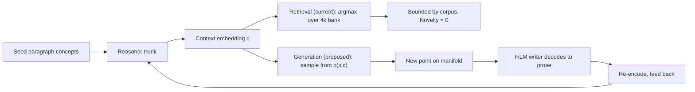

# Novel Concept-Direction Generation: A Divergent Strategy Menu

Target system: `/home/jpearce/Documents/Lucid` — per-sentence JEPA encoder (512-d) + 152M FiLM-conditioned writer + paragraph-scale ranking reasoner.

Problem statement: the paragraph reasoner works (held-out M3 top-1 = 36%) but is a **retriever**. It selects an existing corpus paragraph vector. Retrieval is structurally incapable of producing a thought that was never written. We need the reasoner to *emit a new point on the concept manifold*, not *index into a finite set*.

---

## 0. TL;DR

**Recommendation: Strategy B — a conditional diffusion prior over paragraph concepts, reusing `DiffusionConceptPredictor` verbatim, trained on the existing paragraph dataset, with classifier-free guidance scale as the explicit novelty/coherence dial.**

Why this one: the glue is almost zero (the paragraph dataloader already emits exactly the tensors `diffusion_loss` wants), the failure mode that killed point regression (mean-seeking collapse) is precisely what a diffusion likelihood does not suffer from, the coherence metric (`evaluate_m3`) works unchanged on a sampled vector, and `cfg_scale` gives a continuous knob on the predictability/novelty tradeoff so we measure a *frontier* instead of a single number.

**Critical prerequisite discovered while reading the code (see §2.3): the paragraph corpus is roughly 4,000 vectors / 2,000 training windows.** Any generative prior fit on 4k points in 512-d will memorize, which would silently invalidate the novelty claim. The corpus must be scaled first (it is a cheap config change plus one encoding pass) or the whole experiment measures nothing.

---

## 1. The core reframing

The tension in the brief — "predictable vs. novel" — is not actually a tradeoff between two goals. It is a **statement about which object we are modeling**:

- Retrieval models `argmax_b p(b | context)` over a finite set. Novelty is definitionally zero.
- Point regression models `E[x | context]`. This is the *worst possible* choice: the conditional mean of a multimodal distribution is a point that is neither any real continuation nor a novel one. It sits in the dead zone between modes. This is exactly what the repo has failed at three times (VICReg isotropic floor, channel collapse to effrank 91/256, reverse-delta mirage).
- Distributional generation models `p(x | context)` and *samples*. A sample from a well-fit conditional distribution is, with probability approaching 1, a point that appears nowhere in the training set, yet lies in a high-density region. **This is the definition of "locally coherent, globally surprising."**

So the frame is not "how do we add novelty to a predictor." It is "stop predicting a point; model a distribution and sample from it." Every strategy below is a different way to construct or approximate that conditional distribution, differing in how much structure they assume and how much they cost.

A second, equally important reframing: **novelty is not a property of a vector, it is a property of a vector relative to a reference distribution.** A vector at cosine 0.7 from its nearest neighbor might be a copy (if real held-out paragraphs sit at 0.9) or gibberish (if real paragraphs sit at 0.4). §7.2 defines a self-calibrating novelty metric that fixes this.



---

## 2. What the codebase actually gives us

### 2.1 Reusable machinery (read and verified)

| Piece | File | What it buys us |
|---|---|---|
| `DiffusionConceptPredictor` | `src/conceptpoc/predictor/diffusion.py` | Full conditional DDPM/DDIM over a 512-d vector, with FiLM conditioning, classifier-free guidance (`cfg_drop_prob`, `cfg_scale`), `x0`/`epsilon` parameterization, and a `sample_jitter` temperature. Signature `diffusion_loss(context, target, pad_mask)` is an exact match for the paragraph dataloader's output. |
| `ContextTransformer` | `src/conceptpoc/predictor/model.py` | Shared causal trunk over concept sequences, with `last_real_token` pooling and optional segment/theme conditioning. Both the regression head and the diffusion head sit on it. |
| `RankingReasoner` | `experiments/paragraph_concepts/reasoner.py` | 2.6M params, trained with multi-positive InfoNCE, M3 top-1 36%. Crucially, `out_proj` emits a **free unconstrained 512-d vector** — the key is already a novel point; only the `retrieve_nearest` call in `generate.py` destroys the novelty. |
| `ParagraphSequenceDataset` / `collate_paragraph_batch` | `experiments/paragraph_concepts/data.py` | Emits `(context, pad_mask, targets, candidates, n_positives, doc_ids, para_idxs)`. The first three are exactly a conditional generative model's training tuple; the last four are exactly the M3 eval harness's needs. |
| `evaluate_m3` | `experiments/paragraph_concepts/train.py` | Ranks a **query vector** against 100 in-document candidates. It does not care whether the query came from a ranker or a sampler. This is a free coherence metric for every strategy below. |
| `latent_diagnostics` | `src/conceptpoc/eval/latent.py` | Already computes `mean_max_cos_to_bank` (the novelty primitive) and `mean_consecutive_cos` (the fixed-point-collapse alarm). |
| `_anisotropy` | `src/conceptpoc/eval/metrics.py` | Mean cosine of random bank pairs — the floor that all cosine numbers must be reported against. This is the machinery that caught the previous mirages; use it everywhere. |
| `FluWriter` | `src/conceptpoc/writer/model.py` | Per-block FiLM (`Block.film`, zero-init to identity) plus `generate()` with temperature / top-k / top-p / repetition penalty. Accepts any 512-d vector; nothing constrains the input to the bank. |
| `TrajectoryPlanner` | `src/conceptpoc/trajectory/planner.py` | Coconut-style iterated latent state, `GRUCell` + transformer refinement, decodes to K future vectors. Ready-made backbone for the latent-state-space strategies. |
| `DeltaPredictor`, `apply_delta` | `src/conceptpoc/predictor/delta_model.py` | Change-direction semantics and `normalize(current + step*delta)` — the exact primitive for steering-delta strategies. |

### 2.2 The pooling operator is the hidden opportunity

`_group_doc_sentences` (`data.py:146-148`) builds a paragraph concept as:

```python
pooled = sent_vecs[a:b].mean(axis=0)
vec = _l2_normalize(pooled)
```

Two consequences that most of the strategies below exploit:

1. **A paragraph concept is a centroid of unit sentence vectors.** The set of valid paragraph concepts is therefore approximately the normalized convex hull of achievable sentence-vector bags. This is a *much* friendlier geometry than an arbitrary manifold: convex combinations of valid paragraph concepts are approximately valid paragraph concepts, because a centroid of centroids is a centroid. This raises the prior on Strategy A dramatically and is the single strongest geometric argument in this document.

2. **Paragraph concepts are out-of-distribution for the writer.** The writer was trained on *sentence* vectors. A centroid of 5 unit vectors has pre-normalization norm well below 1 and sits closer to the global mean direction than any sentence vector does. `render_paragraph` (`generate.py:87-92`) papers over this by feeding the same centroid 5 times with isotropic 0.05 jitter. That is a lossy hack, and it is a novelty opportunity in its own right (Strategy I).

Also note: `build_paragraph_corpus` has a `keep_sent_vectors` flag (currently `False`) that would persist the raw sentence vectors alongside the paragraph centroids. Flipping it costs nothing and unlocks Strategy I entirely.

### 2.3 The data-scale problem (load-bearing, please read)

From `artifacts/paragraph_reasoner.metrics.json`: `final_n = 200.0`. `evaluate_m3` only subsamples when `len(indices) > max_examples` and the final call passes `max_examples=5000`, so `len(val_idx) == 200` exactly. With `val_fraction=0.1`, the **entire dataset is ~2,000 windows**. Cross-checking against the cache file size (9.33 MB npz; 4,000 × 512 × float32 = 8.2 MB of incompressible float data plus compressed text), the paragraph bank is **roughly 4,000 vectors**.

This has four serious implications:

- **The 36% M3 number has a standard error of about ±3.4%** (n=200). It is a real signal (random is 1%) but it is not a precisely measured one.
- **Most documents contribute exactly one window.** `load_and_build` requires `min_sents >= G*2 = 10`, and grouping is non-overlapping, so a 10-14 sentence document yields exactly 2 paragraphs and 1 training example. The "reasoner" is therefore mostly doing single-paragraph → next-paragraph association with a context window of length 1, not multi-step reasoning.
- **The retrieval bank has only ~4,000 candidates.** Part of why retrieval output feels so constrained is simply that the library is tiny.
- **A generative prior on 4,000 points in 512-d will memorize.** It will reproduce training points and score beautifully on coherence while having zero true novelty, and the novelty metric will catch it — but only after wasting the run. **Scale the corpus first.**

Cheap fixes, in order of value per unit effort:

- Overlapping groups (stride 1 instead of stride G) → ~5× more paragraphs and ~5× more windows from the same encoding pass.
- `max_docs` from 2,000 → 50,000+. `data/corpus_1m.txt` is 130 MB / 226k lines; the current run uses well under 2% of it.
- Lower `min_sents` from `G*2` to `G+1` to admit shorter documents.

Together these take the dataset from ~2k windows to ~10^5–10^6, at the cost of one JEPA encoding pass (the encoder is 4 layers at 128 tokens; this is minutes-to-an-hour of GPU, not days).

---

## 3. Strategy catalog

Each strategy gives: (1) mechanism, (2) why it is genuinely novel, (3) how it stays coherent, (4) most likely failure mode, (5) cheapest validating experiment, (6) codebase reuse.

---

### A. Latent-space interpolation / learned convex combination ("the concept blender")

**1. Mechanism.** The reasoner emits a key `k` exactly as today. Instead of `retrieve_nearest(k, bank, top_k=1)` and taking `nearest[0]`, retrieve the top-M neighbors (M ≈ 8–16) and then *blend* them. The blend can be (a) unlearned: softmax over cosine similarities with a temperature τ, giving `x = normalize(Σ w_i b_i)`; or (b) learned: a small head that takes the context embedding and the M retrieved vectors and emits simplex weights via softmax, optionally plus a bounded free residual `δ` with `||δ|| ≤ ρ`. Train the learned version with the same InfoNCE objective the reasoner already uses, so the blend is optimized to *be* the next paragraph rather than to *find* it.

**2. Why genuinely novel.** The output is a point in the interior of a simplex spanned by M corpus vectors. For any non-degenerate weight vector it is provably not equal to any corpus point. With M=8 and continuous weights, the reachable set has dimension 7 per neighborhood, and the union over all neighborhoods covers a large fraction of the convex hull of the bank. This is combinatorially far larger than the bank itself: it is "the idea halfway between these three ideas," which is a recognizable form of genuine conceptual novelty (analogy, synthesis, blending).

**3. Coherence.** Structurally guaranteed and this is the strategy's great virtue. Per §2.2, paragraph concepts are centroids, and a convex combination of centroids is a centroid — so the output is on-manifold *by construction*, not by hope. The neighbors are all retrieved near the reasoner's key, so they are all topically appropriate; blending topically-appropriate things cannot wander off topic.

**4. Most likely failure mode.** **Weight collapse to a one-hot.** Trained with a ranking loss, the optimal blend is often just "put all mass on the true next paragraph," and the model will learn to do exactly that — silently reverting to retrieval. Secondary failure: if the top-M neighbors are near-duplicates of each other (likely with a 4k bank), the blend is trivially close to all of them and novelty is illusory. Mitigation: entropy floor on the weights (penalize `-H(w)` below a threshold), and/or diversity-enforced neighbor selection (maximal marginal relevance rather than raw top-M).

**5. Cheapest experiment.** Zero training. Take the existing `artifacts/paragraph_reasoner.pt`, modify `retrieve_nearest` to return top-8, blend with fixed softmax weights at τ ∈ {0.02, 0.05, 0.1, 0.3}, and run the novelty/coherence eval of §7. τ→0 recovers today's retrieval exactly (the null baseline); τ→∞ gives the bank centroid (the degenerate blur). Somewhere in between is the frontier. This is an afternoon of work and it gives the first real datapoint on whether the "blend is on-manifold" hypothesis holds. **Run this regardless of which strategy wins — it is the correct baseline for everything else.**

**6. Reuse.** `RankingReasoner` unchanged; `retrieve_nearest` (`generate.py:51-68`) with `top_k` already parameterized; `render_paragraph` unchanged; `CachedParagraphCorpus.vectors` as the bank.

---

### B. Generative concept prior — conditional diffusion over the paragraph manifold ★ RECOMMENDED

**1. Mechanism.** Train `DiffusionConceptPredictor` at *paragraph* scale: context is the window of prior paragraph concepts, target is the next paragraph concept, loss is standard DDPM denoising. At inference, run DDIM reverse sampling from Gaussian noise conditioned on the context, with classifier-free guidance. The model learns `p(x_next | context)` as a full distribution; every sample is a fresh draw. `cfg_scale` interpolates continuously between the unconditional prior (`scale=0`, maximum novelty, minimum coherence) and a sharply mode-seeking conditional (`scale≫1`, minimum novelty, maximum coherence). `sample_jitter` adds a second, orthogonal temperature knob.

**2. Why genuinely novel.** A sample from a continuous density in 512-d has measure-zero probability of coinciding with a training point. Novelty is not bolted on — it is what sampling *is*. Unlike interpolation, diffusion is not confined to the convex hull: it can produce points in high-density regions that are not between any pair of existing points, which is a strictly larger novelty class. And unlike point regression, there is no mean-seeking failure: the denoising objective is a proper scoring rule for the whole distribution, so multimodality is preserved rather than averaged away. **This directly repairs the specific failure that has bitten this repo three times.**

**3. Coherence.** Three independent mechanisms. (i) The denoiser is trained only on real paragraph concepts, so its learned score function points toward the data manifold — off-manifold points are pushed back on during the reverse process. (ii) FiLM conditioning (`use_film=True`) injects the context at every layer, which the codebase notes was added specifically because concatenation-at-input gets swamped. (iii) CFG amplifies the conditional signal at inference; `cfg_scale=3.0` is already the default.

**4. Most likely failure mode.** **Memorization at the current data scale** (§2.3): with 2,000 windows and ~4,000 targets, a 5M-parameter denoiser will learn to reproduce training targets, and the novelty metric will show `max_cos_to_bank ≈ 1.0`. Second failure: **conditioning ignored** — the model learns the marginal `p(x)` and ignores context, giving beautiful novelty and zero coherence. The shuffled-context control (§7.4) detects this immediately and is non-negotiable. Third, milder: the current code trains in R^512 and normalizes only *after* sampling (`diffusion.py:368`), which is a mismatch with unit-norm targets; `predict_type="x0"` largely mitigates it, and Riemannian flow matching on S^511 is the principled fix if it becomes a problem.

**5. Cheapest experiment.** See §6 for the full spec. Headline: ~150 lines of glue (a training script that swaps `RankingReasoner` for `DiffusionConceptPredictor` in the existing `train.py` loop), reusing `ParagraphSequenceDataset` unchanged, evaluated with `evaluate_m3` on the sampled vector plus the novelty metric of §7.2.

**6. Reuse.** `DiffusionConceptPredictor` verbatim — `diffusion_loss(context, target, pad_mask)` has the exact signature the paragraph collate function produces. `DiffusionConfig` already exposes every knob needed. `evaluate_m3` needs a one-line change (`query = model.sample(ctx)` instead of `query = model(ctx)`). Training loop, GPU gate, and checkpoint DB from `experiments/paragraph_concepts/train.py`.

---

### C. Noise-anchored perturbation within a learned trust radius

**1. Mechanism.** Keep the reasoner's key `k` as a topic anchor. Emit `x = normalize(k + σ(c) · ε)` where `ε ~ N(0, I)` and `σ(c)` is a *learned, context-dependent* trust radius predicted by a tiny head from the context embedding. Train `σ` by maximum likelihood on the true next paragraph under an isotropic (or low-rank anisotropic) Gaussian centered at `k` — i.e. a one-step Gaussian conditional model, which is the cheapest possible member of family B. A low-rank variant `x = normalize(k + U(c) z)` with `U ∈ R^{512×r}`, `r ≈ 16`, restricts the perturbation to a learned local tangent subspace and is strictly better than isotropic noise.

**2. Why genuinely novel.** Continuous perturbation of a continuous anchor; the sample is new with probability 1. Because `σ` is learned rather than hand-set, the model can be *confidently* novel where the data supports many continuations and conservative where it does not — which is exactly the adaptive behavior we want.

**3. Coherence.** The anchor `k` comes from the reasoner that already scores 36% M3, so the mean of the distribution is topically correct by construction. The trust radius is calibrated to the empirical spread of real next-paragraphs, so perturbations stay within the observed variability of the data rather than an arbitrary hand-tuned amount.

**4. Most likely failure mode.** **Isotropic noise in 512-d almost always leaves the manifold.** The concept manifold is very likely low-dimensional relative to 512 (this repo has already measured effective rank 91/256 in one configuration), so a random direction is overwhelmingly likely to be an off-manifold direction. The isotropic version will produce vectors the writer renders as mush. The low-rank version fixes this in principle but requires learning `U(c)` well, at which point you have essentially built a conditional VAE and should just do B or D. Secondary failure: `σ` collapses to ~0 under maximum likelihood if `k` is already good, degenerating back to a point predictor.

**5. Cheapest experiment.** Zero training for the diagnostic version: perturb the existing reasoner key with `σ ∈ {0.05, 0.1, 0.2, 0.4, 0.8}` and plot `max_cos_to_bank` against M3 top-1. **This is worth doing in the first hour regardless of strategy choice**, because the resulting curve tells you the *local geometry*: if coherence falls off a cliff before novelty rises at all, the manifold is thin and every "perturbation" family (C, and the jitter knob in B) is doomed; if there is a plateau, there is room to work in. It is the cheapest possible probe of the central question.

**6. Reuse.** `render_paragraph` already does exactly this at `σ=0.05` (`generate.py:90-92`) — the mechanism is literally in the codebase, just unlearned and unmeasured. `apply_delta` for the normalize-after-add primitive. `latent_diagnostics` for the readout.

---

### D. Latent-variable stochastic state-space (slow topic latent, fast concept emission)

**1. Mechanism.** Posit a slow latent topic state `h_t` (dimension ≈ 32–64, much smaller than 512) with a learned stochastic transition `h_t ~ p(h_t | h_{t-1}, context)` and an emission `x_t = g(h_t) + noise`. Train as a sequential VAE / deep Kalman filter with an amortized inference network `q(h_t | x_t, h_{t-1})`, ELBO objective. Generation: roll the latent forward *stochastically*, decode each state to a concept vector. Novelty enters through the transition noise; coherence is enforced by the transition prior's smoothness.

**2. Why genuinely novel.** Sampling in a low-dimensional latent gives *structured* novelty — the perturbation directions are learned semantic axes rather than random 512-d directions, so a novel latent decodes to a novel-but-plausible concept. This is Strategy C done correctly: the low-dimensional bottleneck *is* the learned trust region. It also produces novelty at the *trajectory* level, not just the single-step level: a whole sequence of paragraphs can follow a topic arc that no document in the corpus follows, which is a qualitatively higher form of novelty than a single new point.

**3. Coherence.** The transition prior is trained on real document trajectories, so rolled-forward states stay in the region of state space corresponding to coherent discourse. The emission decoder is trained only on real concepts, so `g(h)` is on-manifold for any plausible `h`. The 32-d bottleneck makes it hard to represent incoherence.

**4. Most likely failure mode.** **Posterior collapse** — the classic sequential-VAE pathology where the decoder learns to ignore `h` and the KL term drives `q` to the prior, giving a model that samples pure noise-driven garbage or, more often, a single mode regardless of context. Given this repo's documented history with collapse (`effrank 91/256`, "channel collapsed to near-constant"), this is a *high-probability* failure here specifically. Mitigations exist (KL annealing, free bits, β-VAE schedules) but each adds a hyperparameter to a project that has already lost time to hyperparameter-sensitive collapse. Second failure: at ~2,000 sequences, there is not remotely enough data to fit a sequential latent model.

**5. Cheapest experiment.** Fit a *non-sequential* VAE on paragraph concepts first (encoder 512→64, decoder 64→512, β-annealed) and measure two things: reconstruction cosine (does 64-d suffice?) and, for samples from the prior decoded through `g`, `max_cos_to_bank` and writer renderability. If a plain VAE cannot even round-trip the manifold at 64-d, the sequential version is hopeless and you have spent one afternoon finding out. If it round-trips at cosine > 0.9 and prior samples render as fluent, this becomes a serious contender.

**6. Reuse.** `TrajectoryPlanner` (`trajectory/planner.py`) is 80% of the architecture already — `latent_recur` is a `GRUCell` over a latent state, `latent_blocks` refines it, `traj_head` decodes to K future vectors. Adding a stochastic layer and an inference network is a modest edit. `ParagraphSequenceDataset` provides the sequences.

---

### E. Energy-based / NCE sampling with Langevin dynamics

**1. Mechanism.** Learn an energy `E(x, c)` over concept space, low where `x` is a plausible continuation of context `c`. Train by noise-contrastive estimation, which is *nearly free* here: the InfoNCE loss the ranking reasoner already uses is, up to a constant, exactly a conditional energy model with `E(x,c) = -cos(x, k(c))/τ`. So **an energy model already exists in the repo** — it is just an unusually simple (linear-in-cosine) one. Enrich it to `E(x,c) = -f_θ(x, c)` with an MLP, then sample novel points by Langevin dynamics: `x ← x - η ∇_x E(x,c) + sqrt(2η) ξ`, projected back to the sphere each step.

**2. Why genuinely novel.** Langevin explores the entire low-energy set rather than its argmax. It can find low-energy basins that contain no training point at all — regions the model believes are plausible but which the corpus happens not to occupy. That is arguably the purest formulation of "a thought that could have been written but wasn't." The noise term guarantees a fresh point each run.

**3. Coherence.** Low energy *is* coherence: the energy is trained to be low exactly at real continuations of the given context. The context enters the energy directly, so every low-energy point is context-appropriate by definition.

**4. Most likely failure mode.** **The energy landscape is only trained where the data is.** Standard NCE with random negatives teaches the model nothing about the vast empty regions of 512-d space, so those regions can have arbitrarily low (spurious) energy and Langevin will happily walk into them and stay. This is the well-known EBM problem and the reason EBMs need careful negative-sample curricula (persistent contrastive divergence, on-manifold hard negatives). Note that the existing reasoner uses *in-document* negatives only (`data.py:362`), which is even narrower. Second failure: MCMC mixing in 512-d is slow and step-size-sensitive; you can burn a lot of time tuning `η` and chain length.

**5. Cheapest experiment.** Skip training entirely at first: run Langevin on the *existing* reasoner's implicit energy `E(x) = -cos(x, k)/τ` from a random start and watch where it goes. It will converge to `k` (the energy is convex in the cosine), which is a useful negative result — it proves that the current reasoner's energy has exactly one basin and therefore cannot support diverse sampling, motivating the richer `f_θ`. Then train `f_θ` as a 3-layer MLP on the same InfoNCE batches (one extra head, hours of work) and re-run.

**6. Reuse.** `ranking_loss` / `ranking_ce_hard` (`reasoner.py:117-158`) are the NCE objective. `RankingReasoner.score` is the current energy. The candidate-sampling logic in `ParagraphSequenceDataset.__getitem__` is the negative sampler.

---

### F. Two-level: discrete coarse topic code + continuous novel residual

**1. Mechanism.** Vector-quantize the paragraph manifold into a codebook of K ≈ 512–4096 topic codes (VQ-VAE style, or simply k-means on the paragraph bank for a training-free version). Decompose every paragraph concept as `x = normalize(e_{q(x)} + r)` where `e` is its codebook entry and `r` the residual. Then **predict the discrete code autoregressively** (a categorical softmax over K classes — a well-posed, low-variance, standard classification problem that sidesteps every pathology of continuous regression) and **sample the residual** from a learned conditional distribution `p(r | code, context)`. Extend to residual VQ (RVQ) with 2–4 levels for finer control.

**2. Why genuinely novel.** The residual is continuous and sampled, so the composed vector is new. More interestingly, the *combination* is novel: you can pair a topic code with a residual style that never co-occurred with it in the corpus, which is a compositional novelty ("this idea, expressed with that turn of thought") that neither pure interpolation nor pure sampling gives you.

**3. Coherence.** The discrete code is a hard on-manifold anchor — it is literally a cluster centroid of real paragraphs, so it cannot be off-manifold. The residual is bounded by the learned within-cluster spread, so it cannot wander far. Coherence and novelty are cleanly separated into two mechanisms with independent knobs, which makes debugging vastly easier than in any monolithic approach.

**4. Most likely failure mode.** **Codebook collapse** (a small fraction of codes used) — endemic to VQ and requiring EMA updates, commitment loss tuning, and dead-code restarts. Given ~4,000 paragraphs, a 512-entry codebook averages 8 members per cluster, which is far too sparse to estimate a per-code residual distribution. Second failure: if the residual carries most of the semantic content (likely, since 512-d concepts are information-rich and a code index carries only 9–12 bits), the discrete code contributes almost no coherence and the whole two-level structure is decorative.

**5. Cheapest experiment.** Training-free version: k-means the existing 4k paragraph bank into K=64 clusters, check the M3 top-1 you get from predicting *only the cluster* (this measures how much of the 36% predictability is coarse-topic predictability — a genuinely interesting number in its own right), and measure the within-cluster spread to see whether residuals have room to be novel. A few hours, and it directly quantifies whether the coarse/fine split is real or a fiction.

**6. Reuse.** `CachedParagraphCorpus.vectors` for clustering; the `ContextTransformer` trunk with a `nn.Linear(d_model, K)` head for the code predictor (drop-in replacement for `out_proj`); `DiffusionConceptPredictor` for the residual sampler conditioned on `[context, code_embedding]`.

---

### G. Writer-fused: shrink the reasoner to a steering signal

**1. Mechanism.** Abolish the "predict the exact next concept" problem. The reasoner emits only a coarse *steering delta* `d` (a direction of movement, possibly quite low-dimensional or heavily regularized). Feed the writer `normalize(c_seed + α·d)` via FiLM and let the writer's own token-level sampling — which is already genuinely generative with temperature, top-k, top-p, and repetition penalty — supply the actual novelty. The reasoner's job shrinks from "produce a 512-d point accurate to within a cosine" to "point roughly in the right direction," which is a *far* easier learning problem and much better matched to what the measurements say is actually predictable.

**2. Why genuinely novel.** The writer is confirmed generative — it samples from a learned token distribution. Given a conditioning vector that no corpus paragraph produced, it composes text that no corpus paragraph contains. The novelty is real text novelty, immediately visible and immediately auditable (n-gram overlap against the corpus).

**3. Coherence.** `c_seed` dominates the conditioning vector when `α` is small, so the output stays on the seed's topic by construction, and the writer's language model prior enforces local fluency at the token level regardless of the concept vector's quality. This is by far the most robust coherence mechanism on this list because it does not depend on the concept manifold being well-behaved.

**4. Most likely failure mode.** **The novelty is shallow.** Token-level sampling produces different *wordings* of the same *thought*, not different thoughts. It is the difference between paraphrase and invention, and the brief explicitly asks for the latter. Second failure: `α` is a hand-tuned knob with a narrow usable band — too small and output is a restatement of the seed, too large and the FiLM conditioning goes out-of-distribution and the writer degenerates. Third: closed-loop drift, where re-encoding the writer's output and feeding it back accumulates encoding error until the trajectory collapses to a fixed point (watch `mean_consecutive_cos`).

**5. Cheapest experiment.** Essentially free — an hour. Take a seed concept, sweep `α ∈ {0, 0.1, 0.25, 0.5, 1.0}` with `d` set to (i) the existing reasoner key minus the seed, (ii) a random unit vector, and (iii) the delta between two random corpus paragraphs. Render each with `render_paragraph` and measure max 5-gram overlap against the corpus plus human read. **The random-`d` arm is the crucial control**: if random directions produce output as good as reasoner directions, the reasoner is contributing nothing and you have learned something important very cheaply.

**6. Reuse.** Everything. `FluWriter.generate` with all its sampling knobs, `Block.film` per-layer conditioning, `apply_delta` for the composition, `render_paragraph` and `generate_continuation` for the loop. Zero new training.

---

### H. Joint end-to-end fine-tune with a novelty regularizer

**1. Mechanism.** Train the whole stack jointly — encoder, reasoner-as-generator, writer — with a composite objective: reconstruction (the generated concept should decode to text that re-encodes near itself), prediction (the generated concept should score well under the ranking loss), and an explicit **novelty regularizer** that penalizes `max_cos_to_bank` above a threshold, i.e. a repulsion term that actively pushes generated points away from their nearest training neighbor. Curriculum: freeze the encoder, warm up the generator on prediction alone, then ramp the novelty weight — mirroring the `recon_warmup_epochs` / `alpha_warmup_epochs` curriculum already in `JepaConfig`.

**2. Why genuinely novel.** This is the only strategy where novelty is *directly optimized* rather than hoped for as a byproduct of sampling. If you can write the metric, you can descend on it. It also aligns the three components, which currently have mismatched objectives (encoder optimizes reconstruction+VICReg, reasoner optimizes ranking, writer optimizes token NLL — nobody optimizes "produce a novel coherent thought").

**3. Coherence.** The reconstruction and ranking terms are explicit coherence losses, and the relative weights give a directly tunable tradeoff.

**4. Most likely failure mode.** **This is the highest-risk item on the list and should not be attempted next.** Joint training of a 152M writer + encoder + generator with a three-term loss, on a project whose documented history is (a) VICReg gave an isotropic floor, (b) removing anti-collapse caused channel collapse, (c) a promising metric turned out to be an arithmetic mirage — is asking for a fourth entry in that list. The novelty regularizer specifically has a nasty degenerate solution: the cheapest way to reduce `max_cos_to_bank` is to move *off the manifold entirely*, producing high-novelty gibberish that satisfies the loss perfectly. Guarding against that requires the reconstruction term to be strong, which fights the novelty term, and the balance point is a hyperparameter you will search for a long time. Also: joint fine-tuning changes the encoder, which invalidates the cached paragraph bank and every previously measured number.

**5. Cheapest experiment.** Do not do the full version. The extractable cheap piece is the **repulsion term as an inference-time guidance signal** rather than a training loss — see Strategy L, which gets most of the benefit at a fraction of the risk.

**6. Reuse.** `JointJepa.forward` is the multi-term-loss template (recon + α·pred + var + cov + unif with curriculum α). `GpuGate`, `CheckpointDB`.

---

### I. Mean-constrained sentence decomposition (invented — novelty inside the pooling operator)

**1. Mechanism.** Exploit §2.2. Given a target paragraph concept `p` (from *any* of the strategies above, or even from plain retrieval), do not feed `p` to the writer five times with jitter. Instead **sample a set of G sentence-scale vectors `{s_1..s_G}` whose normalized mean is `p`** but whose individual members are each in-distribution for the writer. Implement as: sample from a learned conditional model `p(s_1..s_G | p)` trained on real (paragraph-centroid, sentence-vector-set) pairs, or, in the training-free version, project a set of retrieved sentence vectors onto the affine constraint `mean(s) ∝ p` and renormalize each.

**2. Why genuinely novel.** The constraint `mean = p` leaves `(G-1) × 512` degrees of freedom. Even with the paragraph concept *fully determined by retrieval*, the decomposition into sentences is massively underdetermined, and different decompositions are genuinely different paragraphs that mean the same thing at the coarse scale. This is a completely orthogonal novelty axis to every other strategy — it composes with all of them multiplicatively.

**3. Coherence.** Exactly preserved at the paragraph scale by the mean constraint (the paragraph "means" what it was supposed to mean), and each individual sentence vector is drawn from the sentence-vector distribution the writer was actually trained on, which fixes the out-of-distribution problem noted in §2.2.

**4. Most likely failure mode.** The G sentences may be individually fluent but mutually incoherent — the mean constraint says nothing about whether the sentences follow from each other, so you get five plausible sentences that read as a non-sequitur pile. Fixing this needs sequential structure in the decomposition model, which is more work. Second failure: real sentence sets have strong internal correlation (sentences in a paragraph are similar to each other), and a naive decomposition will produce a spread far wider than real paragraphs; match the empirical within-paragraph spread as a constraint.

**5. Cheapest experiment.** Flip `keep_sent_vectors=True` in `build_paragraph_corpus` (one argument) and rebuild the cache. Then measure the empirical distribution of within-paragraph sentence spread, and A/B two renderings of the *same* retrieved paragraph concept: today's `render_paragraph` (centroid + 0.05 jitter, five times) versus the paragraph's real constituent sentence vectors rendered individually. If the second is dramatically more fluent, the OOD hypothesis is confirmed and this strategy is worth building. Half a day.

**6. Reuse.** `keep_sent_vectors` flag and `CachedParagraphCorpus.sent_vectors` field already exist and are already plumbed through `save`/`load` — they are just switched off. `render_paragraph` is the thing being replaced.

---

### J. Relational transport / conceptual analogy (invented)

**1. Mechanism.** Harvest **transition operators** rather than destinations. From every adjacent paragraph pair `(a_i, a_{i+1})` in the corpus, extract a delta `t = a_{i+1} - a_i` (or a learned nonlinear operator). These deltas encode *rhetorical moves*: "introduce a counterexample," "escalate the stakes," "shift from the general to the particular." Then generate by **applying a transition harvested from document X to the topic of document Y**: `x = normalize(seed + β·t_X)`. The reasoner's role becomes *selecting which move to make* (a much smaller, more predictable decision) rather than *predicting the destination*.

**2. Why genuinely novel.** The output is a cross-product of two independent corpus axes: `|topics| × |moves|`. With ~4k paragraphs that is ~16M combinations, essentially all of which never occurred. And the novelty is *semantically meaningful* rather than merely geometric — "this topic, but taken in that direction" is precisely how humans generate new thoughts. This is the classic word2vec analogy trick lifted to paragraph scale, and it is the strategy most likely to produce output that reads as genuinely *insightful* rather than merely *unfamiliar*.

**3. Coherence.** The seed term dominates for moderate β, anchoring the topic. The delta is a real observed transition between real paragraphs, so it is a direction the manifold actually supports. Restricting to deltas harvested from *topically similar* source documents (nearest-neighbor filtering on `a_i`) makes the transported move much more likely to be valid.

**4. Most likely failure mode.** **Deltas may not transport.** Vector arithmetic works when the space is locally linear and the relation is a global translation; concept manifolds are often curved, and a move that makes sense in one topic region may be meaningless in another. The repo has already seen a related pathology (the "reverse-delta identity" mirage), which is a warning that delta arithmetic in this space needs careful auditing. Second failure: with `G=5` mean-pooling, adjacent-paragraph deltas may be dominated by noise rather than rhetorical structure — check that adjacent-pair deltas cluster at all before believing they mean anything.

**5. Cheapest experiment.** Zero training, a few hours. Harvest all adjacent deltas from the existing bank, cluster them (k-means, K=32), and inspect: do the clusters correspond to recognizable rhetorical moves when you render `seed + delta` for several seeds within one cluster? Then measure whether cluster identity is predictable from context (M3-style, but over 32 move classes instead of 100 paragraphs). **If moves are predictable and topics are transportable, this is a top-tier strategy that costs almost nothing.** If adjacent deltas turn out to be isotropic noise, you have learned that in an afternoon.

**6. Reuse.** `DeltaPredictor` and `apply_delta` are built for exactly this semantics. `CachedParagraphCorpus.doc_slices()` gives adjacency. `artifacts/delta_pred/` suggests prior work on deltas exists to compare against.

---

### K. Novelty-aware rejection sampling (invented — a meta-strategy, composes with everything)

**1. Mechanism.** Whatever the base generator, produce N candidates (N ≈ 32–128 — cheap, since concept vectors are tiny) and select with an explicit joint objective: `score(x) = coherence(x) - λ · max(0, max_cos_to_bank(x) - threshold)`. Coherence is the existing reasoner's cosine score. This turns any generator, however crude, into a tunable point on the novelty/coherence frontier without retraining anything.

**2. Why genuinely novel.** It does not create novelty; it *selects* for it. But that is exactly what is missing: every base mechanism produces a distribution over candidates, and today we take the mode. Taking the argmax of a novelty-penalized objective instead is a one-line change with a large effect.

**3. Coherence.** Guaranteed by construction — coherence is the first term of the objective, and λ directly controls how much of it you are willing to trade.

**4. Most likely failure mode.** You can only select from what the base generator proposes. If the base is retrieval, rejection sampling gives you the 5th-nearest neighbor instead of the 1st, which is *less coherent* without being meaningfully *more novel*. It multiplies a good generator's value and cannot rescue a bad one. Second failure: the coherence critic (the reasoner) becomes an adversarial target — selecting hard on it finds its blind spots, the classic reward-hacking pattern.

**5. Cheapest experiment.** Wrap it around the Strategy A blend or the Strategy C perturbation and sweep λ. An hour of work; produces the frontier plot directly.

**6. Reuse.** `RankingReasoner.score` as the critic; `latent_diagnostics` for the novelty term.

---

### L. Repulsion-guided diffusion (invented — the safe extraction from Strategy H)

**1. Mechanism.** During DDIM reverse sampling, add a guidance term that pushes away from the nearest bank neighbor: at each step, after computing the model output, apply `x ← x - η · ∇_x max_b cos(x, b)`. The gradient of cosine with respect to `x` at the argmax neighbor `b*` is simply `(b* - cos(x,b*)·x̂)/||x||`, so this is about ten lines. It is classifier guidance where the "classifier" is a novelty detector — and it needs no training at all, because the bank is just a matrix.

**2. Why genuinely novel.** It actively steers the sample away from memorized points *during* generation, at exactly the stage where the reverse process would otherwise be pulling toward a training mode. Unlike Strategy H's training-time regularizer, it has an `η` knob you can change at inference without retraining, so you can explore the whole frontier from a single checkpoint.

**3. Coherence.** The denoiser's own score function is still doing the on-manifold work at every step; repulsion is a comparatively small correction applied within the reverse process, so the sample never leaves the manifold's basin of attraction. Contrast with adding noise *after* sampling (the current `sample_jitter`), which has no such correction and simply displaces the point.

**4. Most likely failure mode.** Guidance strength `η` too high pushes off-manifold, and the "nearest neighbor" target flips discontinuously as `x` moves, which can make the dynamics jittery. Smooth it with a soft-min over the top-k neighbors instead of a hard argmax.

**5. Cheapest experiment.** Only meaningful once Strategy B has a trained checkpoint. Then it is a half-day add-on that sweeps `η` and extends the frontier plot.

**6. Reuse.** `DiffusionConceptPredictor.sample` — insert into the DDIM loop at `diffusion.py:339`, right before `ddim_step`.

---

### M. Flow matching on the sphere (invented — the principled version of B)

**1. Mechanism.** All concept vectors are unit-norm, but `DiffusionConceptPredictor` trains in R^512 with Gaussian noise and only projects to the sphere at the very end (`diffusion.py:368`). Riemannian flow matching on S^511 respects the geometry: learn a conditional vector field along geodesics between a base distribution (uniform on the sphere) and the data, integrate it at sampling time. Straighter paths mean far fewer sampling steps and no train/inference geometry mismatch.

**2. Why genuinely novel.** Same argument as B — it is a continuous generative model and samples are new with probability 1.

**3. Coherence.** Same as B, with better manifold adherence because every intermediate state is a valid unit vector rather than an arbitrary R^512 point that only becomes valid at the end.

**4. Most likely failure mode.** More implementation risk than B for an uncertain marginal gain, and none of it exists in the repo. It is the right *second* move if B works but shows geometry artifacts (e.g. samples with systematically wrong norm behavior before normalization, or a normalization step that visibly distorts the distribution).

**5. Cheapest experiment.** Deferred. Diagnose first: in a trained B model, log the norm of the pre-normalization sample. If it is consistently near 1, the geometry mismatch is not hurting and M is unnecessary.

**6. Reuse.** `NoiseSchedule` would be replaced; `DenoiseHead` and the FiLM/CFG machinery carry over unchanged.

---

### N. Adversarial concept generator (GAN)

Included for completeness and **explicitly not recommended**. A generator/discriminator pair over 512-d concept vectors conditioned on context. Novelty is inherent to sampling; coherence comes from the discriminator. But: GAN training is unstable, mode collapse is the dominant failure and would be indistinguishable from the collapse pathologies this repo has already fought three times, and there is no GAN machinery in the codebase. Diffusion dominates it on every axis that matters here.

---

## 4. Cross-cutting observation: several of these compose

These are not mutually exclusive. The strongest eventual system is probably a stack:

- **F or J** picks the coarse move (predictable, low-variance, well-posed).
- **B** samples the fine concept given that move (novel, on-manifold).
- **L** steers the sample away from memorized points during generation.
- **K** selects the best of N samples under an explicit novelty/coherence objective.
- **I** decomposes the resulting paragraph concept into in-distribution sentence vectors.
- **G** lets the writer's token sampling add a final layer of surface novelty.

Each stage multiplies the reachable output space and each has an independent knob. But **do not build the stack first** — build B, measure it honestly, and add stages only where the measurement says the bottleneck is.

---

## 5. Ranking

Scored on novelty × coherence × implementability / cost.

**1. Strategy B — conditional diffusion prior over paragraph concepts.**
Novelty: high (continuous sampling, unbounded by the convex hull). Coherence: high (score function + FiLM + CFG). Implementability: **exceptional** — the model exists, and `diffusion_loss(context, target, pad_mask)` is a signature match for `collate_paragraph_batch`'s output. Cost: one training run on a small model. It also repairs the exact documented failure (point regression's mean-seeking) with the exact right tool, and `cfg_scale` gives a measurable frontier rather than a single number. The one serious caveat is data scale (§2.3), which must be fixed first and is cheap to fix.

**2. Strategy A — learned convex blend of top-M retrieved neighbors.**
Novelty: moderate (confined to the convex hull, but the hull is large). Coherence: **the highest of any strategy**, and guaranteed by geometry rather than by training (§2.2: a centroid of centroids is a centroid). Implementability: trivial — the unlearned version is a few lines against an existing checkpoint. Cost: near zero. Ranks second only because its novelty ceiling is genuinely lower than B's. **It is the correct baseline for the whole program and should be run first regardless**, because it converts the existing 36% retrieval result into a novelty result in an afternoon.

**3. Strategy J — relational transport / conceptual analogy.**
Novelty: high and *semantically meaningful* — combinatorial in topics × moves, and the kind of novelty that reads as insight. Coherence: moderate, depends on whether deltas transport across the manifold. Implementability: high (zero training for the diagnostic). Cost: near zero. Ranks third because it carries real geometric risk (deltas may not transport, and this repo has been burned by delta arithmetic before), but the diagnostic that resolves that risk costs an afternoon and the upside is the highest qualitative payoff on the list.

Honorable mentions: **G** (near-zero cost, immediate qualitative feedback, but shallow novelty — worth running for the sanity check and the random-`d` control, not as the answer); **I** (orthogonal novelty axis, composes with everything, unlocked by flipping one existing flag); **K** and **L** (free multipliers on whatever wins).

Not recommended next: **H** (highest risk, worst match to this project's failure history), **N** (dominated by B), **D** (posterior collapse risk in a codebase with a collapse history, and nowhere near enough data), **M** (right idea, premature), **E** (interesting but the negative-sampling problem is a research project), **C** (subsumed by B; run only the σ-sweep *probe*, which is genuinely valuable, not the full strategy), **F** (run only the k-means *diagnostic*, which is genuinely valuable, not the full VQ system).

---

## 6. Recommended experiment: paragraph-scale conditional diffusion prior

### 6.0 Step zero — fix the data (do not skip)

Modify `experiments/paragraph_concepts/data.py`:

- Add a `stride` parameter to `_group_doc_sentences`; set `stride=1` for overlapping groups (~5× more paragraphs).
- Raise `max_docs` from 2,000 to 50,000 in `load_and_build`.
- Lower `min_sents` from `G*2` to `G+1`.
- Set `keep_sent_vectors=True` while you are re-encoding anyway (free, unlocks Strategy I later).

Target: ≥100,000 paragraph vectors, ≥100,000 training windows. Cost: one JEPA encoding pass (4-layer encoder, 128 tokens — GPU-minutes to a GPU-hour). **Also retrain the ranking reasoner on the larger corpus** so the 36% M3 baseline is measured at the same scale as the new model, with `n` large enough that the number means something.

### 6.1 Model

```python
from conceptpoc.config import PredictorConfig, DiffusionConfig
from conceptpoc.predictor.diffusion import DiffusionConceptPredictor

cfg = PredictorConfig(
    d_model=256, n_layers=4, n_heads=4, ff_mult=4,
    dropout=0.1, max_seq_len=16, head="diffusion",
    diffusion=DiffusionConfig(
        num_train_timesteps=100,
        predict_type="x0",      # targets are unit-norm; x0 is far better behaved
        sampler="ddim", sampling_steps=30,
        head_hidden=1024, head_layers=4,
        use_film=True,          # per-layer conditioning, not concat-at-input
        cfg_drop_prob=0.15,     # required for CFG at inference
        cfg_scale=3.0,          # swept at eval
        sample_jitter=0.0,      # swept at eval
    ),
)
model = DiffusionConceptPredictor(concept_dim=512, predictor_cfg=cfg)
```

Roughly 5–8M parameters. Match `d_model=256` to the existing `RankingReasonerConfig` so the two are comparable at equal capacity.

### 6.2 Loss

Primary: `model.diffusion_loss(context, target, pad_mask).total` — unmodified.

Optional auxiliary (weight λ=0.1, *ablate it*): a cosine term on the predicted `x0`, `λ·(1 - cos(normalize(x0_hat), x0))`. This directly targets the geometry we care about. **Flagged risk:** a cosine-to-target term is exactly the mean-seeking objective that failed before, so if the ablation shows it helps coherence but crushes novelty, drop it. Run the λ=0 arm first.

### 6.3 Training loop

Fork `experiments/paragraph_concepts/train.py`. The only substantive changes:

- Instantiate `DiffusionConceptPredictor` instead of `RankingReasoner`.
- Replace the `ranking_loss(query, candidates, n_pos)` call with `model.diffusion_loss(context, target, pad_mask).total`. The `targets` tensor is already unpacked from the batch and currently discarded as `_targets` (`train.py:231`) — it becomes the training signal.
- In `evaluate_m3`, replace `query = model(ctx)` with `query = model.sample(ctx, sampling_steps=30)`.

Everything else — `OneCycleLR`, `GpuGate`, `CheckpointDB`, `iter_bar`, best-checkpoint selection — carries over unchanged. Estimated 150 lines of new code.

### 6.4 Sweep

`cfg_scale ∈ {0.0, 1.0, 2.0, 3.0, 5.0}` × `sample_jitter ∈ {0.0, 0.05, 0.1}`. `cfg_scale=0` is the unconditional prior (pure novelty control); the sweep traces the frontier. All from a **single trained checkpoint** — the sweep is inference-only.

---

## 7. Evaluation (the part that must not be a mirage)

Given the documented history of `val_cosine` turning out to be an arithmetic artifact, the eval design matters more than the model design. Every number below is either a *rate* (uncheatable by scale) or is reported against an explicit control.

### 7.1 Setup

Split documents (not windows) into train/held-out to prevent leakage — the current code splits windows via `torch.randperm` over the flat index (`train.py:141-142`), which means paragraphs from the same document appear in both splits. **Fix this; it likely inflates the current 36%.** Bank `B_train` = training-document paragraph vectors only. Reference set `H` = held-out-document paragraph vectors.

All cosines computed on **mean-centered, renormalized** vectors (`x_c = normalize(x - μ)` with μ the bank mean), and report the anisotropy floor via `_anisotropy` alongside every raw number.

### 7.2 Novelty (self-calibrating — the key metric)

Define `n(x) = max_{b ∈ B_train} cos(x_c, b_c)`.

Compute the reference distribution `R = {n(h) : h ∈ H}` — how close a *genuinely new, genuinely valid* paragraph gets to the training bank. This is the calibration that makes the metric meaningful rather than an arbitrary threshold.

- **`novelty_rate`** = fraction of generated samples with `n(x) ≤ median(R)`. A generator matching the novelty of real unseen text scores 50%.
- **`copy_rate`** = fraction with `n(x) ≥ p99(R)`. This is the memorization alarm.
- Report the full `n(x)` histogram against `R`'s histogram. Overlap of the two distributions is the real result; the scalars are summaries.

### 7.3 Coherence

- **M3 top-1 / MRR** via `evaluate_m3` with the sampled vector as query, averaged over S=8 samples per context, reporting both mean-of-S and best-of-S. Reference points: random = 1%, retrieval reasoner = 36% (re-measured at the new data scale), identity/copy-last-context baseline = ?
- **Renderability**: render the sampled vector through `render_paragraph`, re-encode with `JepaCodec`, report `cos(re-encoded, sampled)`. This closes the loop that `generate_continuation` already runs (`generate.py:154-160`) and catches "vector is novel but the writer can't express it."
- **Seed-adjacency band**: `cos(x, last_context_vector)` must fall inside the empirical band of *real* adjacent paragraph pairs. Too high means the model copied the seed; too low means it wandered off topic. Report the real band as the reference.

### 7.4 Controls (each one detects a specific known failure)

- **Shuffled context.** Sample with a context drawn from a *different* document. If M3 does not collapse (target: ≤ 8%), the conditioning is decorative and the model learned the marginal. **This is the single most important control and directly guards against the class of mirage that has bitten this project before.**
- **Identity baseline.** Use `last_context_vector` as the query. If it scores well on M3, then M3 is measuring topic persistence rather than prediction and the 36% headline needs reinterpretation.
- **Effective rank** of 1,000 samples drawn from 1,000 different contexts. Target ≥ 128/512. This detects posterior/mode collapse — the exact pathology measured before as "effrank 91/256."
- **Text-level overlap.** Max 5-gram overlap and ROUGE-L of rendered text against the 50 nearest corpus paragraphs. Catches "novel vector, copied text."
- **Closed-loop drift.** Run 8 autoregressive steps and report `latent_diagnostics`: `mean_consecutive_cos` (→1 means fixed-point collapse) and `mean_max_cos_to_bank` per step (falling with degrading text means off-manifold drift).

### 7.5 Decision gate

| Metric | Pass threshold | Detects |
|---|---|---|
| `novelty_rate` | ≥ 0.60 | Output is as novel as unseen real text |
| `copy_rate` | ≤ 0.02 | Not memorizing |
| M3 top-1 (mean of 8) | ≥ 0.20 | Coherent (vs. 1% random, ~36% retrieval ceiling) |
| M3 top-1, shuffled context | ≤ 0.08 | Conditioning is real |
| Effective rank of samples | ≥ 128/512 | No mode collapse |
| Renderability cosine | ≥ 0.70 | The writer can express it |
| Max 5-gram overlap | ≤ real-paragraph p90 | Text is not copied |

The honest deliverable is **the frontier curve** (novelty_rate on one axis, M3 top-1 on the other, one point per `cfg_scale`), not a single row. If any point on that curve sits above and to the right of the retrieval baseline (which lives at novelty_rate ≈ 0, M3 = 0.36), the strategy has succeeded.

---

## 8. Failure branches — decide these in advance

- **If diffusion memorizes (`copy_rate` high) even after scaling the corpus:** shrink the model, increase dropout, and add Strategy L repulsion guidance. Memorization at 10^5 windows with a 5M model would be surprising and would suggest the paragraph manifold is genuinely low-entropy.
- **If conditioning is ignored (shuffled-context control fails):** the context signal is too weak. Raise `cfg_drop_prob`, raise `cfg_scale`, and check the FiLM path is actually active (`use_film=True` — note the default in `DiffusionConfig` is `False`).
- **If samples are novel but incoherent (M3 near random):** the σ-sweep probe from Strategy C will already have told you whether the manifold is thin. If it is, fall back to **Strategy A**, whose coherence is geometrically guaranteed rather than learned, and accept a lower novelty ceiling in exchange for a working system.
- **If everything is mediocre:** the problem is upstream in the encoder, not the reasoner. A 512-d space with effective rank ~91 and mean-pooled paragraph centroids may simply not have enough usable structure to generate in. In that case the next move is encoder work (fixing the anisotropy), not more reasoner variants — and the σ-sweep plus the effective-rank control will have given you the evidence to say so.

---

## 9. First-week ordering

The three probes in the first block are all training-free, all take under a day each, and each one either de-risks or kills a large part of the strategy space. Run them before committing to the main experiment.

1. **σ-sweep probe** (Strategy C, ~1 hour): perturb the existing reasoner key at increasing σ, plot novelty against M3. Tells you the local manifold geometry — thin or thick. Gates B, C, and L.
2. **Blend baseline** (Strategy A, ~half a day): top-8 softmax blend at several temperatures. Converts the existing 36% into a real novelty number and establishes the baseline every later result is compared to.
3. **Delta-cluster diagnostic** (Strategy J, ~half a day): do adjacent-paragraph deltas cluster into recognizable moves, and is cluster identity predictable? A cheap shot at the highest-upside strategy.
4. **Corpus scale-up** (§6.0): overlapping groups, 50k docs, `keep_sent_vectors=True`. Retrain the ranking reasoner at the new scale for a comparable baseline with a meaningful `n`.
5. **Main experiment** (§6): train the diffusion prior, sweep `cfg_scale` × `sample_jitter`, produce the frontier curve against the full eval and control suite of §7.
