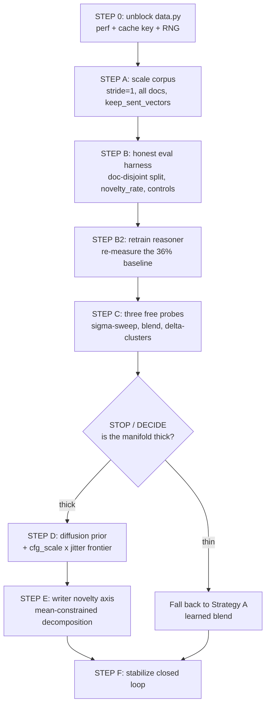

# Lucid — Implementation Plan: Most Important Fixes, In Order

Target repo: `/home/jpearce/Documents/Lucid`
Accepted strategic direction: stop retrieving, model `p(x_next | context)` and sample. Strategy B (conditional diffusion prior) is the main bet, Strategy A (convex blend) the running baseline, Strategy J (relational transport) the high-upside probe. Reference: [.hermes/plans/2026-08-06_110000-opus5-novel-generation.md](.hermes/plans/2026-08-06_110000-opus5-novel-generation.md).

Hardware: one RTX 3090 (24 GB, **~12.7 GB already occupied by another process** — the `GpuGate` path matters and every batch size below assumes ~10 GB usable).

Audience: a coding agent (Grok) executing step by step. Every step below states the goal tied to a measured number, the exact files to change, what to leave alone, and a numeric success gate.

---

## 0. What I found in the code that changes the ordering

Three findings from reading the actual files reorder the plan you sketched. All three are load-bearing; please read this section before executing anything.

### Finding 1 — `ParagraphSequenceDataset.__getitem__` is O(n_docs) per item and will not survive a 25× corpus

`CachedParagraphCorpus.doc_slices()` rebuilds a fresh Python list of `n_docs` tuples on every call:

```67:71:experiments/paragraph_concepts/data.py
    def doc_slices(self) -> list[tuple[int, int]]:
        return [
            (int(self.doc_offsets[i]), int(self.doc_offsets[i + 1]))
            for i in range(len(self.doc_offsets) - 1)
        ]
```

and `_global` calls it once per lookup:

```340:342:experiments/paragraph_concepts/data.py
    def _global(self, doc_id: int, local: int) -> int:
        a, _ = self.corpus.doc_slices()[doc_id]
        return a + local
```

`__getitem__` calls `_global` once per context position (up to `window=8`) and once per candidate (`n_candidates=100`), plus one direct `doc_slices()` call. That is roughly **110 full-list rebuilds per dataset item**. At the current 2,000 docs this is tolerable (it is very likely most of the 395 s the last run took). At `max_docs=50_000` it becomes ~5.5 million tuple constructions per item, i.e. the corpus scale-up as specified **will appear to hang**. This must be fixed before Step A, not after.

### Finding 2 — the ranking loss is largely degenerate, which is a second independent reason the 36% is not trustworthy

Documents in this repo are blank-line-separated blocks (`_split_blocks` in [src/conceptpoc/data/corpus.py](src/conceptpoc/data/corpus.py)), i.e. real prose paragraphs of a handful of sentences — not whole books. With non-overlapping `G=5` grouping and `min_sents = G*2 = 10`, a typical eligible document yields **2 or 3 paragraph concepts**. The negative sampler then has an empty or near-empty pool:

```362:374:experiments/paragraph_concepts/data.py
        pool = [i for i in range(n) if i not in banned]
        need_neg = self.n_candidates - len(pos_locals)
        ...
            elif pool:
                neg_locals = self.rng.choice(pool, size=need_neg, replace=True).tolist()
            else:
                # Degenerate short doc: repeat true next as filler (rare)
                neg_locals = [local_next] * need_neg
```

The comment says "rare". At the current data scale it is the common case. When all negatives equal the positive, `ranking_loss` reduces to the constant `log(K) - log(n_pos)`: **4.605** for `n_pos=1`, **3.912** for `n_pos=2`, **3.507** for `n_pos=3`. The measured `train_loss` went 4.013 → **3.692** over 10 epochs and flattened — squarely inside that degenerate band. The training signal is mostly a constant with no gradient.

Worse, there is an objective/metric contradiction. Training marks `local_next+1` and `local_next+2` as **positives** (`n_following_pos=2`). `evaluate_m3` bans only the context and the target, so those same paragraphs are eligible **distractors**:

```78:88:experiments/paragraph_concepts/train.py
        banned = set(range(ctx_start_local, local_next + 1))
        pool = [i for i in range(n) if i not in banned]
        need = n_candidates - 1
        ...
        cand_locals = [local_next] + [int(x) for x in dist]
```

For a 3-paragraph document with `local_next=1`, `pool == {2}` — so **all 99 distractors are paragraph 2**, the very paragraph training taught the model to score as high as the target. The reported 36% top-1 is substantially a coin flip on `cos(q, p1)` vs `cos(q, p2)`.

### Finding 3 — the 36% has a ±6.7 point confidence interval and the model overfits in 2 epochs

From [artifacts/paragraph_reasoner.metrics.json](artifacts/paragraph_reasoner.metrics.json): `final_n = 200.0`, and every `val_m3_top1` entry is a multiple of 0.005, confirming n=200 exactly. The 95% Wald interval on 0.36 at n=200 is **[0.29, 0.43]**. Separately, `best_epoch = 2` out of 10 and val M3 then *declines* monotonically (0.36 → 0.315): a 2.63M-parameter model overfits ~1,800 training windows in two epochs.

### Resulting order

Your requested order is preserved, with two justified insertions:

- **STEP 0 inserted before A** — the `data.py` unblocking work (Finding 1, plus the cache-key and RNG bugs below). Without it Step A does not complete.
- **The document-disjoint splitter moves from B into the front of B, before the reasoner retrain.** Your STEP A ends with "retrain the reasoner so 36% is re-measured with document-disjoint splits" — but the splitter *is* a Step B deliverable. So A builds the corpus and the split manifest; B builds the metric suite and *then* does the retrain. The retrain is the first consumer of the honest harness rather than a preview of it.

Everything else (C probes → D diffusion → E writer → F loop) is unchanged, and I agree with putting the probes before the training run.



---

## STEP 0 — Unblock `data.py` (prerequisite for every later step)

**Training-free. ~70 lines changed + ~40 lines of instrumentation. Compute: under 5 minutes.**

### Goal and why it is first

Three defects in [experiments/paragraph_concepts/data.py](experiments/paragraph_concepts/data.py) make Step A either impossible or silently wrong:

1. **O(n_docs) per item** (Finding 1). At 50k docs the dataloader stalls.
2. **The cache key ignores the parameters you are about to change.** `_cache_key` hashes only the codec id, `group_size`, and the document list:

```120:131:experiments/paragraph_concepts/data.py
def _cache_key(docs: list[Document], group_size: int, codec_id: str) -> str:
    h = hashlib.sha256()
    h.update(codec_id.encode())
    h.update(f"G={group_size}".encode())
    h.update(str(len(docs)).encode())
```

   Running with `stride=1` or `keep_sent_vectors=True` on the same document list produces the **same key** and therefore silently loads the existing 4k-vector `stride=5` cache. Step A would appear to succeed and change nothing. This is the single highest-risk-of-silent-failure item in the whole plan.
3. **Shared mutable RNG.** `self.rng = np.random.default_rng(seed)` is consumed inside `__getitem__`, so results are order-dependent and non-reproducible the moment you use `num_workers > 0` (which you will need at 100k+ windows).

### Concrete changes — `experiments/paragraph_concepts/data.py` only

- Memoize `doc_slices()`. Add a private `_slices: list | None = None` field (set `init=False`) to `CachedParagraphCorpus` and return the cached list.
- Remove the `doc_slices()` call from the hot path entirely. In `ParagraphSequenceDataset.__init__`, store `self._starts = np.asarray(corpus.doc_offsets)` and replace `_global` with `return int(self._starts[doc_id]) + local`. Cache `self._slices = corpus.doc_slices()` once in `__init__` and use it in `__getitem__`.
- Extend `_cache_key(docs, group_size, codec_id)` → `_cache_key(docs, group_size, codec_id, *, stride, min_sents, keep_sent_vectors)` and hash all three new fields. Also fold them into the cache **filename** (`paragraphs_G{G}_s{stride}_{key}.npz`) so a human can see which cache is which.
- Replace the shared `self.rng` with a deterministic per-index generator inside `__getitem__`: `rng = np.random.default_rng((self.seed * 1_000_003 + idx) & 0xFFFFFFFF)`. Keep `self.seed`.
- Add a `n_degenerate` counter / `degenerate_fraction` property: count indices whose negative pool is empty or smaller than `need_neg`. This is the instrumentation that makes Finding 2 auditable.

### Do NOT touch

`reasoner.py` (architecture is fine), `src/conceptpoc/predictor/diffusion.py`, the writer, the JEPA encoder, or any existing checkpoint. Do not delete `artifacts/paragraph_concepts_cache/paragraphs_G5_c9918d626200019d.npz` — it is the baseline bank and the old numbers are measured against it.

### Success gate

- A 1,000-item iteration over `ParagraphSequenceDataset` on the **existing** 4k cache completes in **< 2 s** (measure before and after; expect a 50×+ speedup).
- Re-running `_cache_key` with `stride=1` on the same doc list produces a **different** hex key than with `stride=5`. Assert this in a throwaway check.
- `degenerate_fraction` printed for the existing cache. Expected: **> 0.5** — that number is the evidence for Finding 2 and belongs in the run log.
- Existing behavior preserved: rebuilding with `stride=5, keep_sent_vectors=False` and the old doc list reproduces `vectors.shape` and `doc_offsets` bit-identically to the cached npz.

---

## STEP A — Scale the paragraph corpus

**Training-free (no gradient steps). ~110 lines. Compute: 20–90 minutes wall (one JEPA encoding pass).**

### Goal and why now

Every downstream number is currently measured on ~4,000 paragraph vectors and ~2,000 windows, with a 200-example held-out set. Concretely: the reasoner overfits in 2 epochs (Finding 3), the negative pool is degenerate (Finding 2), and a 5–8M-parameter diffusion denoiser fit on 4,000 points in 512-d will memorize outright — which would make the entire novelty measurement meaningless. This is the prerequisite the strategy doc flags as non-negotiable (§2.3), and it is the longest wall-clock item, so start it early and write Step B's code while it runs.

### Concrete changes

**`experiments/paragraph_concepts/data.py`**

- `_group_doc_sentences(sent_vecs, sents, group_size, doc_id, stride=1)`: change the loop from `for p in range(n // g)` over `[p*g, (p+1)*g)` to a sliding window `for a in range(0, n - g + 1, stride)`. Keep `position=` as the window index. At `stride=1` a document with `s` sentences yields `s - g + 1` paragraphs instead of `s // g`.
- Thread `stride` through `build_paragraph_corpus` and `load_and_build`, and persist it in the npz payload alongside `group_size` so `load()` round-trips it.
- **`load_and_build` currently cannot pass `keep_sent_vectors` at all** — the flag exists on `build_paragraph_corpus` but the call at the end of `load_and_build` omits it:

```288:295:experiments/paragraph_concepts/data.py
    return build_paragraph_corpus(
        eligible,
        codec,
        group_size=g,
        cache_dir=cache_dir,
        codec_id=f"jepa_v3_128t@{Path(jepa_ckpt).name}",
        progress=progress,
    )
```

  Add `keep_sent_vectors=keep_sent_vectors` and `stride=stride` parameters and forward them.
- Store `sent_vectors` as **float16** in the npz (cast back to float32 on load). At ~1M sentences × 512 dims, float32 is 2 GB; float16 is 1 GB and the loss is far below the noise floor of a unit-norm embedding. Alternatively write it to a sibling `.npy` and memmap it. Do not put a 2 GB array through `np.savez_compressed` — it will be slow and memory-hungry.
- Add `max_paragraphs: int | None` to `load_and_build` as a safety cap (subsample documents, not paragraphs, so document boundaries stay intact).
- Add a `document_split_manifest(corpus, held_out_frac=0.1, seed=42)` helper that returns `{"train_doc_ids": [...], "held_doc_ids": [...]}` and save it as JSON next to the cache. **Document-level, never window-level.** This is the artifact Step B consumes.

**`experiments/paragraph_concepts/train.py`**

- New CLI flags: `--stride` (default 1), `--min-sents` (default `G+1`), `--keep-sent-vectors` (store_true), `--max-paragraphs`, `--held-out-frac` (default 0.1). Forward `min_sents` — `main()` currently never passes it, so it silently defaults to `g*2`.
- Change `--max-docs` default from `2000` to `0`, treated as "all eligible".

### Recommended invocation

```bash
.venv/bin/python -m experiments.paragraph_concepts \
  --corpus data/corpus_1m.txt --group-size 5 --stride 1 \
  --min-sents 6 --max-docs 0 --max-paragraphs 400000 \
  --keep-sent-vectors --window 8 --epochs 20 \
  --cache-dir artifacts/paragraph_concepts_cache
```

Note on realistic yield: `data/corpus_1m.txt` is 130 MB / 226,430 lines, and the name suggests ~1M sentences. Each line is roughly a paragraph of 4–6 sentences, so with `min_sents=6` a substantial fraction of blocks are ineligible. Do not hard-code an expectation of exactly 50,000 documents — ask for all eligible documents and report what you got. If `min_sents=6` yields fewer than 100k windows, the next lever is `--group-size 3` (which also raises the per-document paragraph count), not a larger `max_docs`.

### Do NOT touch

The JEPA checkpoint (`artifacts/jepa_v3_128t/jepa/joint_robust.pt`) — re-encoding with a different encoder invalidates every cached vector and every previously measured number. Do not change `encode_documents`' pooling or `_l2_normalize`. Do not delete the old cache.

### Success gate

- **≥ 100,000 paragraph vectors** and **≥ 100,000 training windows** (report both; the current values are ~4,000 and ~2,000).
- **`degenerate_fraction < 0.05`** (from Step 0's counter). If it is still high, the in-document negative pool is structurally too small and you must enable global negatives — see Step B.
- Median paragraphs-per-document **≥ 4** (currently 2). This is what turns "single-paragraph association" into actual multi-step context.
- Cache file loads and round-trips: `sent_vectors is not None`, `sent_vectors.shape[0] == total sentences`, and `corpus.stride == 1`.
- Split manifest written, with **zero document id appearing in both** train and held-out lists.

---

## STEP B — Fix the eval before modeling anything (the anti-mirage step)

**~380 lines new + ~80 lines changed. Compute: 30–90 min (one reasoner retrain). Not training-free (B2 retrains the 2.6M reasoner).**

### Goal and why this must precede generation modeling

This repo's documented history is three mirages: the VICReg isotropic floor, channel collapse to effective rank 91/256, and the reverse-delta identity artifact. Findings 2 and 3 above say the 36% is the fourth candidate. If you train the diffusion prior against the current harness you will get a number you cannot defend. Concretely, the current harness has four defects:

1. **Window-level split, not document-level** — paragraphs from the same document land in both splits:

```140:143:experiments/paragraph_concepts/train.py
    gen = torch.Generator().manual_seed(seed)
    perm = torch.randperm(len(full), generator=gen).tolist()
    train_idx, val_idx = perm[:n_train], perm[n_train:]
```

   At `stride=1` this becomes catastrophic: overlapping windows share 4 of 5 source sentences, so a held-out window is nearly identical to a training window.
2. **No novelty metric at all.** `latent_diagnostics` gives `mean_max_cos_to_bank`, but with no reference distribution it is an uncalibrated number.
3. **`evaluate_m3` runs one example at a time** with a Python loop and a per-example forward. Fine at n=200; at n=10,000 with 30 DDIM steps × 2 CFG passes per sample it is ~600k sequential tiny forwards.
4. **No controls.** Nothing currently distinguishes "the model learned `p(x|c)`" from "the model learned `p(x)`".

### B1 — New file: `experiments/paragraph_concepts/evalsuite.py` (~300 lines)

Single module, no dependencies on anything that will change later. Functions:

- `load_split(corpus, manifest_path)` → `(bank_train, held_vectors, held_texts, train_doc_ids, held_doc_ids)`. `bank_train` = paragraph vectors from training documents only. This is `B_train`; the held-out set is `H`.
- `centering(bank)` → `(mu, bank_centered)` where `bank_centered = normalize(bank - mu)`. **Every cosine in this module is computed on centered vectors**, and every reported number is accompanied by the anisotropy floor from the existing `_anisotropy` in [src/conceptpoc/eval/metrics.py](src/conceptpoc/eval/metrics.py) — that is the machinery that caught the earlier mirages, so reuse it rather than reimplementing.
- `novelty_scores(X, bank_centered, mu)` → `n(x) = max_b cos(x_c, b_c)` per row. Chunk the matmul (100k × 512 @ 512 × 100k will not fit; use 4096-row blocks and `torch.topk` on GPU).
- `reference_distribution(held_vectors, bank_centered, mu)` → `R = {n(h)}` plus `{"median": ..., "p90": ..., "p99": ...}`. **This is the calibration that makes novelty meaningful**: it answers "how close does a genuinely new, genuinely valid paragraph get to the training bank?"
- `novelty_rate(X, R)` = fraction with `n(x) <= median(R)`. A generator as novel as real unseen text scores 0.50.
- `copy_rate(X, R)` = fraction with `n(x) >= p99(R)`. The memorization alarm.
- `effective_rank(X)` — not present anywhere in the repo, so add it: `s = svdvals(X - X.mean(0)); p = s/s.sum(); return exp(-(p*log p).sum())`. Also return the participation ratio `(Σs²)²/Σs⁴` as a second, less entropy-sensitive read. Detects the exact "effrank 91/256" pathology.
- `max_ngram_overlap(gen_text, ref_texts, n=5)` → max fraction of the generated 5-grams appearing in any reference. Reference set = the texts of the 50 nearest-by-cosine training paragraphs (`CachedParagraphCorpus.sentences`). Catches "novel vector, copied text".
- `renderability(vecs, writer, tokenizer, codec, group_size)` → render each vector via `render_paragraph`, re-encode the rendered sentences with `JepaCodec.encode`, mean-pool, normalize, return `cos(re_encoded, original)`. This closes exactly the loop `generate_continuation` already runs and catches "the vector is novel but the writer cannot express it".
- `seed_adjacency(X, last_context_vecs)` plus `real_adjacency_band(corpus)` → the empirical p10/p50/p90 of `cos(a_i, a_{i+1})` over real adjacent pairs. A generated vector must land inside that band: above it means it copied the seed, below means it wandered off topic.
- `write_frontier_row(path, **metrics)` → append one JSON object per configuration to a JSONL. **Every step from C onward writes to the same file with the same schema** so the frontier plot is a single `pandas.read_json(lines=True)` away.

### B2 — Modify `experiments/paragraph_concepts/train.py` (~80 lines)

- **Document-disjoint split.** Replace the `torch.randperm` block above with: read the Step A manifest, then partition dataset indices by `full._index[i][0] in held_doc_ids`. Fail loudly (raise) if the manifest is missing rather than falling back to random — a silent fallback is how this defect survives.
- **Batch `evaluate_m3`.** Rewrite as: precompute all `(ctx, candidates)` tensors for the eval subset, then run in batches of 256 through `model(ctx, pad_mask)` and `model.score(query, candidates)`. Keep the existing rank-extraction logic. Accept a `query_fn(ctx, pad_mask) -> (B, dim)` callable instead of assuming `model(ctx)`, so Step D's sampler plugs in with no further edits to this function.
- **Add `--negatives {indoc,global,mixed}`** to `ParagraphSequenceDataset`. `global` draws negatives uniformly from the whole training bank excluding the target's document; `mixed` uses half and half. This is the structural fix for Finding 2. Report M3 under `indoc` (comparable to the old 36%) *and* `global` (the honest corpus-wide task) — they measure different things and both belong in the log.
- **Add `--n-following-pos` to the CLI** (it is a `train()` kwarg but not exposed). Run the `0` arm to resolve the objective/metric contradiction in Finding 2.
- **Controls, as functions taking `query_fn`:** `m3_shuffled_context` (context drawn from a different document), `m3_identity` (query = last context vector), `m3_random` (query = a random unit vector; should land at ~1/K).

### B3 — Retrain the reasoner and re-measure the baseline

Run the same command as Step A with the honest harness. Report the full row: `indoc` M3, `global` M3, shuffled-context M3, identity-baseline M3, at `n_following_pos ∈ {0, 2}`, with n now in the thousands.

### Do NOT touch

`reasoner.py` — no architecture or loss changes in this step; the point is to re-measure the *same* model honestly. Do not touch `diffusion.py` yet. Do not tune hyperparameters to make the number look better; if the honest number is 22% instead of 36%, **that is the deliverable**.

### Success gate

- **Held-out n ≥ 5,000** (currently 200). The 95% CI on a ~0.3 rate then narrows from ±6.7 points to **≤ ±1.3 points**.
- **Zero document overlap** between splits, asserted in code, not by inspection.
- `identity` baseline M3 reported. If it is within 5 points of the model's M3, the metric is measuring topic persistence rather than prediction, and the headline must be reinterpreted — say so explicitly in the log.
- `m3_random` lands within ±1 point of `1/n_candidates`. If it does not, the harness itself is broken.
- `reference_distribution(H)` computed with **|H| ≥ 5,000**, and `median(R)` and `p99(R)` recorded. These two scalars are consumed by every later step; if they shift, all earlier frontier rows are void.
- Anisotropy floor reported alongside every cosine.
- `best_epoch` is **not** 1 or 2 out of 20 (Finding 3). If it still is, the corpus did not actually scale — go back to Step A.

**Expected outcome to brace for:** the honest, document-disjoint, global-negative M3 will very likely be **below** 36%. Record it as the new baseline and move on. A defensible 25% beats an indefensible 36%.

---

## STEP C — Three training-free probes, then STOP and DECIDE

**Training-free. ~320 lines total. Compute: 1–3 hours, all inference.**

### Goal and why before the training run

Each probe either de-risks or kills a large slice of the strategy space, and all three run against the **existing** `artifacts/paragraph_reasoner.pt` (or the Step B2 retrain) with zero gradient steps. The σ-sweep in particular answers the one question that determines whether Step D is worth 4 hours: **is the concept manifold thick enough to move around in?** If coherence falls off a cliff before novelty rises at all, every perturbation-and-sampling family — including diffusion's `sample_jitter` and Strategy L — is doomed, and you want to know that before training, not after.

### New file: `experiments/paragraph_concepts/probes.py` with three subcommands

**C1 — σ-sweep (Strategy C probe, ~90 lines, ~20 min)**

For each held-out context, take the reasoner key `k`, form `x = normalize(k + σ·ε)`, and record `(novelty_rate, copy_rate, M3 top-1, seed_adjacency)` for `σ ∈ {0, 0.05, 0.1, 0.2, 0.4, 0.8}`.

Run **two arms**, because the difference between them is the actual finding:
- **isotropic** `ε ~ N(0, I)` in 512-d;
- **low-rank** `ε` drawn in the span of the top-16 PCA directions of `bank_train`, then renormalized.

The strategy doc's stated failure mode for this family is "isotropic noise in 512-d almost always leaves the manifold". The two-arm design tests that directly for ~10 extra lines. Note that `render_paragraph` already does the isotropic version at σ=0.05 and has never been measured:

```88:92:experiments/paragraph_concepts/generate.py
        c = base
        if i > 0:
            noise = torch.randn_like(c) * 0.05
            c = F.normalize(c + noise, dim=-1)
```

**C2 — top-8 softmax blend baseline (Strategy A, ~110 lines, ~30 min)**

Retrieve the top-M=8 neighbors of `k` from `bank_train` and emit `x = normalize(Σ w_i b_i)` with `w = softmax(cos/τ)` for `τ ∈ {0.02, 0.05, 0.1, 0.3, 1.0}`. `τ → 0` recovers today's retrieval exactly and is the null baseline at `novelty_rate ≈ 0`; `τ → ∞` gives the bank centroid, the degenerate blur.

Add an **MMR-diversified** neighbor-selection arm (greedily pick neighbors maximizing `cos(k, b) - λ·max_j cos(b, b_j)`), because if the top-8 are near-duplicates the blend is trivially close to all of them and the novelty is illusory. Report the mean pairwise cosine among the selected 8 as the diagnostic for that.

Reuse `retrieve_nearest` as-is — its `top_k` is already parameterized and `generate.py` already calls it with `top_k=5` and then discards everything but `[0]`.

**C3 — delta-cluster diagnostic (Strategy J, ~120 lines, ~40 min)**

Harvest all within-document adjacent deltas `t = a_{i+1} - a_i` from training documents. k-means to K=32. Then report three things:

- **Cluster structure vs a control.** Compute the within/between-cluster variance ratio for real adjacent deltas *and* for deltas between random paragraph pairs. **If the two are the same, adjacent deltas are isotropic noise and Strategy J is dead** — that comparison is the entire point of the probe and it is what the repo's previous delta mirage should have had.
- **Move predictability.** A 32-way classification: can cluster identity be predicted from context better than the 3.1% chance rate? Use a nearest-centroid readout on the frozen reasoner's context embedding — no training.
- **Transport check.** For 5 seeds and 5 clusters, render `normalize(seed + β·t̄_cluster)` at `β ∈ {0.25, 0.5, 1.0}` and record `max_cos_to_bank` plus a human read. Reuse `apply_delta` from [src/conceptpoc/predictor/delta_model.py](src/conceptpoc/predictor/delta_model.py).

### Do NOT touch

Nothing outside `probes.py`. All three probes are read-only against existing checkpoints and the Step A cache. Do not "improve" the reasoner in response to a probe result — the probes are measurements, and their value depends on the measured object not moving.

### Success gate (these are decision gates, not pass/fail)

- C1 produces a monotone `novelty_rate` curve and a documented answer to: **is there a σ where `novelty_rate ≥ 0.4` while M3 stays ≥ 60% of its σ=0 value?** Yes → the manifold is thick; proceed to D. No, and the low-rank arm is also flat → the manifold is thin; go to the fallback in Step F.
- C2 produces a `(novelty_rate, M3)` point strictly above and to the right of the `τ→0` retrieval point. Specifically: some τ with `novelty_rate ≥ 0.3` and M3 within **5 points** of retrieval. This is the number every later result is compared against.
- C3 gives a variance ratio for real adjacent deltas that is at least **1.5× the random-pair control**, and 32-way cluster accuracy **≥ 3× chance (≥ 9.4%)**. Both pass → Strategy J is live. Either fails → drop J and record why.

### ▶ STOP / DECIDE CHECKPOINT

This is the cheapest informative point in the plan and the right place to stop and re-plan. Write the three probe results into `artifacts/novel_gen/probe_summary.md` and choose:

- **C1 thick AND C2 beats retrieval** → proceed to Step D as specified. This is the expected path.
- **C1 thin (coherence collapses before novelty rises, in *both* arms)** → **do not train the diffusion prior.** A generative prior cannot help if there is no room to move; the bottleneck is upstream in the encoder's anisotropy. Pivot to Strategy A's *learned* blend (whose coherence is guaranteed by geometry rather than learned) and open a separate encoder work item.
- **C1 thin isotropic but thick low-rank** → train D, but with `sample_jitter` fixed at 0 and `cfg_scale` as the only novelty dial. The jitter knob would be pushing in a direction the manifold does not support.
- **C3 strongly positive** → schedule Strategy J as a parallel track after D; it is cheap and has the highest qualitative upside.

---

## STEP D — Train the paragraph-scale conditional diffusion prior (Strategy B)

**Not training-free. ~210 lines new + ~15 lines additive to `diffusion.py` + ~90 lines sweep. Compute: 1–4 h training + 0.5–1.5 h sweep.**

### Goal

Replace `argmax` over a finite bank with a sample from a continuous conditional density. A sample from a 512-d density has measure-zero probability of coinciding with a training point, so novelty is not bolted on — it is what sampling is. And unlike point regression (which this repo has failed at three times), the denoising objective is a proper scoring rule for the whole distribution, so multimodality survives instead of being averaged into the dead zone between modes.

### D1 — Config (per §6.1 of the strategy doc)

```python
from conceptpoc.config import PredictorConfig, DiffusionConfig
from conceptpoc.predictor.diffusion import DiffusionConceptPredictor

cfg = PredictorConfig(
    d_model=256, n_layers=4, n_heads=4, ff_mult=4,
    dropout=0.1, max_seq_len=16, head="diffusion",
    diffusion=DiffusionConfig(
        num_train_timesteps=100,
        predict_type="x0",      # targets are unit-norm; x0 is far better behaved
        sampler="ddim", sampling_steps=30,
        head_hidden=1024, head_layers=4,
        use_film=True,          # NOTE: the dataclass default is False
        cfg_drop_prob=0.15,     # NOTE: CFG is a no-op unless this is > 0
        cfg_scale=3.0,          # swept at eval
        sample_jitter=0.0,      # swept at eval
    ),
)
model = DiffusionConceptPredictor(concept_dim=512, predictor_cfg=cfg)
```

`d_model=256` matches `RankingReasonerConfig` so the two are comparable at equal trunk capacity. Expect ~5–8M parameters vs the reasoner's 2,632,704 — report both.

**Two config traps, both visible in the code.** `DiffusionConfig.use_film` defaults to `False` ([src/conceptpoc/config.py](src/conceptpoc/config.py) line 76), and `sample()` gates CFG on `cfg_drop_prob > 0`:

```307:310:src/conceptpoc/predictor/diffusion.py
        use_cfg = (
            self.diff_cfg.cfg_scale != 1.0
            and self.diff_cfg.cfg_drop_prob > 0
        )
```

If either is left at its default you get a concat-conditioned model with CFG silently disabled — i.e. the run measures nothing and looks like it worked. Assert both at startup.

### D2 — Loss

Primary: `model.diffusion_loss(context, target, pad_mask).total`, unmodified. The `targets` tensor the collate function already produces is currently discarded:

```231:231:experiments/paragraph_concepts/train.py
            context, pad_mask, _targets, candidates, n_pos, _, _ = batch
```

It becomes the training signal. No new dataset code is needed — `collate_paragraph_batch`'s output is already a signature match for `diffusion_loss(context, target, pad_mask)`.

**Run the λ=0 arm first.** The optional auxiliary cosine term on predicted `x0` is *exactly* the mean-seeking objective that failed three times in this repo. Add it behind `--aux-cosine-weight` (default 0.0) and only ablate it if the λ=0 arm is coherence-limited. If it raises coherence but crushes `novelty_rate`, drop it.

### D3 — Training loop: new file `experiments/paragraph_concepts/train_diffusion.py` (~200 lines)

Fork [experiments/paragraph_concepts/train.py](experiments/paragraph_concepts/train.py). Substantive changes only:

- Instantiate `DiffusionConceptPredictor` instead of `RankingReasoner`.
- Swap `ranking_loss(query, candidates, n_pos, temp)` for `model.diffusion_loss(context, target, pad_mask).total`.
- Pass `query_fn=lambda ctx, mask: model.sample(ctx, mask, sampling_steps=30)` into Step B's batched `evaluate_m3`. Because B2 refactored it to take a callable, `evaluate_m3` needs **no** change here.
- Best-checkpoint selection on **held-out M3 of the sampled vector**, not on diffusion MSE. Denoising MSE is not monotone in the thing we care about.
- Per-epoch eval on a fixed **1,000-context subsample** with 1 sample each (30 DDIM steps × 2 CFG passes × 1000, batched, is seconds). Save the expensive 8-samples-per-context version for the final eval.
- Save via `save_diffusion_predictor` from [src/conceptpoc/persistence.py](src/conceptpoc/persistence.py) so the checkpoint round-trips through `load_diffusion_predictor` — it already handles the nested `DiffusionConfig`.

Reuse unchanged: `OneCycleLR`, `GpuGate` (it matters — 12.7 GB of this GPU is already in use), `CheckpointDB`, `iter_bar`, `log_epoch`.

### D4 — The one permitted edit to `diffusion.py` (~15 lines, purely additive)

`sample()` reads `cfg_scale` and `sample_jitter` only from `self.diff_cfg`, so a sweep would have to mutate model attributes between runs. Add optional keyword arguments with `None` defaults that fall back to the config:

```python
def sample(self, context, pad_mask=None, *, ..., cfg_scale: float | None = None,
           jitter: float | None = None):
    scale = self.diff_cfg.cfg_scale if cfg_scale is None else cfg_scale
    ...
```

Because the defaults are `None` → existing config values, **no existing caller changes behavior**. Also log the **pre-normalization norm** of `x` just before line 368 (`return F.normalize(x, dim=-1)`); if it is consistently far from 1.0, the R^512-vs-sphere geometry mismatch is real and Strategy M (flow matching on S^511) becomes the next move. That is a one-line diagnostic that answers a question the strategy doc explicitly defers.

Beyond these two additions: **do not touch `diffusion.py`**. No changes to `NoiseSchedule`, `DenoiseHead`, or `diffusion_loss`. The whole appeal of Strategy B is that this file is already correct.

### D5 — Frontier sweep (~90 lines, inference-only, single checkpoint)

`cfg_scale ∈ {0.0, 1.0, 2.0, 3.0, 5.0}` × `sample_jitter ∈ {0.0, 0.05, 0.1}` = 15 configurations, all from one trained checkpoint. For each: 1,000 held-out contexts × 8 samples, then the full Step B suite — `novelty_rate`, `copy_rate`, M3 (mean-of-8 and best-of-8), shuffled-context M3, effective rank, renderability, seed-adjacency, max 5-gram overlap. One `write_frontier_row` per configuration.

`cfg_scale=0` is the unconditional prior and is the pure-novelty end of the dial; `cfg_scale=5` is sharply mode-seeking.

### Do NOT touch

`reasoner.py`, the writer checkpoint, the JEPA checkpoint, the Step A cache, or the Step B reference distribution `R`. If `R` changes, every frontier row computed against the old `R` is void.

### Success gate

From §7.5 of the strategy doc, at **at least one point** on the sweep:

| Metric | Pass | Detects |
|---|---|---|
| `novelty_rate` | ≥ 0.60 | As novel as unseen real text |
| `copy_rate` | ≤ 0.02 | Not memorizing |
| M3 top-1, mean of 8 | ≥ 0.20 | Coherent (random ≈ 1%) |
| M3 top-1, shuffled context | ≤ 0.08 | **Conditioning is real** |
| Effective rank of 1,000 samples | ≥ 128/512 | No mode collapse |
| Renderability cosine | ≥ 0.70 | The writer can express it |
| Max 5-gram overlap | ≤ real-paragraph p90 | Text is not copied |

The **shuffled-context control is non-negotiable**. A model that learned the marginal `p(x)` and ignores context scores beautifully on novelty and diversity and is worthless; that control is the only thing that catches it, and it is exactly the class of mirage that has bitten this project three times.

The honest deliverable is **the frontier curve** (`novelty_rate` on x, M3 top-1 on y, one point per configuration), not a single row. Success means at least one point sits above and to the right of both the retrieval baseline (`novelty_rate ≈ 0`, M3 = the Step B2 re-measured value) and the Step C2 blend baseline.

---

## STEP E — The writer-side novelty axis (Strategy I)

**Training-free in its first version. ~190 lines. Compute: under 1 hour.**

### Goal

This is an orthogonal novelty axis that multiplies with everything upstream, and it fixes a known lossy hack. A paragraph concept is a centroid of 5 unit sentence vectors, but the writer was trained on *sentence* vectors — so paragraph concepts are out-of-distribution for it. `render_paragraph` papers over this by feeding the same centroid five times with isotropic 0.05 jitter (`generate.py:88-92`, quoted in C1). Meanwhile the constraint `mean(s_1..s_G) ∝ p` leaves `(G-1) × 512` degrees of freedom: **even with the paragraph concept fully determined by retrieval, the decomposition into sentences is massively underdetermined**, and different decompositions are genuinely different paragraphs that mean the same thing at the coarse scale.

Step A already flipped `keep_sent_vectors=True`, so `CachedParagraphCorpus.sent_vectors` is populated and this costs nothing extra.

### Concrete changes — new file `experiments/paragraph_concepts/decompose.py`

- `within_paragraph_spread(corpus)` → the empirical distribution of `cos(s_i, p)` and of pairwise `cos(s_i, s_j)` within real paragraphs. This is the reference band; a decomposition wider than real paragraphs is wrong even if it satisfies the mean constraint.
- `project_to_mean_constraint(S, p)` → given G candidate sentence vectors, apply `S' = S + (p - mean(S))` then renormalize each row. Iterate 2–3 times (renormalizing breaks the mean, so alternate projection). Assert `cos(normalize(mean(S')), p) ≥ 0.98` on exit.
- `decompose_retrieved(p, sent_bank, G)` → training-free version: retrieve G diverse sentence vectors near `p` (MMR again), then project onto the constraint.
- `render_decomposed(writer, tokenizer, S)` → render each `s_i` individually and join. This replaces `render_paragraph`, which stays in place unmodified as the A/B control.
- **The decisive A/B**, three arms on the *same* retrieved paragraph concept: (i) today's `render_paragraph` (centroid + 0.05 jitter × 5); (ii) the paragraph's **real** constituent sentence vectors rendered individually (the oracle ceiling, now available from `sent_vectors`); (iii) `decompose_retrieved` + `render_decomposed`. Score all three with Step B's `renderability` and `max_ngram_overlap`, plus a 10-sample human read.

### Optional (only if Step C1's low-rank arm was positive)

The G/delta steering control: feed the writer `normalize(c_seed + α·d)` for `α ∈ {0, 0.1, 0.25, 0.5, 1.0}` with `d` set to (i) reasoner key minus seed, (ii) a **random unit vector**, (iii) the delta between two random corpus paragraphs. **The random-`d` arm is the crucial control**: if random directions render as well as reasoner directions, the reasoner is contributing nothing to the writer path and you have learned something important for an hour of work.

### Do NOT touch

Do not fine-tune or retrain the writer. Do not modify `FluWriter` or `render_paragraph` — add alongside, so the A/B has a fixed control. Do not change `_group_doc_sentences`' pooling (mean-pool is what every cached vector and every measured number assumes).

### Success gate

- Arm (ii), the real-sentence oracle, beats arm (i) on renderability by **≥ 0.10 cosine**. This is the test of the OOD hypothesis: if the oracle does *not* beat the jitter hack, the OOD story is wrong and Strategy I should be dropped — half a day to find out.
- Arm (iii) recovers **≥ 70% of the gap** between (i) and (ii).
- Arm (iii)'s within-paragraph spread falls inside the p10–p90 band of real paragraphs (the guard against "five plausible sentences that read as a non-sequitur pile").
- Paragraph-level fidelity preserved: `cos(normalize(mean(S')), p) ≥ 0.98`.

---

## STEP F — Stabilize the generation loop, and the pre-decided fallbacks

**Training-free (except the fallback branches). ~130 lines. Compute: under 1 hour.**

### Goal

`generate_continuation` re-encodes the writer's own rendered text and feeds it back, so encoder error compounds every step. The documented failure is fixed-point collapse — `mean_consecutive_cos → 1` — and the existing loop has no instrumentation and two mitigations that are hacks.

### Concrete changes — `experiments/paragraph_concepts/generate.py`

- **Fix the feedback pooling bug.** The feedback concept is pooled over the wrong number of sentences:

```158:159:experiments/paragraph_concepts/generate.py
        enc = codec.encode(rendered_sents[: max(group_size, len(rendered_sents))])
        feedback = _l2_normalize(enc.mean(axis=0))
```

  `max(group_size, len(...))` takes **all** sentences whenever there are more than `group_size` of them. Every corpus paragraph concept is a mean of exactly `G`; the feedback vector is a mean of a variable number. That is a train/inference distribution mismatch injected directly into the closed loop, and it should be `min(...)`.
- **Instrument every step** with `latent_diagnostics` from [src/conceptpoc/eval/latent.py](src/conceptpoc/eval/latent.py) — it already computes exactly the two numbers needed (`mean_consecutive_cos` for fixed-point collapse, per-step `mean_max_cos_to_bank` for off-manifold drift). Log per-step, not just the mean.
- **Replace the `used` set with a principled anti-repeat.** The current loop excludes previously retrieved indices from retrieval (`exclude=used`), which is a de-duplication hack that becomes meaningless once the generator samples instead of retrieving. Replace with a penalty on `cos(x, previous_outputs)` applied during candidate selection.
- **Add Strategy K rejection sampling** as the general-purpose stabilizer: generate N=32 candidates per step (concept vectors are tiny, so this is nearly free) and select `argmax [coherence(x) - λ·max(0, n(x) - threshold)]`, with coherence from `RankingReasoner.score` and `n(x)` from `evalsuite`. This turns any base generator into a tunable point on the frontier with no retraining, and it composes with D's output. Sweep λ.
- **Teacher-forced vs free-running comparison.** Run 8 steps feeding back (a) the sampled concept directly, and (b) the re-encoded rendered text. The gap between the two isolates how much drift is the *writer/encoder round-trip* versus the *generator*. If (a) is stable and (b) collapses, the bug is renderability, not the prior — and Step E is the fix, not more generator work.

### Fallback branches (decide now, execute only if triggered)

- **If `copy_rate` is high even after Step A** (memorization at 10^5 windows with a 5M model would be surprising): shrink the denoiser (`head_hidden` 1024 → 512), raise dropout, and add **Strategy L repulsion guidance** — insert into the DDIM loop right before `ddim_step` at `diffusion.py:339`: `x ← x - η·∇_x max_b cos(x, b)`, where the gradient at the argmax neighbor `b*` is just `(b* - cos(x,b*)·x̂)/||x||`. About 40 lines, no training, and `η` is an inference-time knob so one checkpoint gives the whole frontier. Smooth the hard argmax into a soft-min over the top-k neighbors or the dynamics will jitter as the nearest neighbor flips.
- **If the shuffled-context control fails** (conditioning is decorative): verify `use_film=True` actually took effect, raise `cfg_drop_prob` to 0.25, raise `cfg_scale`. If it still fails, the context embedding is too weak — widen the trunk before abandoning the approach.
- **If samples are novel but incoherent (M3 near random):** Step C1 already told you whether the manifold is thin. If it is, fall back to **Strategy A's learned blend** — coherence guaranteed by geometry (a centroid of centroids is a centroid) rather than learned — and accept a lower novelty ceiling for a working system. Budget ~150 lines: a small head on the context embedding emitting simplex weights over the top-M, trained with the existing `ranking_loss`, plus an **entropy floor** on the weights, because the documented failure mode is collapse to a one-hot that silently reverts to retrieval.
- **If everything is mediocre:** the bottleneck is the encoder, not the reasoner. The σ-sweep plus the effective-rank control will have given you the evidence to say so, and the next work item is encoder anisotropy — not another reasoner variant.

### Success gate

- 8-step rollout with `mean_consecutive_cos` **≤ the real-adjacent-paragraph p90** (not drifting toward 1.0).
- Per-step `mean_max_cos_to_bank` **flat within ±0.05** across 8 steps (no monotone off-manifold drift).
- Rejection sampling at some λ improves M3 by **≥ 3 points** at equal `novelty_rate` versus taking the first sample.
- The teacher-forced vs free-running gap is quantified, with an explicit written conclusion about which component owns the drift.

---

## Recommended build order and the stop/decide checkpoint

| # | Step | Training-free | LOC | Compute | Blocks |
|---|---|---|---|---|---|
| 1 | **0** — unblock `data.py` | yes | ~110 | < 5 min | everything |
| 2 | **A** — scale corpus | yes (no grad steps) | ~110 | 20–90 min | B, C, D |
| 3 | **B1** — `evalsuite.py` | yes | ~300 | minutes | C, D, E, F |
| 4 | **B2/B3** — doc-disjoint split + retrain reasoner | **no** | ~80 | 30–90 min | the baseline |
| 5 | **C** — three probes | yes | ~320 | 1–3 h | **← STOP/DECIDE** |
| 6 | **D** — diffusion prior + frontier | **no** | ~305 | 1.5–5.5 h | E, F |
| 7 | **E** — writer novelty axis | yes | ~190 | < 1 h | — |
| 8 | **F** — loop stabilization | yes | ~130 | < 1 h | — |

Two notes on parallelism: B1 is pure code with no dependency on A's *output*, so **write `evalsuite.py` while the Step A encoding pass runs** — that removes A's wall-clock from the critical path. And Step E depends only on A (via `keep_sent_vectors`), not on D, so it can run alongside D's training.

### ▶ The stop/decide checkpoint sits after STEP C

That is the correct place because C is the last block that is entirely training-free, it is the cheapest informative point in the plan, and its central output — whether the manifold is thick enough to move around in — is a **precondition for Step D being worth doing at all**, not merely an input to it. Steps 0/A/B are unconditional infrastructure (they must happen under every branch, since without them no number is trustworthy). Step D is the first item that commits hours of GPU to one specific hypothesis.

At the checkpoint, produce `artifacts/novel_gen/probe_summary.md` with the three probe results and one of these four decisions, using the branch rules in Step C:

1. Proceed to D as specified (expected).
2. Proceed to D with `sample_jitter` pinned to 0 (thin isotropic, thick low-rank).
3. Skip D, pivot to Strategy A's learned blend (thin in both arms) and open a separate encoder work item.
4. Proceed to D and schedule Strategy J as a parallel track (C3 strongly positive).

---

## Artifact ledger — what each step produces, so progress is auditable

Every artifact is a file on disk. No step is "done" until its artifacts exist.

**STEP 0**
- `artifacts/novel_gen/step0_timing.json` — dataset iteration rate before/after, and `degenerate_fraction` on the existing 4k cache (the evidence for Finding 2).

**STEP A**
- `artifacts/paragraph_concepts_cache/paragraphs_G5_s1_<key>.npz` — the scaled corpus, with `sent_vectors` (float16) and `stride` persisted.
- `artifacts/paragraph_concepts_cache/split_manifest_<key>.json` — document-level train/held-out ids. **The contract every later step reads.**
- `artifacts/novel_gen/corpus_stats.json` — n_paragraphs, n_windows, paragraphs-per-doc histogram, `degenerate_fraction`, wall-clock encode time.

**STEP B**
- `experiments/paragraph_concepts/evalsuite.py` — the harness itself is the artifact.
- `artifacts/novel_gen/reference_distribution.json` — `R` from held-out documents, with `median`, `p90`, `p99`, `|H|`, and the anisotropy floor. **Immutable from here on**; if it changes, every later frontier row is void.
- `artifacts/novel_gen/real_adjacency_band.json` — p10/p50/p90 of real adjacent-paragraph cosine.
- `artifacts/paragraph_reasoner_v2.pt` + `.metrics.json` — retrained reasoner, plus the honest re-measured baseline under `indoc` and `global` negatives at `n_following_pos ∈ {0,2}`, with shuffled-context and identity controls.
- `artifacts/novel_gen/frontier.jsonl` — created here with the retrieval baseline as its first row.

**STEP C**
- `artifacts/novel_gen/probe_sigma.csv` — σ × {isotropic, low-rank} × (novelty_rate, copy_rate, M3, seed_adjacency).
- `artifacts/novel_gen/probe_blend.csv` — τ × {top-M, MMR} rows, appended to `frontier.jsonl`.
- `artifacts/novel_gen/probe_deltas.json` — variance ratios vs the random-pair control, 32-way cluster accuracy, plus rendered transport samples.
- `artifacts/novel_gen/probe_summary.md` — **the stop/decide document**, with the chosen branch.

**STEP D**
- `artifacts/paragraph_diffusion/prior.pt` — via `save_diffusion_predictor`.
- `artifacts/paragraph_diffusion/history.json` — per-epoch loss and sampled-vector held-out M3.
- `artifacts/novel_gen/frontier.jsonl` — +15 rows (one per `cfg_scale` × `sample_jitter`).
- `artifacts/novel_gen/frontier.png` — `novelty_rate` vs M3 top-1, with the retrieval and blend baselines marked. **This plot is the headline deliverable of the whole program.**
- `artifacts/novel_gen/prenorm_norms.json` — pre-normalization sample norms (the Strategy M go/no-go).
- `artifacts/novel_gen/samples_diffusion.jsonl` — 100 rendered paragraphs with their per-sample metrics, for human reading.

**STEP E**
- `artifacts/novel_gen/decomposition_ab.json` — the three-arm A/B on renderability, n-gram overlap, and spread.
- `artifacts/novel_gen/spread_reference.json` — real within-paragraph spread distribution.
- `artifacts/novel_gen/samples_decomposed.jsonl` — side-by-side renderings of the same concept under all three arms.

**STEP F**
- `artifacts/novel_gen/rollout_diagnostics.json` — per-step `latent_diagnostics` for 8-step rollouts, teacher-forced and free-running.
- `artifacts/novel_gen/rejection_sweep.csv` — λ × (M3, novelty_rate).
- `artifacts/novel_gen/RESULTS.md` — the final honest write-up: the frontier curve, every control, every failed gate, and the answer to "did we produce a thought that was never written?"

---

## Global "do not touch" list

These hold across every step. Violating any of them invalidates previously measured numbers, which is the most expensive kind of mistake available here.

- **`artifacts/jepa_v3_128t/jepa/joint_robust.pt`** — the encoder. Re-encoding with a different encoder invalidates every cached vector, the reference distribution `R`, and every frontier row.
- **`artifacts/writer_p2_film/writer_cond.pt`** — the writer. Confirmed generative and confirmed conditioned; no fine-tuning in this plan.
- **`artifacts/paragraph_concepts_cache/paragraphs_G5_c9918d626200019d.npz`** and **`artifacts/paragraph_reasoner.pt`** — the baseline bank and checkpoint. Keep them; the old 36% is measured against them and you need it for the before/after.
- **`src/conceptpoc/predictor/diffusion.py`** — read-only except the two purely additive changes in D4 (optional `cfg_scale`/`jitter` kwargs defaulting to `None`, and the pre-normalization norm log) and the optional Strategy L guidance hook in F. No changes to `NoiseSchedule`, `DenoiseHead`, or `diffusion_loss`.
- **`experiments/paragraph_concepts/reasoner.py`** — architecture and losses unchanged through Step D. If Strategy A's learned blend is triggered as a fallback, add a new module rather than editing this one.
- **`render_paragraph`** — Step E adds alongside it; the existing function must stay byte-identical to serve as the A/B control.
- **`artifacts/novel_gen/reference_distribution.json`** — write once in Step B, then treat as immutable.

## One process note

Per the repo's development guidelines: any temporary probe or verification script that is not part of the shipped pipeline gets deleted once its artifact is written. The files that stay are `evalsuite.py`, `probes.py`, `train_diffusion.py`, `decompose.py`, and the edits to `data.py`, `train.py`, and `generate.py`. Everything under `artifacts/novel_gen/` is output, not code. Commit after each step with a `feat:` / `fix:` message naming the gate that passed and the number it hit — and do not push until the user confirms the results look real.
