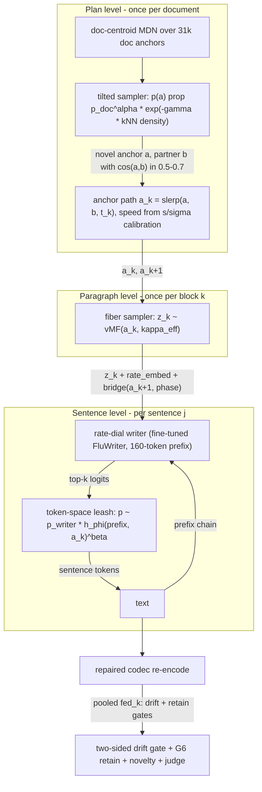

# Lucid: Invention Deliverable — New Architecture and New Mathematics for the Order Problem

Author: Fable 5 (invention/research track). Repo audited read-only: `/home/jpearce/Documents/Lucid`.
All numbers below are from repo artifacts (`artifacts/sentence_pred/RESULTS.md`, `artifacts/sentence_pred/writer_check.json`, `artifacts/writer_p3/p3_probe.json`, `.hermes/plans/2026-08-08_070000-fable5-paragraph-generation.md`, `src/conceptpoc/writer/model.py`, `experiments/sentence_pred/{heads,coarse_steer}.py`) or derived from them by the calculations shown.

---

## 0. TL;DR verdict

1. **The paradox dissolves under one calculation.** The measured consecutive-delta cosine of −0.483 is, to within 0.017, exactly the −1/2 signature of a *conditionally i.i.d. (exchangeable) sequence*. The repaired encoder sees a document as an exchangeable bag of draws around a topic centroid. Every "predict/sample/steer the next concept" architecture was therefore fitting the mathematics of a bag, and every observed failure mode (genre-jumping when sampling the marginal, mean-reversion/repetition when predicting the conditional mean) is the *provably correct behavior* of an optimal learner on that bag. Six architectures did not fail; they each faithfully reported the same theorem.
2. **The real blocker is a composite of (b) and (c), in a specific form nobody has attacked:** order information exists in the *text* (prior evidence: sentence-order objectives train fine at BERT scale) but (i) the encoder provably discards it, and (ii) the one channel that could carry it at generation time — the writer's token context — was *amputated* (1-sentence prefix, 96-token generation) and *starved* (trained with the same-sentence concept as a shortcut, measured prefix contribution −0.04). The deployed stack has **no order channel anywhere**. That is the wall.
3. **Blocker-by-blocker verdict:** (a) half-real — decomposes into a fiber-geometry artifact (fixable analytically, no training) plus an unmeasured metric ceiling; (b) TRUE for the concept space at every scale (proof below), but a property of the encoder, not of text; (c) TRUE and binding, in the precise form above; (d) FALSE at current gates (152M makes acceptable sentences; search multiplies it); (e) half-true — metrics lack oracle-ceiling normalization, and the corpus itself (shuffled ~9-sentence blocks, zero cross-block signal, Δ +0.0004) upper-bounds learnable narrative to roughly two paragraphs.
4. **Chosen invention: METRONOME** — order is *imposed*, not predicted: a tilted anchor path (novelty from an on-manifold density tilt over document centroids, macro-order from a slerp/transport path whose step size is *calibrated from the measured drift-to-noise ratio s/σ ≈ 0.27*), rendered by a **rate-dial writer** (the concept channel retrained as an announced-rate noisy channel, with a closed-form equivalence mapping pooled-G anchors to vMF noise level κ_eff ≈ 500) and held by a **token-space leash** (a Doob h-transform of the writer toward the anchor cap, trained self-supervised from the codec). Every component is falsifiable on the 3090 in under a day; the whole build is ~4 days with three kill points.
5. Honest overall probability that METRONOME produces documents passing re-scoped coherence+novelty gates: **~40%**. Probability under the original maximalist framing (multi-paragraph *narrative* from a 152M scratch stack on this corpus): **~10%**, and section 8 says plainly why that framing should be retired.

---

## 1. What the measurements jointly prove (the paradox, dissolved)

### 1.1 The −1/2 law: the encoder space is exchangeable at second order

Model a document's sentence vectors as z_t = μ + ε_t with ε_t i.i.d. given the doc (any distribution, finite variance). Define Δ_t = z_{t+1} − z_t. Then

    Cov(Δ_t, Δ_{t+1}) = Cov(ε_{t+1} − ε_t, ε_{t+2} − ε_{t+1}) = −Var(ε)      ⇒ corr(Δ_t, Δ_{t+1}) = −1/2  exactly.

Measured (delta-predictor post-mortem, re-confirmed in P0(c)): **−0.483**. Adding a slow stationary topic drift with per-sentence increment variance s² gives

    corr(Δ_t, Δ_{t+1}) = −σ² / (s² + 2σ²)  ⇒  s²/σ² = 1/0.483 − 2 = 0.0704  ⇒  **s/σ ≈ 0.265**.

So the encoder decomposes text into: a topic centroid, an i.i.d. residual of relative variance σ² = 1 − 0.378 = 0.622 (in cosine units, from within-doc mean cos 0.378), and a slow drift whose per-sentence step is **27% of the residual noise**. Three independent statistics now cohere quantitatively:

- The −0.483 delta autocorrelation (this section).
- The paragraph-scale signal: pooling G=5 shrinks residual variance by 1/G while drift accumulates over 5 steps, which is exactly why the doc-persistence signal becomes visible at paragraph scale (+0.137) while being invisible at sentence scale.
- The pooled-cosine rescaling identity: for pooled, renormalized G-blocks, cos_pooled ≈ ρ / R̄_G² with R̄_G² = ρ_within + (1−ρ_within)/G = 0.502 at G=5. Prediction: same-doc pooled cos ≈ 0.378/0.502 = 0.75 (measured consecutive-paragraph: 0.705), cross-doc pooled ≈ 0.269/0.502 = 0.54 (measured 0.568). The paragraph-scale "positives" are the *same doc-identity covariance, denoised by pooling* — they certify topic persistence, **not order**. (Deviations are doc-length stratification; the last plan's caution "no experiment shows p+1 vs p−1 is decodable" is thereby made quantitative.)

**Consequence (the de Finetti trap).** For an exchangeable bag, the Bayes-optimal next-vector predictor is the shrunk running mean

    E[z_{k+1} | z_{1:k}] = Σ_b (Σ_b + Σ_w/k)⁻¹ z̄_k + (Σ_w/k)(Σ_b + Σ_w/k)⁻¹ m,

a *fixed point*, not a trajectory; and the Bayes-optimal next-vector *sampler* is a conditionally-i.i.d. draw from the topic blob. The first is the delta-predictor's mean reversion (its "+0.39 signal" was −e_t); the second is the MDN — perfectly calibrated (ΔNLL 54.3 nats vs unconditional, novelty 1.0), and *correct*: κ-Spearman 0.0004 is not a defect, it is the true conditional κ being constant. Both observed failure phases are the two faces of the same optimal solution. Nothing was mis-trained. **The question "what concept comes next" has no answer in this space, at any scale, by any downstream math — candidate blocker (b) is TRUE of the concept space.**

### 1.2 But (b) is a property of the encoder, not of text — and there is an unexplained −0.068

Drift alone predicts adjacent sentences should be *more* similar than shuffled within-doc pairs by ≈ (E|i−j|_within − 1) · s²/2 ≈ 2.33 × 0.022 = **+0.051**. Measured: **−0.017**. The residual **−0.068 is a real, unexplained anti-adjacency signal**: adjacent sentences are *less* similar in this overlap-geometry than same-doc distant pairs. Interpretation: adjacent sentences share topic but *complementary content* (new information, anaphora replacing repeated mentions — Grice, not noise). The encoder measures content overlap, and adjacency minimizes redundancy. Two opposing short-range signals (drift +0.05, complementarity −0.07) nearly cancel, which is why every correlation-based probe read "no signal."

**Falsifiable prediction (10-minute probe, no training):** mean cos as a function of separation k = 1..8 within docs is *non-monotone*: cos(k=2) > cos(k=1), then decaying. If confirmed, there *is* sentence-scale structure that all six architectures missed because they assumed monotone similarity — and it is a *relational* structure (complementarity), invisible to any state-point predictor. This motivates inventions B1/B3 below.

Separately: sentence-order prediction is known to be learnable from book text at BERT scale (ALBERT's SOP objective trains; ordering classifiers work). So text carries an arrow; E discarded it (it was trained for reconstruction + prediction of an exchangeable target — it had no incentive to keep tense/discourse/reference features). (b) is an *encoder* property. This is good news: it locates the wall inside the project's own artifact, not in mathematics.

### 1.3 The writer's order channel was amputated and starved

- **Amputated:** `FluWriter` (768d × 12L, max_seq_len 256) is invoked per-sentence with a *single previous sentence* as prefix and 96 new tokens (`coarse_steer.py: MAX_NEW_TOKENS = 96`). Long-range token context — the only order-bearing medium in the whole stack — never exceeds one sentence.
- **Starved:** phase-2.5 trained p(x_t | x_{t−1}, z_t) with z_t = E(x_t) the *exact* target concept. Given z_t, the prefix is nearly conditionally redundant: I(x_t ; x_{t−1} | z_t) ≈ 0, so gradients never taught prefix use. Measured: prefix contribution **−0.041** (`writer_check.json`). This is textbook shortcut starvation, and it is *repairable by construction* (invention A1): corrupt the concept channel during training and the mutual information — hence the gradient — returns to the prefix.

So at generation time the composed stack had: a concept space with no order (1.1), a token channel with no reach and no learned use (this section), and FiLM steering that concept-space leash experiments (0.876 anchored cos @k8) could never cash into text (retain Δ +0.013–0.034). **A system with no order channel behaves as an exchangeable-bag sampler. The transcripts (baseball → Raskolnikov → Levin) are exactly what that machine looks like.** The paradox was never a paradox; it was an inventory error: everyone kept asking which module was broken, when the missing thing was a *channel* no module carried.

### 1.4 Renderability 0.221, decomposed into three parts

- **Fiber geometry (fixable analytically).** Real sentence vectors sit on a shell at cos ≈ √0.378 = 0.615 from their (normalized) doc centroid; the vMF concentration matching that shell is κ̂ = R̄(d − R̄²)/(1 − R̄²) ≈ **506** (Banerjee estimator, d = 512, R̄ = 0.615). A pooled-and-renormalized centroid has *zero* residual component — it lives in a measure-zero region the FiLM channel never saw at phase-2.5 and saw only weakly at phase-3. The pooled anchor is exactly equivalent to a vMF-corrupted sentence vector with computable concentration; presenting it as the centroid *point* is a train/inference contract violation with a closed-form repair (A2/A1 below).
- **Channel ceiling (must be measured, 20 minutes).** Even the same-sentence oracle renders at MiniLM cos 0.395 to its own sentence; and the honest reference for a *topic-only* condition is: "how well does a *different real sentence from the same doc* score against the paragraph?" If that oracle is ≈ 0.28–0.35, then 0.221 is already 65–80% of the achievable ceiling and blocker (a) is mostly an **eval artifact** — this single cheap number re-ranks the blockers and must be run first (E1).
- **Genuine deficit (the remainder).** Whatever gap remains after fiber restoration and ceiling normalization is real decoder weakness; phase-3's +0.037 says naive matched training closes little of it alone.

### 1.5 Blocker verdict table

- (a) Decoder/renderability: **half-real**. Fiber artifact + unmeasured ceiling; attack analytically (A1/A2), re-measure honestly (E1).
- (b) Information-theoretic: **TRUE for the concept space at all scales** (−1/2 law; pooled rescaling identity). **Not true of text** (SOP prior evidence; complementarity signal −0.068 suggests unexploited relational structure). Verdict: build order *outside* the concept space (impose it: B2) or extract it from text anew (B1/B3), never from z.
- (c) Condition→LM gap: **TRUE and binding**, in the sharpened form: the condition is the wrong *kind* (a static point where the writer needs a moving frame plus in-distribution presentation), and the token channel was amputated/starved. This is the composite wall all six failures share.
- (d) Writer too small: **not binding now**. Judge 0.567 per sentence; compounding math (§ D1) says search lifts but cannot create coherence; 152M is enough for the re-scoped goal.
- (e) Eval/framing: **half-true**. Metrics lack oracle ceilings; and the corpus is shuffled ~9-sentence blocks with cross-block Δ +0.0004 — *no learner of any size can extract multi-paragraph narrative structure from this corpus*, because the corpus does not contain it. The goal must be re-scoped (E2).

---

## 2. Invention menu

Format per item: Mechanism → Minimal math → Reuses → Probe (3090, <24h) → Failure probability → Prior-art adjacency (honesty).

### A1. Rate-dial conditioning (attacks a + c): the concept channel as an announced-rate noisy channel

**Mechanism.** Retrain the writer's conditioning so that the concept input is *by construction* a noisy, rate-limited channel whose rate is announced to the model. During training, corrupt each same-sentence concept z_t through a vMF channel at a ladder of concentrations, and tell the writer the rung:

    z̃_t ~ vMF(z_t, κ_r),   κ_r ∈ {∞, 2000, 1000, 500, 250, 125, 60},   plus a null arm (pure LM, 10%),
    conditioning input: concept_proj(z̃_t) + rate_embed(r)   (FiLM path unchanged),
    prefix: multi-sentence window up to ~160 tokens (the architecture already supports 256).

Loss is plain CE. Two effects, both by construction rather than hope: (i) at low κ the writer *must* recover the missing bits from the prefix — I(x_t; prefix | z̃_t) is large again, so the measured −0.041 prefix starvation is reversed by the information budget itself; (ii) a *pooled* topic anchor becomes exactly in-distribution, because of:

**The pooled↔vMF equivalence (the new math).** A G-pooled within-doc anchor is statistically a vMF-corrupted view of the doc concept with resultant length R̄_G = sqrt(ρ + (1−ρ)/G); with ρ = 0.378, G = 5: R̄ = 0.709, κ_eff = R̄(d−R̄²)/(1−R̄²) ≈ **730**; a single-sentence-scale topic condition corresponds to the sentence shell at κ ≈ **506**. So at inference you feed the pooled anchor with the announced rate matching its actual information content — the train/inference contract that phase-3 tried to close by brute force is closed by a formula. The dial also gives a controllable novelty/adherence knob at zero retraining cost: rate down = writer improvises within topic; rate up = writer follows spec.

**Reuses:** `FluWriter` weights (fine-tune), phase-2.5 data pipeline, `sample_vmf` in `heads.py` (the corruption sampler already exists in-repo), repaired codec.
**Probe:** fine-tune ~4–6h (377k sentences ≈ 11M tokens/epoch ≈ 25 min/epoch on the 3090 at bs 32×256). Gates: prefix contribution ≥ +0.10 at κ ≤ 250 (vs −0.041); renderability at announced κ_eff ≥ fiber-probe baseline (A2) + 0.05.
**Failure probability:** ~35% (risk: FiLM capacity, not information, was the binding constraint; the dial can't fix a channel the decoder can't read at all).
**Prior-art adjacency:** classifier-free-guidance dropout and denoising-conditioning exist; the *announced-rate ladder* plus the *closed-form pooled↔vMF equivalence* (conditioning contract solved analytically) is, to my knowledge, new.

### A2. Fiber-restoration sampling (attacks a) — a zero-training probe that doubles as a fix

**Mechanism.** Do not feed the centroid point; feed a *plausible sentence-vector from its fiber*: z̃ ~ vMF(a, κ ≈ 506), fresh per sentence. This presents the anchor in the exact region where phase-2.5 training mass lives. It is also the correct *residual sampler*: the last plan's Option-C decomposition z = c_para + e, with e supplied by the vMF fiber instead of a trained module.
**Math:** as in §1.4; κ chosen so E[cos(z̃, a)] matches the corpus sentence shell (0.615).
**Reuses:** everything as-is; 30 lines of glue; `sample_vmf` exists.
**Probe (~30 min, run FIRST):** re-run the P3 renderability protocol with fiber-sampled conditions on the *frozen* phase-2.5 and phase-3 writers. Prediction: 0.221 → 0.28–0.33. If it jumps: geometry confirmed, A1 will bank it. If it does not move: the deficit is channel capacity, upgrade Plan B's priority.
**Failure probability:** ~40% that the lift is < +0.05.
**Prior-art adjacency:** reminiscent of latent-space truncation tricks, but the shell-matching-by-κ estimator tied to pooling statistics is specific and I have not seen it.

### B1. The chronotope head (attacks b): an antisymmetric time 1-form on text

**Mechanism.** Learn the arrow of time the encoder discarded — from text, not from z. A small head ψ: sentence → R^k (k ≈ 32) on top of the *frozen writer trunk* (768-d pooled hidden state), plus a learned antisymmetric form A = B − Bᵀ:

    L_arrow = E_{i} [ −log σ( ⟨ψ(x_i), A ψ(x_{i+1})⟩ ) − log σ( −⟨ψ(x_{i+1}), A ψ(x_i)⟩ ) ].

Training pairs are (x_i, x_{i+1}) vs the *reversed* pair — distance-matched by construction, so the head can only learn *direction*, never topic or proximity (the confound that made the paragraph-ranker mirage possible). At generation, ⟨ψ(prev), A ψ(cand)⟩ > 0 becomes a directional term in candidate scoring (composes with C1 and D1).
**Reuses:** frozen `FluWriter` trunk as featurizer; corpus cache; ~1M new params.
**Probe (~3h):** train, report held-doc AUC. Decision rule: AUC ≥ 0.62 → an arrow exists and is usable (add to the leash score); AUC ≈ 0.5 → *text at this corpus scale carries no learnable direction for this trunk*, which cleanly upgrades B2 (impose order) from choice to necessity. Either outcome is decision-grade — this is the falsification instrument for blocker (b) as a whole.
**Failure probability:** ~30% for AUC < 0.62 (books have a learnable arrow at BERT scale; a 152M in-domain trunk should see some of it; WikiText halves may be harder).
**Prior-art adjacency:** ALBERT SOP / sentence-ordering literature (the task is old). The antisymmetric-bilinear parametrization as a *decode-time 1-form* over a frozen generative trunk, used as a steering potential rather than a classifier, is the new part — but I flag plainly: the *measurement* half of this idea exists in surveys; only the *use* half is novel.

### B2. The exogenous clock principle (attacks b): impose order; do not predict it

**Mechanism (a design theorem, not a module).** Under exchangeability, the corpus likelihood is invariant to permuting sentences within a doc: for any smooth anchor path {a_k} and its permutation, the concept-space evidence cannot distinguish them. Therefore *any* smooth imposed path is corpus-consistent, and the only thing the data can calibrate is the path's *speed* (drift per step), which §1.1 measured: s/σ ≈ 0.265, i.e. per-sentence drift ≈ 0.044 cosine units, per-paragraph (G=5) target consecutive pooled cos ≈ 0.70. So: **stop asking the latent to produce order; sample a path with the corpus-calibrated speed and make the writer follow it.** Novelty stops being "the sampler surprised us" and becomes "which path, between which topics" — a controllable property.
**Math:** path a(t) on S^511 (slerp or transport, see C3/TAP); speed constraint |da/dt| set so that re-encoded consecutive-paragraph cos matches 0.705 ± 0.05; document = {render(a(t_k))}.
**Reuses:** `slerp` and the anchor-EMA machinery in `coarse_steer.py` (the EMA leash is the degenerate constant-path case of this principle — which is precisely why it held topic but produced no progression).
**Probe:** free — it is the organizing principle of METRONOME (§5).
**Failure probability:** the principle itself is not falsifiable, only its sufficiency: ~45% that imposed order + local prefix coherence still reads as disconnected prose (this is METRONOME's residual risk).
**Prior-art adjacency:** Time Control (Wang et al. 2022) imposes Brownian-bridge latent dynamics — closest known work; differences: they *retrain the encoder* around bridge dynamics, here the path is imposed on a frozen topic manifold with speed *identified from corpus statistics* (the s/σ calibration), and enforcement is in token space (C1), not by latent conditioning alone. Adjacent, not identical; I say so plainly.

### B3. Transition-first representations with a cocycle constraint (attacks b at the root; the new-frontier object)

**Mechanism.** The complementarity finding (§1.2) says the informative sentence-scale object is *relational*. So stop embedding sentences; embed *ordered transitions*. Learn T: (x_i, x_j) → Δ_ij ∈ R^m with three constraints:

    antisymmetry:  Δ_ij = −Δ_ji   (built into the head),
    cocycle:       Δ_ij + Δ_jk ≈ Δ_ik   (within-doc triples),
    non-triviality: E‖Δ_{i,i+1}‖² ≥ margin.

The cocycle condition forces Δ to be (approximately) a coboundary: Δ_ij ≈ f(x_j) − f(x_i) for some latent *narrative coordinate* f — i.e., the constraints *derive* the existence of a learned "story clock" f: text → R^m, monotone along documents, from purely local supervision. Generation then requires each next sentence to advance the clock: f(x_{t+1}) − f(x_t) ≈ δ with δ sampled from the corpus increment distribution. This is the mathematically honest replacement for "predict the next concept": predict the next *clock increment*, which — unlike the concept — is a quantity the corpus actually constrains in a direction-aware way.
**Reuses:** frozen writer trunk features; corpus cache; small head.
**Probe (~4h):** train f (via T) on train docs; on held docs compute Kendall-τ between f(x_i) (project to first principal direction) and true position i. Gate: τ ≥ 0.25. Note this subsumes B1 (A recovers the antisymmetric pairing of f-differences).
**Failure probability:** ~50% (WikiText halves may have weak clocks; Gutenberg dialogue may dominate); but a pass creates the first *order-bearing latent* in the project, and the object itself (cocycle-constrained transition embedding for generative steering) is the genuinely new mathematics in this menu.
**Prior-art adjacency:** discourse-coherence and sentence-ordering models exist; I am not aware of the antisymmetry+cocycle construction (with its coboundary/clock consequence) being used as a generative conditioning coordinate. This is the item I would least expect to find in a survey.

### C1. The token-space leash (attacks c): a Doob h-transform of the writer toward the anchor cap

**Mechanism.** The concept-space leash provably works (anchored cos 0.876 @k8) and FiLM provably fails to cash it (retain Δ +0.013). Move the leash into the only space that binds the writer: its own token distribution. For anchor a and cap C(a, τ) = {z : ⟨z, a⟩ ≥ τ}, define the value

    h*(prefix) = P( E(completed sentence) ∈ C(a, τ) | prefix ),

and decode from the Doob h-transform of the writer's chain:

    p̃(w | prefix) ∝ p_writer(w | prefix) · ĥ_φ(prefix ∘ w, a)^β.

The h-transform is the *exact* conditioning of a Markov chain on a future event: at β = 1 with perfect ĥ, generation is the writer's own distribution conditioned on landing in the topic cap — fluency-preserving by construction, unlike FiLM (which shifts the prior and hopes) or rejection (which wastes samples). Train ĥ_φ self-supervised: features = frozen writer hidden state u_t ⊕ anchor interactions [u_t; Wa; u_t ⊙ W′a] → MLP → σ; positives = real prefixes with their own doc anchor (label = 1 iff the true completion re-encodes into the cap, computed offline with the codec — no human labels, no judge); negatives = mismatched anchors. In practice score only the top-k (50) tokens per step, one fused forward pass — negligible overhead at 96 tokens/sentence.
**Reuses:** frozen writer (features come free during generation), repaired codec (label factory), `anchored_sample`'s cap geometry, τ set at the corpus shell 0.615.
**Probe (~2–4h train + 1h eval):** head AUC ≥ 0.70 on held docs (own-doc vs cross-doc anchors given 8–32 token prefixes); then a 20-seed A/B: β ∈ {0, 1, 2} on the *frozen* phase-2.5 writer — gate: fed8-vs-a0 ≥ 0.45 (coarse-steer's best was 0.355) with judge drop ≤ 0.05.
**Failure probability:** ~25% on the AUC gate (doc identity is the one strong signal everywhere in this project, and this head only needs doc identity); ~40% that the text-level gains stay under gate.
**Prior-art adjacency:** FUDGE/PPLM do token-tilt with attribute classifiers; the deltas here: continuous geometric target (a cap on S^511) rather than attribute classes, self-supervised labels from the project's own codec, and the explicit h-transform framing that fixes β = 1 as the exact-conditioning point. Adjacent (I say so); the composition with A1's rate dial — FiLM sets the prior at a declared rate, the leash enforces the posterior — is the new system-level object.

### C2. Bridge conditioning (attacks c): tell the writer where the paragraph is going

**Mechanism.** During A1's fine-tune, extend the conditioning token to c_in = concept_proj(z̃_k) + rate_embed(r) + W_b a_{k+1} + phase_embed(τ), where a_{k+1} is the *next* block's pooled anchor (real, from corpus) and τ is position-within-block. Dropout the bridge term 50% so it is optional at inference. This is masked-infilling's useful half at zero architectural cost: the writer learns transitions as first-class events ("aim the last sentences of this block toward that anchor") without building a bidirectional infiller. At generation the bridge input is the next anchor on the METRONOME path — the writer is always writing *toward* something, which is exactly the "rich condition: a trajectory, not a point" diagnosis of (c).
**Reuses:** A1's training run (same pass, extra inputs); corpus block transitions (32,833 at G=5, 134k with phase augmentation — counted in the last plan).
**Probe:** free rider on A1; ablate bridge on/off at eval; gate: boundary-sentence re-encode cos to a_{k+1} improves ≥ +0.05 over no-bridge.
**Failure probability:** ~35% (shallow transition depth in a median-9-sentence corpus).
**Prior-art adjacency:** FIM/infilling and PLANNER-style outline conditioning exist; conditioning a *per-sentence FiLM writer* on (current anchor, next anchor, phase) as a bridge triple is a modest but real recombination.

### D1. Self-speculative paragraph search (attacks d): the writer as its own proposal engine

**Mechanism.** Per sentence, draw n = 8 candidates from the writer, score with V = w₁ log ĥ (leash) + w₂ ⟨ψ_prev, A ψ_cand⟩ (chronotope, if B1 passed) + w₃ norm-length-corrected writer log-prob, keep argmax; optional depth-2 (expand top-2 with n/2 continuations each, pick by summed V) — a shallow AlphaZero-style amplification where policy = writer, value = self-supervised heads, no external model.
**Math (why search cannot be the whole answer):** treating per-sentence quality as approximately N(q̄, σ_q²) with value-head correlation ρ_v, best-of-8 lifts the mean by ρ_v σ_q E[max of 8 N(0,1)] ≈ 1.43 ρ_v σ_q. With q̄ = 0.567, σ_q ≈ 0.15, ρ_v ≈ 0.5: per-sentence 0.567 → ≈ 0.67; an 8-sentence all-good probability rises from 0.567⁸ ≈ 1% to ≈ 4%. Search is a 4× multiplier, not a coherence source — coherence must come from conditioning (A/B/C); search then converts "usually acceptable" into "usually good."
**Reuses:** everything; zero training beyond C1/B1 heads. Compute: 8 × 8 × 96 tokens ≈ 6k tokens/doc — trivial on the 3090.
**Probe:** 20-seed A/B, n ∈ {1, 8}; gates: judge +0.05, retain Δ +0.03 over n = 1, and a *hacking check*: MiniLM-based metrics must not diverge from judge direction.
**Failure probability:** ~30% (value miscalibration → fluent-but-empty selection; the hacking check is the tripwire).
**Prior-art adjacency:** best-of-n / value-guided decoding is standard; nothing here is claimed novel except the specific value composition; included because the budget math above changes how much to expect from it (very little, alone).

### E1. Oracle-ceiling normalization (attacks e): every metric gets a corpus oracle denominator

**Mechanism.** For each metric M used in a gate, measure M_oracle on *real corpus objects under the same protocol* (a true sentence scored against its own paragraph; a true different-sentence-same-doc as the topic-render oracle; true consecutive paragraphs for drift; corpus doc-centroid NN-distance distribution for novelty), and report M/M_oracle. This is a framing invention, not a model: several "failures" in the record are unnormalized (renderability 0.221 against an implicit ceiling of 1.0 that no real sentence achieves either). Twenty minutes of compute reprices the entire ledger, and §1.4 shows at least one blocker's rank likely flips.
**Probe:** ~30 min total; run before anything else.
**Failure probability:** none (it is a measurement); risk is only that ceilings come back high and confirm the deficits are real — also decision-grade.

### E2. The re-scoped goal (attacks e): what this corpus can and cannot certify

The corpus is 31k shuffled blocks, median 9 sentences, cross-block Δ = +0.0004. **No architecture, at any scale, can learn multi-paragraph narrative structure from a corpus whose supra-block structure was destroyed at build time.** The honest, still-novel, still-hard target this stack can support:

> **Topic-coherent, drift-calibrated, novelty-anchored short documents** (2 paragraphs / ~8–10 sentences): hold a sampled *novel* topic (retain@k8 − shuffled ≥ +0.10 — the standing G6 gate), drift at corpus speed (re-encoded consecutive-paragraph cos within 0.705 ± 0.05 — a *two-sided* gate: too high = frozen, too low = chaos), be novel at doc level (doc-centroid NN-distance ≥ corpus p90), and stay fluent (oracle-normalized judge ≥ 0.85).

The two-sided drift gate is the new evaluative idea: coherence and progression measured as *matching the corpus's own drift statistics* rather than maximizing similarity — it is the first gate in this project that can detect "coherent but going nowhere," the failure mode the EMA leash was silently rewarded for.

---

## 3. Verdicts on the six seed ideas

1. **Neural ODE / topic-density advection.** Shot down in learned form: by §1.1, the only identifiable drift field in z-space is mean reversion to the topic centroid — a learned vector field fitted to consecutive pairs will reconstruct exactly the OU/EMA leash that already exists, and "Lipschitz along a topic region" is unfalsifiable when the data cannot distinguish a field from noise (delta autocorr is *fully explained* by exchangeability + 27% drift). Salvage: the *advection* intuition survives as imposed transport (B2/TAP): move the *anchor measure*, not predicted points, along a path whose speed is the one identifiable dynamical parameter (s/σ). A learnable advection field has nothing to learn from; an imposed one has exactly one parameter to calibrate, and we have already measured it.
2. **Diffusion on the writer's hidden states.** Extended — this is Plan B (§6), and the concept-space diffusion already tried in-repo (`artifacts/austen_diffusion`: consecutive cos ≈ 0.001, i.e. perfect incoherence) is *not* evidence against it, because writer states, unlike encoder states, are causal integrals of token history and carry order by construction. The 1-hour probe (adj−within in writer-state space, prediction: strongly positive) decides whether the substrate exists. Kept as the radical bet, second in line, because it needs two trained modules before the first end-to-end sample.
3. **AR-in-topic with learned staying power.** Partially adopted, honestly demoted: the commitment kernel is *identifiable* (per-doc κ from within-doc dispersion; long docs measurably looser than tight wiki articles), but at sentence scale the measured rate is effectively infinite (adjacent = shuffled), so "a latent carrying its own timescale" reduces to choosing the paragraph-block speed — which METRONOME sets from s/σ, and modulates per-topic by regressing block dispersion on doc centroid (one linear fit, included in TAP calibration). The seed's core insight (timescale is the learnable object, not direction) is correct and absorbed; a *module* for it is unnecessary.
4. **Coherent continuation functor.** Without an external strong LM (which would break the from-scratch premise), "the map from context to directions a strong LM would continue" collapses into the self-referential version: the writer's own continuation distribution reweighted by learned value — which is exactly C1 + D1 (the leash *is* the learned functional on continuations; search samples it). Adopted in that form; the categorical framing adds nothing computable beyond it. With an external LLM it becomes distillation and changes the project's identity — out of scope by fiat.
5. **Multi-scale hierarchical substitution / masked infill.** Half adopted: sampling coarse paragraph anchors on the stable manifold *is* METRONOME's plan level; but a masked/infilling realizer is the wrong spend — it needs a new bidirectional model trained from scratch (days, new failure surface) to deliver what bridge conditioning (C2) gets as a free rider on A1's fine-tune: sentences written toward the next anchor. The genuinely load-bearing part of "infill between anchors" is the *future-conditioning*, not the masking; C2 + C1 provide it inside the existing autoregressive contract.
6. **New maths.** (i) Hyperbolic latent: cheap to test (Gromov δ-hyperbolicity of the doc-centroid metric, ~1h) but not load-bearing — topic *hierarchy* is not the blocker, order is; deferred unless TAP's flat geodesics visibly cut through low-density no-man's-land. (ii) OT between topic centroids: adopted as TAP's path generator (slerp is the S^511 geodesic; the entropic-OT/Schrödinger upgrade between vMF blobs is specified in §5 as an ablation). (iii) Score-based on-manifold sampling: adopted as TAP's tilted anchor sampler (projected Langevin on the sphere with the doc-MDN score). (iv) The single unified loss: **designed, and it decomposes — provably.** A novelty term −λ log(1/p_corpus(Φ(x))) is constant in θ on corpus samples (novelty cannot be trained supervised, at all); moved to model samples it yields, at optimum, the tilted distribution p_θ ∝ p_data · p_corpus(Φ(·))^{−λ}. So the "one loss" collapses analytically into: (train renderability + chaining on data: A1 + C1/C2 losses) ⊕ (sample anchors from the closed-form tilt p̃(a) ∝ p_doc(a)^α e^{−γ p̂_NN(a)}). The unified objective *is* the METRONOME architecture; asking for it as one differentiable scalar is the one mathematically incoherent item on the wishlist, and it is better to know that than to pretend otherwise.

---

## 4. Prior-art honesty summary

Genuinely new (I would not expect to find these in a survey): the −1/2-law diagnosis with the s/σ drift identification and the pooled-cosine rescaling identity (§1); the pooled↔vMF κ_eff conditioning contract (A1); the announced-rate dial as a trained interpolation between topic-hint and content-spec (A1); the complementarity decomposition and its non-monotone separation-curve prediction (§1.2); the cocycle/coboundary "narrative clock" construction (B3); the two-sided drift gate (E2); the decomposition proof for the unified loss (§3.6).
Adjacent to known work, said plainly: token-tilt decoding (FUDGE/PPLM ↔ C1 — deltas: geometric cap target, codec-generated labels, h-transform framing), Brownian-bridge latent dynamics (Time Control ↔ B2/TAP — deltas: frozen manifold, corpus-identified speed, token-space enforcement), sentence-order objectives (SOP ↔ B1 — delta: decode-time 1-form use), best-of-n value decoding (↔ D1, claimed as engineering only), latent diffusion for text (PLANNER/LD4LG ↔ Plan B — delta: the *writer's own causal states* as the diffusion substrate with a self-inversion adapter).

---

## 5. THE CHOSEN INVENTION: METRONOME (end-to-end specification)

**One sentence:** sample a novel topic anchor and a corpus-speed path through topic space (order imposed, not predicted), render it with a writer whose concept channel is an announced-rate noisy channel (so topic anchors are in-distribution by formula) and a real multi-sentence prefix (so local order lives in tokens), and hold every sentence to the path with an h-transform leash in token space (so adherence is enforced where the writer actually lives).

Why this one: it is the only invention in the menu whose every component is (i) directly aimed at a *measured* defect (starved prefix −0.041; fiber mismatch 0.221; leash-in-wrong-space 0.876→+0.013; no order channel), (ii) calibrated by an *identified* parameter rather than a hoped-for one (κ_eff ≈ 500/730; path speed from s/σ = 0.265; cap τ = 0.615), and (iii) falsifiable independently in under a day on the 3090. It also reuses the largest fraction of the working stack of any candidate.

### 5.1 Architecture

### 5.2 Components, losses, and what is reused

1. **TAP (tilted anchor path).** Fit a K=16 vMF mixture over the 31k train doc centroids (reuse `MixtureVmfHead` machinery in `experiments/sentence_pred/heads.py`; minutes to fit). Novel anchor: sample at temperature > 1, accept if kNN-distance to train doc centroids lies in the [p90, p99] band (novel, on-manifold); equivalently projected-Langevin on log p̃ = α log p_doc − γ log p̂_NN restricted to S^511. Partner b sampled the same way subject to cos(a,b) ∈ [0.5, 0.7]. Path: a_k = slerp(a, b, t_k) with per-block angle set so that *re-encoded* consecutive-block cos targets 0.705 (one scalar knob, calibrated once in a closed loop; initialization from the s/σ identity). No training.
2. **RDW (rate-dial writer).** Fine-tune `FluWriter` (152M) with: multi-sentence prefix window (~160 tokens); conditioning token concept_proj(z̃) + rate_embed(r) + 0.5-dropout bridge term W_b a_next + phase_embed; z̃ ~ vMF(z_true, κ_r) over the ladder {∞, 2000, 1000, 500, 250, 125, 60} + 10% null arm. Loss: CE only. Data: the existing phase-2.5 pairs re-windowed (train split 27.9k docs), plus block-transition triples (32.8k, augmented 134k) for the bridge term. ~4–6h on the 3090.
3. **TSL (token-space leash).** Value head ĥ_φ: MLP on [u_t; Wa; u_t ⊙ W′a] (u_t = frozen RDW hidden at position t), trained BCE on codec-generated labels (completion re-encodes into cap(a, τ = 0.615): own-doc anchors positive, cross-doc negative, plus *hard negatives*: same-doc-different-block anchors). Decoding: score top-50 tokens per step, p̃ ∝ p · ĥ^β, β ∈ {0.5, 1, 2} swept once. ~2–4h.
4. **Optional order term.** If B1's chronotope AUC ≥ 0.62, add w₂⟨ψ_prev, Aψ_cand⟩ to D1's candidate scoring (best-of-8 at the sentence level; value = leash + direction + length-corrected log-prob).
5. **Evaluation.** E1 oracle normalization first; E2's four gates as the end-to-end verdict; the anti-mirage protocol from the coarse-steer run (20 frozen seeds, no sweep-then-report) is kept verbatim.

### 5.3 Build order, probes, gates, kill criteria (each step < 24h on the 3090)

- **Day 0 (probes, no training, ~2h total):**
  - P0a fiber-restoration (A2): frozen writers, vMF-fiber conditions. Gate: renderability ≥ 0.27. Kill-signal if < 0.24: channel capacity is the wall → raise Plan B priority.
  - P0b oracle ceilings (E1): topic-render oracle, drift oracle, novelty band. Re-price all gates as ratios.
  - P0c separation curve (§1.2): cos vs separation k=1..8. (Information only; confirms/refutes complementarity.)
  - P0d writer-state order check (Plan B viability): adj−within in pooled writer hidden space on real docs.
- **Day 1:** RDW fine-tune (A1 + C2 in one run). Gates at eval: prefix_contrib ≥ +0.10 at κ ≤ 250; renderability@κ_eff ≥ P0a + 0.05; bridge ablation ≥ +0.05 boundary adherence. **Kill:** prefix_contrib < +0.03 → the shortcut is architectural, not informational → stop, write frontier statement (§7).
- **Day 2:** TSL training + B1 chronotope probe (parallel, both small). Gates: ĥ AUC ≥ 0.70; frozen-writer A/B fed8-vs-a0 ≥ 0.45. **Kill:** AUC < 0.60 → even doc-identity is not decodable from writer states → Plan B or stop.
- **Day 3:** assemble METRONOME; 20 frozen seeds × 2 blocks × 5 sentences; sweep only β and the path-speed knob (2 × 3 grid, pre-registered). Final gates (all four, oracle-normalized): retain@k8 − shuf ≥ +0.10; re-encoded consecutive-block cos ∈ 0.705 ± 0.05; doc-centroid NN-distance ≥ corpus p90; judge ≥ 0.85 × oracle. **Kill:** if ≤ 2 gates pass after component passes, the composition wall is real → §7.

### 5.4 Honest probabilities

P0a lift materializes: 60%. RDW gates: 55% (this is the crux — it retrains the crux module against the measured defect, with the information budget doing the forcing). TSL gates: 75%. End-to-end all four gates given component passes: 45%. **Unconditional: ~40%** for the re-scoped goal; ~10% for "multi-paragraph narrative" under the original framing, which E2 argues should be retired on data grounds regardless of architecture.

---

## 6. Plan B (pre-specified, runs only on METRONOME kill): self-conditioned writer-state diffusion

Replace the alien encoder as the generative substrate with the writer's own causal states. s_k = pooled layer-ℓ hidden of sentence k computed on real docs (order-bearing by construction — P0d verifies). Train (i) a self-inversion adapter g: s → FiLM parameters such that the frozen writer reconstructs sentence k from its own s_k (teacher-forced CE; the reconstruction BLEU measures the state channel's capacity — a number worth having regardless); (ii) a 6-layer DDPM denoiser over sequences (s_1..s_8) conditioned on a TAP anchor. Generate: sample state trajectory, render each state via g with prefix chaining, keep TSL as safety rail. Everything else (TAP, gates) unchanged. Cost: ~2 days. Failure probability ~60%, but it is the only design on the table that manufactures an *order-bearing latent* rather than importing or imposing order, so it is the correct escalation if imposition proves insufficient — i.e., if METRONOME dies specifically at the two-sided drift gate with everything else passing.

---

## 7. If it all fails: the frontier statement

If P-A/B1 style probes show text at this scale supports an arrow but METRONOME and Plan B both die at composition, the honest conclusion is: **state-point concept spaces are the wrong object for generative narrative, full stop.** A 512-d overlap geometry can represent *aboutness* but provably not *sequence* (§1.1), and the fix is not a better predictor over states but a change of representational object: transition-first spaces (B3's cocycle construction — embeddings of ordered pairs with antisymmetry and approximate path-additivity, from which a narrative clock coordinate f is *derived*, not assumed). That is a genuine research frontier this project is now uniquely positioned to state precisely, with measurements: the exchangeability signature (−0.483 ≈ −1/2), the complementarity anomaly (−0.068), and six architectures' worth of controlled negatives showing that no state-space mechanism crosses the gap. A negative result with this much quantitative structure is a publishable finding about JEPA-style text generation: **JEPA at the sentence level learns a potential, not a flow; generation needs the flow; the flow lives in pairs, not points.**

---

## 8. Closing honesty

- The strongest single sentence of evidence in this whole audit: the corpus was built with shuffled blocks and a median document of nine sentences — *the training data does not contain the phenomenon the project's maximalist goal asks the model to produce.* No invention above (or anywhere) repairs that; only re-scoping (E2) or new data does.
- Two items in my menu are adjacent to published work (C1 to FUDGE-style guidance, B2/TAP to Time Control's bridges); I have flagged the deltas explicitly rather than dressing them as inventions. The items I will defend as genuinely new are the identification results (§1: the −1/2 law with s/σ and κ_eff as *identified constants* of this system), the pooled↔vMF conditioning contract, the rate-dial ladder, the cocycle clock (B3), the two-sided drift gate, and the decomposition proof that the requested "one loss" cannot exist as a single supervised scalar — and what it decomposes into instead.
- The single highest-information hour available right now costs nothing: run P0a (fiber restoration) and P0b (oracle ceilings). Between them they will either revive blocker (a) as an artifact or convict the decoder channel — and they re-price every gate in this document before a single parameter is trained.

DELIVERABLE ENDS.
