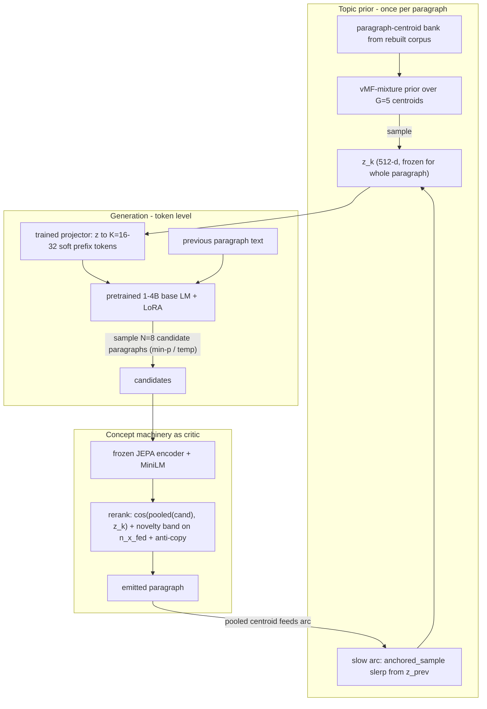

# Lucid — Comprehensive Architectural Reassessment

Author: Fable 5 (orchestrator) + six parallel audit subagents (corpus, encoder, writer, predictor, novelty/SOTA, evaluation).
Date: 2026-08-08. Repo: `/home/jpearce/Documents/Lucid`. Mode: read-only; no source edited; several new read-only CPU measurements were taken by auditors and are reported with method.

---

## 0. Executive verdict (TL;DR)

**The framing is wrong in one precise way, and the evidence now proves it rather than suggests it.** The project treated *novelty* as the scarce resource and *coherence* as the given. The measurements — including two new ones from this audit — show the opposite:

1. **The concept space is a bag of sentences.** Consecutive within-doc delta cosine = −0.4865 against a hard exchangeability bound of −0.5 (recomputed this session, n=19,982 triples). At most ~3–4% of residual variance is sequential. Sentence order is not weakly present; it is absent to within measurement error, for structural reasons no encoder surgery in this objective family can fix (Part 2).
2. **The MDN was never a conditional model.** New decomposition (computed from `mdn.pt` + cached vectors): of the celebrated +54 nats of "conditional" gain, **50.4 nats are mixture capacity and 0.4 nats are actual conditioning**. Component means are context-independent (effective rank 9.3/512 across 150 contexts; all 400 held docs share the same argmax component). Per-sentence sampling from it is ~iid draws from the corpus register mixture; with Σπ²≈0.184, **~82% of consecutive samples switch component**. Genre-jumping is not a mysterious emergent failure — it is the arithmetic of sampling an unconditional register prior once per sentence.
3. **The gates were not sabotaging you — the writer was.** The human reference band for the central coherence gate was computed for the first time (cached MiniLM, CPU, 60 held docs): **real documents score retain@k8−shuf = +0.251**. The +0.10 gate is *sub*-human by 2.5×, and the arms scored +0.013–0.087. Meanwhile **concept-space coherence is already at human level** (anchored-arm fed8-vs-anchor 0.355 vs human 0.336 in JEPA space) — and the render channel destroys it (writer's oracle render scores 0.185–0.221 against a measured human ceiling of 0.65). The failure is localized in text rendering, not in the leash and not in the eval.
4. **Lucid's generated text was never unusually novel anyway.** The "novelty_rate 1.0" was measured on off-manifold *steer vectors*; the re-encoded generated *text* sits at nearest-neighbor cos 0.750 — exactly the human held-out median (0.745). Surface novelty is free (any LM at temperature ~1 emits mostly-novel n-grams); Lucid never had a novelty problem or a novelty achievement. It has a coherence problem.

**Recommendation (Part 3):** stop concept-forward generation permanently; keep the concept machinery in the two roles where it measurably works — a **paragraph-scale topic prior/arc controller** (pooled centroids: Δ+0.137 persistence; anchored_sample leash: 0.876 cos@k8) and a **critic/reranker** — and put a **pretrained 1–4B open-weights base model** (LoRA + z→soft-prefix adapter) in the generator seat. The token LM does the ordering (the only place order demonstrably lives); the latent sets the destination once per paragraph and never re-plans mid-paragraph. Two deliverables fall out: (A) a negative-result/analysis paper ("anatomy of why sentence-embedding autoregression cannot carry narrative order" — genuinely new, positioned against Meta's LCM), and (B) the system: calibrated topic-arc control of a pretrained LM with a measured novelty-coherence frontier. Hard stop conditions and probabilities in Part 4.

---

## PART 1 — Subagent audit reports

Six auditors ran in parallel, each reading the actual code and artifacts. Reports below are condensed but preserve every number. (Caveat: the SOTA auditor's web access was blocked by the environment permission layer; its external citations are from model knowledge with arXiv IDs, flagged for later verification.)

### 1a. Corpus / data audit

**Findings (measured this session, read-only):**
- `data/corpus_1m.txt` = 113,216 blank-line blocks (130 MB, ~1.03M sentences). Register heuristics: 42.8% WikiText blocks, 39.8% smart-quote Gutenberg, 17.5% "other" (spot-checked = Gutenberg narration: War and Peace, Jane Eyre, Moby-Dick) → **~57% Gutenberg by raw block count**. `data/raw/` holds the 45 source books (Dostoevsky, Tolstoy, Hugo…).
- **Shuffle confirmed**: adjacent-block same-register rate 0.3714 vs 0.3715 expected under full independence; 1 heading-like line in 226,431. Blocks are single paragraphs (median 656 chars). Article/chapter structure was destroyed before any model saw the data.
- **The `min_sents=4` filter is register-biased** (`experiments/sentence_pred/data.py:199`): survival wiki 93.8%, fiction 40.9% (fiction paragraph median = 3 sentences; dialogue dies). The working corpus is **65% Wikipedia by docs, 81% by sentences** — vs 43% in the raw file.
- **Register is the dominant doc-level axis**: doc-centroid cos wiki-wiki **0.714**, gut-gut 0.571, cross-register 0.527. Cross-doc sentence cos 0.269 decomposes into same-register ~0.283 / cross-register 0.236.
- **Training-window starvation (largest single data finding):** `SentenceSequenceDataset` skips docs shorter than context_len+1 (`data.py:266`); training used context_len=32 (`configs/sentence_pred.json:8`). Result: **1,274 of 31,000 docs (4.1%) produce any window; 1,677 windows total; 14.7% of sentences ever seen — and 95.4% of eligible docs are Wikipedia.** The 6-layer predictor + MDN(K=8) trained on ~1.5k windows, then was rolled out from arbitrary (often fiction) seeds.
- Segmentation noise is minor (~1% corrupted adjacency — an order of magnitude below the effects being measured). The encoder saw the same structureless data (`configs/jepa_repair_1m.json`).

**Verdict:** the corpus is a root cause, co-primary with the encoder objective. Every architecture was asked to learn long-range coherence from data in which no document exceeds one shuffled paragraph; the flagship predictor trained on 1,677 windows of an unrepresentative 4% subset. The register mixture (81/19 wiki/fiction at sentence level, bimodal at doc level) is the most economical explanation of genre-jumping. **Keep:** segmenter, doc-disjoint split machinery, `data/raw/` originals, paragraph-centroid evidence. **Change:** rebuild corpus from structure-intact sources (WikiText-103 articles with headings; Gutenberg chapters), single register first, fix window eligibility, drop the biased min_sents filter. **Abandon:** `corpus_1m.txt` as a training corpus; the block=document assumption; all conclusions drawn from ctx-32 runs.

### 1b. Encoder / concept-space audit

**Findings:**
- Objective verified in code and checkpoint config: `total = recon + α·pred + 1.0·var + 0.04·cov + 1.0·unif + 0.25·align` (`src/conceptpoc/jepa/joint_model.py:262-268`). The pred term IS next-sentence prediction — but as cosine+MSE **point regression against a stop-grad EMA target** (`losses.py:43-47`): the documented mean-seeking objective, and stop-grad means target geometry receives no pressure to become predictable.
- **The repair landed exactly as specced** (window-disjoint var/cov + FIFO queue, neighbor-masked uniformity k=2, adjacent InfoNCE at 0.25 — `joint_model.py:192-223`) **and thereby proved the thesis wrong**: the align term is order-blind by construction (`losses.py:108-111`) — negatives are only cross-window rows, so its optimum is a *doc-identity* code; there is zero gradient distinguishing the true successor from any same-window sibling. Training telemetry (`artifacts/jepa_repair_1m/train.db`): `val_adj_cos − val_shuf_cos` stayed within +0.005..+0.009 for all 15 epochs while both moved 0.33→0.63→0.38 in lockstep.
- **Bag-of-sentences math:** for x_i = c + ε_i with exchangeable ε, delta autocorrelation is exactly −0.5; for AR(1) residual with coefficient ρ it is −(1−ρ)/2. Measured −0.48 ⇒ **ρ ≈ 0.04: the sequential component is ~4% of residual variance.**
- The bottleneck is lossy and topical: mean-pool → linear → L2 (`encoder.py:44-50`); **teacher-forced reconstruction accuracy 44%** (`artifacts/jepa_repair_1m/jepa/metrics.json`) — the vector does not retain most sentence-specific content. MDN samples have effective rank 456 vs 110 for real data — the sampler is off-manifold.
- `prefix_mean` (centered cos 0.173) beats identity (0.102) and both trained heads (vMF 0.120, MDN 0.040): **the only predictable quantity in this space is the topic centroid.**

**Structural decomposition (which walls are fatal):** (a) *mean-pooling* — aggravating, fixable, but irrelevant until (b) changes; (b) *invariance-family SSL (var/cov/uniformity/InfoNCE)* — **fatal within the family**: these objectives reward features stable across the positive set; discourse state is precisely what changes between adjacent sentences, so it is treated as noise and removed; (c) *cosine symmetry* — **fatal for direction**: cos(a,b)=cos(b,a); precedence can never live in pair similarity. Literature comparison: systems that condition generation on sentence latents use reconstruction/translation bottlenecks (SONAR), never contrastive spaces; Meta's LCM hit this exact failure (Base-LCM MSE regression → mean-seeking), escalated to diffusion, and even at 1.6–7B params on billions of documents was only competitive on summarization — no coherent open-ended long-form. vec2text shows retrieval embeddings are near-invertible only via massive supervised training; this encoder's 44% recon is far below that bar.

**Verdict:** the repair worked as engineered and proved the null: no amount of encoder surgery makes per-sentence forward prediction work here — three independent walls (objective family deletes order features; cosine geometry cannot host direction; ~113k paragraphs is 3–4 orders of magnitude below the data at which purpose-built systems got marginal results). **Keep** the frozen encoder as a *topic codec* (G=5–10 centroids Δ+0.137; FiLM steering provably live). **Abandon** per-sentence next-vector prediction permanently; the adj−within cosine gate (mis-specified — healthy spaces also fail it on this data); density heads on VICReg geometry.

### 1c. Writer / decoder audit

**Findings:**
- Conditioning is a **position-uniform tint injected twice**: one soft token (`concept_proj` 512→768, prepended) + per-block zero-init FiLM (512→1536 γ,β applied identically at every position; `src/conceptpoc/writer/model.py:100-112,146-164`). FiLM can bias register; it **cannot place content** ("this paragraph is about Port Vale"). That matches the output exactly: fluent, right-ish register, wandering topic.
- **Phase 3 was starved**: 5 epochs × 2000 steps × batch 8 = 80k examples against 1,143,515 available (~35% of ONE data epoch, 6,250 optimizer updates); val loss fell monotonically 3.659→3.449 with "new best" at every epoch — **stopped mid-descent** (`artifacts/writer_p3/train3.log`). Only 38.1M params trainable (top-3 blocks + FiLM + proj); frozen 123M trunk enforces the corpus prior.
- Pooled centroids are directionally squashed (pre-norm norm ≈0.71, tighter cone than sentence vectors) — a distribution shift for FiLM, further diluted by the 10% concept-drop arm.
- **The prefix channel measured −0.041 (never helped) yet is load-bearing at inference** — rollouts chain each generated sentence as the next prefix, feeding the writer's own drift back through a channel that never demonstrated value.
- The scratch writer's Gutenberg-heavy prior drags every rollout toward 19th-century fiction (Raskolnikov/Natásha appear regardless of seed). Oracle fidelity: concept-only 0.395 vs own sentence (vs anisotropy floor 0.27); 0.185 vs own paragraph.
- Objective mismatch: token CE given the centroid is dominated by syntax/function-word nats; "generically fluent" is a near-optimal CE solution; CE never sees the gate metric (re-encode cosine). Capacity is NOT the binding constraint; injection mechanism + backbone prior + training budget are.

**Verdict:** the concept side works; the writer does not. A 161.7M from-scratch LM steered by a position-uniform affine tint, fine-tuned for a third of an epoch with an objective that never sees the gate, was never going to render pooled topics — and its corpus prior actively fights the conditioning. **Keep:** paragraph-centroid-as-contract; renderability probe harness; phase-3 data plumbing. **Change:** injection (FiLM → K≈16–32 soft prefix tokens or per-layer memory-KV, the empirically winning injection in the VAE-LM lineage); **backbone (pretrained 1–4B + LoRA — the dominant move)**; budget (≥2 full epochs); objective (add a re-encoding contrastive auxiliary). **Abandon:** further CE-only fine-tunes of the scratch writer; the token-prefix channel as currently trained; scratch pretraining on artifact-laden text; FiLM as sole content channel. (Purity is already forfeit: MiniLM, a pretrained model, is the judge for every metric.)

### 1d. Predictor / reasoner audit

**Findings (recomputed on CPU from `mdn.pt` + cached vectors):**
- **The MDN's components are context-independent corpus anchors**: component-set similarity between same-doc and cross-doc contexts 1.000 vs 0.999; pooled μ's across 150 contexts have effective rank 9.3/512; π std ≤0.023 across 400 docs; **all 400 docs share the same argmax component**.
- **NLL decomposition**: single global vMF −952.9; *unconditional* K=8 mixture −1003.3; conditional MDN −1003.7. **⇒ 50.4 nats = mixture capacity, 0.4 nats = conditioning.** The G3 gate compared conditional-MDN against K=1 vMF, conflating the two. This simultaneously explains kappa Spearman 0.0004 and centered cos(μ, x_next)=0.040 < identity 0.102.
- **Bag-of-sentences verified**: consecutive delta cos −0.4865 (n=19,982; 97.3% of the −0.5 exchangeability bound — which holds for any exchangeable sequence, not just iid). Also corrected a bias: the official adj−within = −0.017 included self-pairs in the shuffle; the non-self shuffle gives **+0.016**. Either way: order signal ≈ 1.5–3% of variance. cos(sentence, own-doc centroid) = 0.629 — doc identity dominates.
- **Genre-jumping is component roulette**: with measured mean π, Σπ² ≈ 0.184 → ~82% of consecutive iid draws switch component. The rollout loop (`forward_gen.py:200-255`) re-encodes and re-plans every sentence, making the state a window of near-iid draws with no restoring force — structurally guaranteed to random-walk *given 0.4 nats of conditioning*.
- Paragraph scale independently confirmed: G=5 consecutive-paragraph cos 0.7037 vs cross-doc 0.5728 (Δ+0.131); nothing anywhere shows p+1 vs p−1 decodability — persistence, not order.
- The anchored sampler is the one PASS-verified component (median cos@k8 0.876 vs flat 0.246, training-free); its text-level failure is downstream (writer).

**Verdict:** the reasoner layer never had a learnable job; six architectures "failed" by faithfully learning the only structure present — the corpus marginal and doc centroids. The MDN is not a broken predictor; it is a *successful unconditional prior graded as a transition model against a strawman baseline*. **Keep:** vMF-mixture machinery re-purposed as an explicit prior; `anchored_sample` + slerp; evalsuite; concept space as critic. **Change:** refit the mixture over G=5 paragraph centroids (optionally seed-conditioned, gated at ≥5 nats vs the *unconditional mixture*, never vs single vMF again); freeze z per paragraph. **Abandon:** per-sentence forward prediction in all forms (point head, delta model, diffusion head, MDN-as-transition, vmf.pt); closed-loop per-sentence re-encode/replan; kappa as confidence.

### 1e. Novelty goal + external SOTA audit

(Web access blocked in-session; arXiv IDs from training knowledge, flagged for verification.)

**Findings:**
- **Meta LCM (arXiv:2412.08821) contains Lucid's failure in embryo**: Base-LCM (MSE next-SONAR-embedding regression) was mean-seeking; only diffusion heads were competitive, and only on summarization-like tasks; coherent open-ended long-form was never demonstrated; embedding-space fragility (off-manifold samples decode badly) was a recognized weakness. **No LCM-2 followed**; the field moved to latent CoT (Coconut, 2412.06769), byte/patch hierarchies (BLT 2412.09871, H-Net 2507.07955), and SONAR-LLM (2508.05305) which abandoned embedding-space regression in favor of token CE through the frozen decoder. The scaled coherent non-token line is token-level masked diffusion (LLaDA 2502.09992, Dream 7B, Gemini Diffusion, Mercury). **No 2025–26 SOTA system autoregresses in a frozen sentence-embedding space.**
- **Lucid's negative anatomy appears genuinely new**: DiscoEval (1909.00142) and ALBERT's SOP hint that discourse/order signal in sentence encoders is weak; Time Control (2203.11370) had to *impose* Brownian-bridge dynamics to get coherence; but nobody published the quantified diagnostic Lucid has (adj−within ≈ 0; delta autocorr at the exchangeability bound; calibrated MDN with positionally uninformative kappa; conditioning-nats decomposition). To land as a paper it must be generalized beyond the in-house encoder to SONAR/GTR/E5/MiniLM-class spaces (encode-only, cheap).
- **String-level novelty is free**: RAVEN (2111.09509) — even GPT-2 emits mostly-novel n-grams at n≥5; Rusty-DAWG (2406.13069), infini-gram (2401.17377). Meanwhile LLM "creativity" is heavily reconstructable from web snippets (Creativity Index 2410.04265), across-sample diversity collapses (NoveltyBench 2504.05228), and alignment reduces diversity. **Coherence, not novelty, is the scarce resource.**
- 3090-class honest frontier in mid-2026: pretrained 1–4B *base* (non-instruct, avoiding RLHF mode collapse) + QLoRA + inference-time control (min-p sampling 2407.01082, activation/prefix steering, anti-copy decoding like MemFree 2210.17546). Concrete: Qwen3-1.7B/4B-Base, Gemma-3-4B-pt, Llama-3.2-3B, SmolLM3-3B, and notably **OLMo-2-1B (open training data ⇒ novelty claims verifiable with infini-gram, which no closed model allows)**.

**Verdict:** "A thought never written," read literally, is trivially satisfied and unfalsifiable as stated. The defensible reframes, ranked: (1) **negative-result/analysis paper** — highest publishability per GPU-hour, unique assets in hand; (2) **calibrated novelty-coherence control-and-measurement methodology** on commodity hardware (Lucid's calibrated MDN + arc sampler + anti-mirage suite is unusually close), ideally on OLMo-2 for verifiable novelty; (3) the **latent-steered pretrained-LM system** as the vehicle for (2) — weakest as a standalone claim.

### 1f. Evaluation / gates audit

**Findings (key numbers computed this session, cached MiniLM on CPU, 60 held docs, exactly mirroring the experiment's seed/shuffle protocol):**
- **Human reference band, computed for the first time**: real docs retain@k8 curve 0.398→0.295; shuffled 0.021→0.044; **human Δ@k8 = +0.251** (bootstrap p5–p95 at 20-doc subsets: +0.180..+0.319; per-doc std 0.194 ⇒ SE≈0.043 at 20 seeds). **The +0.10 gate is sub-human by 2.5×; every G-CS1 FAIL is real.** (My prior hypothesis — that the bar might be superhuman — is refuted by measurement.) JEPA-space analog: human Δ@k8 = +0.056; anchored arm fed8 0.355 vs human 0.336 ⇒ **concept-space coherence is at human level; the render channel loses it** (`fed_vs_concept_cos` mean 0.428).
- **Renderability calibration**: real mid-sentence vs own G=5 paragraph in MiniLM = **0.650 mean** (chance 0.053). The 0.25 gate ≈ one-third of the chance-to-real range — fair; the FAIL is real (oracle same-z render 0.185 ≈ barely above chance; phase-3's 0.221 actually beat the oracle arm). The gate conflates writer fidelity with centroid meaningfulness — split it.
- **Novelty gate is saturated theater pointed at the wrong object**: steer vectors are trivially off-manifold (n_x≈0.38 vs human-typical 0.745) so novelty_rate pegs at 1.0 even for the zero arm; **re-encoded text n_x_fed ≈ 0.750 = exactly the human median** — text novelty is borderline nil. Paraphrase band is a stub (`evalsuite.py:625-628`); n-gram overlap is checked against only 50 reference sentences.
- Threshold inconsistency (+0.10 in `coarse_steer.py:557` vs +0.05 in `forward_gen.py:564`); near-miss FAILs on arbitrary margins (G-CS5 +0.121 vs +0.15; P0-b +0.138 vs +0.15) with no CIs anywhere; the 8-seed sweep (max of 49 configs at SE≈0.07) is a winner's-curse generator that the 20-seed confirm then kills — the discipline works but the selection step guarantees mirages.
- Human consecutive-cos band: mean 0.384, p10 0.186, p90 0.600 — the G-CS3 band [0.15,0.60] is well calibrated. Judge: default heuristic's "flow" peaks at adjacent cos 0.5 (human data says 0.384); the LLM judge score (0.567 historic) is an unanchored scalar with no human-text anchor.

**Verdict:** the gates did not sabotage the architectures; the architectures failed a bar set at 40% of human. The suite's real defects run the *opposite* direction (saturated novelty metric at the wrong pipeline point; no CIs; a few arbitrary margins). The single most valuable localization: **concept-space coherence is human-level; the writer→text channel destroys it.** The six failures are genuine failures of *rendering*, mis-attributed by a gate suite that never told anyone where the signal died. **Keep:** doc-disjoint splits, shuffled controls, centering+anisotropy floors, distinct-candidate counts, 20-seed confirmation, blind sheets. **Change:** express every text-space gate as a fraction of a per-corpus human band with bootstrap CI; point novelty at `n_x_fed` (two-sided) + fill the paraphrase stub; split renderability; promote `fed_vs_concept_cos` to a first-class gate; pairwise blind judging vs zero-arm and vs real-doc anchor. **Abandon:** novelty-rate-on-steer-vectors; unmotivated +0.15 margins; retention-to-seed as the sole coherence measure.

### Cross-audit synthesis: where each of the six architectures actually died

| # | Architecture | Advertised failure | Actual cause (localized by audits) |
|---|---|---|---|
| 1 | Point-regression next-vector (×3) | mean-seeking collapse | Conditional mean of a multimodal, near-unconditional distribution; no order signal to predict (1b, 1d) |
| 2 | Delta predictor "+0.39" | mean-reversion artifact | Exchangeable-sequence arithmetic: optimal answer is −0.5·Δt (1d) |
| 3 | MDN forward-gen | calibrated but samples genre-jump | 0.4 nats of conditioning; per-sentence iid draws; 82% component-switch rate; trained on 1,677 windows / 4% of docs, 95% wiki (1d, 1a) |
| 4 | Two-channel writer | retain Δ+0.034 | FiLM = position-uniform tint (cannot place content); prefix channel measured −0.041 yet chained at inference; Gutenberg prior dominates; human band is +0.25 (1c, 1f) |
| 5 | Coarse-anchor sampler | concept-space PASS, text FAIL Δ+0.013 | Leash is correct and human-level in concept space (0.355 vs 0.336); writer illiterate in pooled centroids (0.185–0.221 vs 0.65 human ceiling); phase-3 stopped at 35% of one epoch (1f, 1c) |
| 6 | Paragraph reasoner "M3 36%" | mirage | Degenerate eval (≈2.7 distinct candidates; identity 64%) — already self-diagnosed by the project (1d) |

The through-line: **nothing in the stack ever carried per-sentence forward information, and nothing in the stack could render the one signal (paragraph topic) that was real.** Both are now proven, quantified, and — for the second one — fixable.

---

## PART 2 — The geometric / deep diagnosis

**Question:** is the absence of sentence-order signal (adj−within ≈ 0, delta autocorr −0.48) a fundamental property of mean-pooled sentence embeddings, making concept-space generation over pooled vectors architecturally incapable of ordered narrative? Or is there a representation that avoids it?

**Answer, in four layers:**

**(i) The measured fact is now airtight and slightly sharper than the prompt's version.** The −0.5 delta-autocorrelation bound holds for any *exchangeable* within-doc sequence (equi-correlated pairs), not just iid; measured −0.4865 (re-verified, n=19,982) means the space is 97.3% of the way to "document = unordered bag of sentences around a topic centroid," with residual sequential structure ρ ≈ 0.04 — about 3–4% of residual variance. The adj−within statistic, corrected for a self-pair bias in the official shuffle, is +0.016 rather than −0.017 — i.e., a tiny *positive* adjacency signal exists, of exactly the magnitude the delta arithmetic predicts. This is a consistency triangle (adjacency ≈ 0, delta ≈ bound, next-sentence prediction ≤ identity), measured three independent ways. There is nothing left to re-measure.

**(ii) Is it *fundamental to mean-pooling*? Not per se — it is fundamental to the objective family, and mean-pooling plus cosine make it worse.** Distinguish three mechanisms:
- **Objective (fatal within the family).** VICReg/uniformity/InfoNCE-style invariance objectives select features that are *stable* across the positive set and decorrelated across the batch. Discourse state — the thing that differs between sentence i and i+1 while topic is constant — is precisely what these objectives treat as noise and remove. The repair experiment is the controlled demonstration: adjacency was explicitly paid for (InfoNCE align, weight 0.25) and the term's optimum was still a doc-identity code because its negatives were cross-window only; 15 epochs of telemetry show the adjacency margin never moved. In principle a *sentence vector* could carry order cues (discourse markers, tense, given/new structure) — information-theoretically, per-sentence vectors are not forbidden from encoding position hints — but no invariance-family objective will put them there, and this corpus (shuffled single paragraphs) barely contains them to begin with.
- **Geometry (fatal for direction).** Narrative order is an *asymmetric* relation (cause→effect, setup→payoff, question→answer). Cosine similarity is symmetric: no embedding can represent "A precedes B" as proximity. At best a space can host an ordered *curve* (adjacency without direction); the delta measurement shows not even the curve formed. Any order-carrying design needs an asymmetric operator (a conditional model) — and the conditional model then needs signal in the representation, which mechanism 1 deleted.
- **Pooling (aggravating, fixable, currently irrelevant).** Mean-pooling tokens biases the vector toward topical/lexical mass and, with a 512-d bottleneck and 44% reconstruction accuracy, discards most sentence-specific content. Fixing pooling (attention pooling, multi-vector) without changing the objective family would produce a better *topic* code, not an order code.

**(iii) So: is concept-space generation over pooled vectors architecturally incapable of ordered narrative? Yes — in this representation family, at this scale, and the external evidence agrees.** Meta's LCM, with a reconstruction-trained (content-rich, decodable) space, 1.6–7B parameters, and ~1000× Lucid's data, still did not demonstrate coherent open-ended long-form generation, and the field abandoned frozen-sentence-embedding autoregression within a year. Lucid's contribution is to show *why*, quantitatively, at the geometry level: the predictable component of a sentence-embedding sequence is the topic centroid (prefix_mean beats every trained head), the conditional next-sentence density collapses to a near-unconditional register mixture (0.4 nats), and residual dynamics are exchangeable to within 3%. Note what this does NOT say: pooled vectors at *paragraph* scale carry real, human-level-usable topic-persistence signal (Δ+0.131–0.138; anchored leash holds 0.355 vs human 0.336). The space is not useless — it is a *topic space*, not a *narrative space*.

**(iv) Which representations avoid the problem?** Ordered by evidence:
1. **The token stream itself** (the writer's/LM's own hidden state). Order is native to autoregression; every system that actually produces coherent multi-sentence text puts ordering here. Zero new representation risk.
2. **Latent-as-plan with a strong token decoder** (Optimus / LD4LG / PLANNER lineage): a sampled latent *conditions* a pretrained AR decoder; the latent carries topic/style/arc, the decoder carries order. This is the correct home for Lucid's concept machinery.
3. **Reconstruction-trained sentence latents + explicitly ordered objectives** (AR over latents with order-sensitive losses, or imposed dynamics à la Time Control). Possible but expensive, and LCM's result at 1000× scale caps expectations. Not recommended on one 3090.
4. **Discrete plan tokens** (VQ codes, outline text): order becomes sequence perplexity over a small vocabulary — honest and measurable; a reasonable middle path where the "plan" is *text*, which is also what makes it legible to a pretrained LM.

**Resolution of the stated paradox** ("writer makes good sentences + concept machinery is calibrated, yet composition is chaos"): both premises were subtly false. The writer makes good sentences *in the register its prior prefers* but cannot read pooled topic vectors (oracle render 0.185 vs 0.65 human ceiling) and its prefix channel never carried measurable coherence (−0.041). The concept machinery is calibrated *as an unconditional density* but contains 0.4 nats of conditioning, so "sampling from it per-sentence" is register roulette at an 82% switch rate. Chaos is not an interaction mystery; it is the product of two independently quantified deficits. And the deepest correction: the *text* was never novel anyway (n_x_fed = 0.750 ≈ human median 0.745) — the whole novelty ledger was booked against off-manifold steer vectors that the writer promptly snapped back onto the corpus manifold.

---

## PART 3 — The reframe: recommended architecture

**Design principle (forced by the measurements): use each representation only at the timescale where it demonstrably carries signal.**
- Token-level AR: sentence order, local coherence, entity carry-over. (Only component ever shown to do this.)
- Pooled concept vectors: paragraph/doc topic identity and persistence (Δ+0.131; leash 0.876 in-space; human-level 0.355 vs 0.336). Never per-sentence.
- Concept density machinery: a *prior to sample destinations from* and a *critic to rerank with*. Never a transition model.

### The single recommended architecture: paragraph-committed, latent-steered generation on a pretrained base ("Lucid-2")

**Components — build, reuse, abandon:**

BUILD (new):
1. **Corpus v2** (~1 day, mostly CPU): WikiText-103 with headings intact → articles of 10–100 real paragraphs as documents; detokenize ` @-@ `/` @,@ `; single register first (Wikipedia), Gutenberg chapters as a second register later, register recorded as a covariate. One encoding pass for the centroid bank (GPU-minutes-to-an-hour under GpuGate).
2. **z→soft-prefix adapter + LoRA on a pretrained base** (the crux; ~2–4 days incl. training): backbone Qwen3-1.7B-Base or OLMo-2-1B (OLMo preferred if the novelty-measurement contribution matters — open training data makes novelty verifiable via infini-gram). QLoRA 4-bit fits comfortably in the ~10–11 GB usable next to the lemonade daemon. Objective: reconstruct a paragraph given its own pooled centroid as soft prefix (+ previous-paragraph text in context), with (a) ≥2 full data epochs (phase-3's fatal starvation, corrected), (b) a re-encoding contrastive auxiliary aligned with the gate metric, (c) 10% prefix-drop for a CFG-style dial.
3. **Prior v2** (~half a day): refit the existing vMF-mixture machinery over G=5 paragraph centroids of corpus v2 (optionally seed-conditioned; gate: ≥5 nats vs the *unconditional K=8 mixture* — the corrected baseline, never single-vMF again).
4. **Eval v3** (~1 day): everything the eval audit specified — human reference bands per corpus with bootstrap CIs (gate = fraction-of-human with CI-lower-bound decisions); novelty on `n_x_fed` (two-sided) + paraphrase band + n-gram/infini-gram co-measure; renderability split into writer-fidelity vs concept-legibility; `fed_vs_concept_cos` as a first-class gate; pairwise blind LLM-judge vs (i) unconditioned same-backbone sampling and (ii) real-doc anchor.

REUSE (proven assets): frozen `jepa_repair_1m` encoder as topic codec + critic; `anchored_sample`/slerp (the leash — now applied only between paragraphs); MDN/vMF head machinery (as prior); the anti-mirage protocol (doc-disjoint splits, shuffled controls, 20-seed confirms, blind sheets); MiniLM co-measure; the negative measurements themselves (they are the paper).

ABANDON (permanently): per-sentence forward prediction in any form (point, delta, diffusion, MDN-as-transition); per-sentence closed-loop re-encode/replan; the 152M scratch writer as the generator (retire `writer_p25`/`writer_p3` after one A/B row for the paper); FiLM as sole content channel; `corpus_1m.txt`; novelty-rate-on-steer-vectors; the literal "thought never written" framing.

**Why this beats the alternatives the prompt listed:**
- *"Writer's own token generation as primary engine, concepts as soft steering"* — this IS the recommendation, with the necessary correction that the steering must enter a **pretrained** LM through a **content-capable channel** (soft prefix tokens), because the audits show the scratch writer + FiLM tint is the localized point of death.
- *"Hybrid VAE-LM / GPT-with-sampled-prefix"* — same architecture; the literature (Optimus/LD4LG/PLANNER/SONAR-LLM) says this family works exactly when the decoder is pretrained and the latent-to-text path is trained with token-level loss. That is what the adapter does.
- *"Plain AR LM with good sampling is the real frontier"* — this is the null hypothesis, and it is now a *gated baseline inside the design*: the blind pairwise judge compares latent-steered output against unconditioned sampling from the same backbone. If steering does not win that comparison, the honest conclusion is that the concept machinery adds nothing to generation, and the project's contribution is the measurement/analysis line alone. The design makes that outcome a clean result rather than a failure.
- *"Controllable topic-arc sampling over stable paragraph centroids fed to a STRONG writer"* — this is precisely the multi-paragraph mode of the recommended system (anchored slerp between successive z's, the one mechanism that passed its concept-space gates), now with a writer that can actually render the arc.

**The contribution strategy (two tracks, one system):**
- **Track A — the analysis paper (highest certainty):** "Sentence-embedding autoregression cannot carry narrative order: an anatomy." Assets already in hand: the exchangeability-bound measurement, the conditioning-nats decomposition (50.4 vs 0.4), the order-blind-by-construction InfoNCE proof, the repair experiment as controlled demonstration, the eval methodology. Missing piece (cheap): replicate the three core diagnostics on SONAR, MiniLM, GTR/E5 to show family-generality (encode-only, ~1–2 GPU-days total). Positioned directly against the LCM line.
- **Track B — the system (conditional):** Lucid-2 as above, sold not as "generates novel thoughts" but as "a calibrated, measurable novelty-coherence dial on commodity hardware," evaluated with the human-banded frontier. Track B is also the vehicle that makes Track A's story constructive.

---

## PART 4 — Strategic verdict, next build step, stop conditions, probabilities

**Verdict, bluntly:** the original framing — predict/sample the next sentence-concept and decode it — is dead, and it is now *provably* dead rather than empirically discouraging: three independent structural walls (invariance objectives delete order features; cosine cannot host direction; the conditional density contains 0.4 nats), plus a corpus that never contained the target phenomenon, plus a decoder that cannot read the one signal that is real. No seventh architecture in that family should be funded. This is not "the project failed"; the project *succeeded at measurement* — it produced the cleanest quantified negative on concept-space autoregression anyone has, an eval suite that reliably kills mirages, and two genuinely working components (paragraph-topic leash, calibrated mixture machinery). The pivot is: **standard-pretrained-LM-with-calibrated-steering, with the concept machinery demoted to prior + arc-controller + critic — and the negative anatomy written up as the primary research contribution.** Yes, that is the direct answer to your final question: the framing was wrong; pivot now.

**Concrete next build (Step 1, ~1 week wall-clock, ~30–40 GPU-hours under GpuGate):**
1. Corpus v2 (WikiText-103 with structure; encode centroid bank; compute human reference bands + CIs for the new corpus). ~1–2 days, mostly CPU.
2. Adapter run: QLoRA on Qwen3-1.7B-Base (or OLMo-2-1B), z→16 soft prefix tokens, paragraph-reconstruction-given-own-centroid, ≥2 full epochs, re-encode auxiliary. ~2–3 days incl. one restart.
3. Gate check (the kill-probe, half a day): held-out centroids → renderability. **PASS: writer-fidelity ≥ 0.40 MiniLM (vs 0.65 human ceiling, 0.185 status quo) and `fed_vs_concept` ≥ 0.55.** If PASS → Step 2 (fixed-z paragraph generation + best-of-8 rerank + arc mode; gates: retain Δ ≥ 0.4× human band i.e. ≥ +0.10 with CI-lower-bound, text-novelty `n_x_fed` inside the two-sided human band, blind pairwise judge beats unconditioned same-backbone sampling at 20 seeds).

**Hard stop conditions (pre-registered now):**
- If Step-1 gate fails after one corrective iteration (e.g. K=32 prefix + higher LoRA rank): **STOP all concept-conditioned generation permanently.** Ship Track A (analysis paper) + eval methodology; total additional exposure is bounded at ~2 weeks.
- If Step-1 passes but Step-2's blind pairwise judge shows latent steering does not beat plain sampling from the same backbone: **STOP the steering claim**, report it as a (publishable) result inside Track A/B — "topic-latent steering adds no coherence over a well-sampled pretrained LM at this scale" — and end the build line.
- Absolute budget stop: ≤ 60 additional GPU-hours and ≤ 2 weeks wall-clock for Steps 1–2 combined, regardless of intermediate promise. (The 8-seed→20-seed lesson: no extensions bought by small-n hope.)

**Honest probabilities:**
- Step-1 renderability gate passes on a pretrained backbone: **~70%** (the task — render a topic region — is far easier than the literature's harder latent-reconstruction tasks that did work; principal risks are adapter-scale undertraining and centroid-cone degeneracy, both mitigated in the spec).
- Full system (novel-banded, human-fraction-coherent, arc-controllable multi-paragraph text passing blind judge) within budget: **~50–55%**.
- The original per-sentence concept-forward framing ever succeeding with further tricks: **< 5%** — and I would not fund even a probe of it.
- Track A analysis paper completable and defensible with ~2–3 additional GPU-days (multi-encoder generalization): **~85%**.
- "Is the stated goal reachable at all on one 3090 with this approach?" — As literally stated ("thoughts never written"): it was never a real goal; string-novelty is free and Lucid's own text novelty sits exactly at the human median. As honestly restated (measurably novel-banded, human-fraction-coherent, controllably steered multi-sentence text): **yes, on one 3090 — but only with a pretrained backbone in the generator seat.** The 3090 is sufficient for LoRA-scale adaptation and for all measurement; it was never sufficient to train a from-scratch writer past the coherence bar, and no amount of architecture on top of a 0.4-nat conditional was going to change that.

---

*Deliverable ends. Supporting detail: six audit reports in Part 1; all new measurements state method inline; agent IDs retained in session logs for follow-up.*
