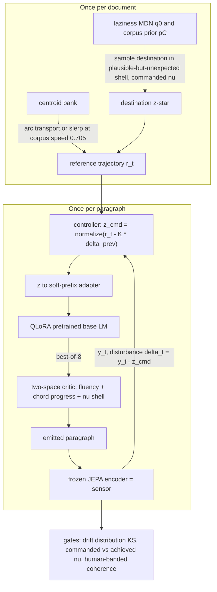

# Lucid Option-A: Novelty Brainstorm + Step-1 Build Spec

Author: Fable 5. Date: 2026-08-08. Repo: `/home/jpearce/Documents/Lucid` (read-only; no source edited).
Basis: the 2026-08-08 architectural reassessment (`.hermes/plans/2026-08-08_100000-fable5-reassessment.md`), the METRONOME invention deliverable (`.hermes/plans/2026-08-08_090000-fable5-invention-metronome.md`), and repo artifacts. Every number quoted below is a measured in-repo number; every prior-art claim is flagged as (a) external literature, (b) in-house prior invention (METRONOME/reassessment — we cannot re-claim our own prior plans as new novelty), or (c) genuinely new in this document.

---

## 0. The honesty contract and the identity test

The risk named in the task is real: "QLoRA a Qwen with a soft prefix trained to reconstruct paragraphs from their own embeddings" is LD4LG/PLANNER/ICAE-class prior art with a different encoder. If that is all we build, the JEPA side is decorative and the project has no identity.

**The identity test I will apply to every idea:** *if you deleted the frozen JEPA encoder + MDN + centroid bank and substituted any off-the-shelf sentence encoder, would the claimed contribution survive unchanged?* If yes, the idea is not ours. The way to fail that test (in the good sense) is to make the frozen calibrated space **load-bearing in multiple, mutually-reinforcing roles**: sensor of a control loop, metric of a novelty scale, unit system of the gates, and the bridge of the critic — such that every number in the paper is denominated in it, and the *calibration constants already measured in this repo* (drift band 0.705±0.05, human leash 0.336, exchangeability −0.4865, conditioning 0.4 nats, render wall 0.185–0.221 vs 0.65) are the priors that make the new claims falsifiable.

**In-house prior-art register (things METRONOME/reassessment already invented; adjacent, not claimable as new):**
- Two-sided drift gate (coherence AND progression as matching corpus drift statistics) — METRONOME E2.
- Tilted anchor sampler: p̃(a) ∝ p_doc(a)^α · exp(−γ·kNN-density) — novelty relative to the **corpus** bank — METRONOME TAP.
- Imposed corpus-speed path ("exogenous clock", slerp at s/σ-calibrated speed) — METRONOME B2. **Open-loop.**
- Token-space h-transform leash — METRONOME C1.
- Pooled↔vMF κ_eff conditioning contract (κ≈506 sentence shell, ≈730 pooled G=5) — METRONOME A1.
- "Re-encoding contrastive auxiliary" as a one-line training suggestion — reassessment Part 3, build item 2.

What is genuinely open, and where the new novelty must live: **the loop was never closed** (no feedback anywhere in any Lucid plan or in the external literature at paragraph-latent scale), **novelty was never measured against the generator's own prior** (only against the corpus bank), and **no one has proposed evaluating text steering with control-theoretic instruments** (gain, disturbance rejection, settling). Those three gaps are where this document plants its flags.

---

## 1. Inventory: what we own (assets and measured facts)

Artifacts reused by everything below:
- Frozen encoder: `artifacts/jepa_repair_1m/jepa/joint.pt` (512-d, L2-normalized, mean-pool bottleneck; teacher-forced recon 44% — a *topic* codec, not a content codec).
- MDN / vMF machinery: `artifacts/sentence_pred/mdn.pt`, `vmf.pt`; `MixtureVmfHead`, `sample_vmf` in `experiments/sentence_pred/heads.py`.
- Arc machinery: `anchored_sample` + slerp in `experiments/sentence_pred/coarse_steer.py` (concept-space PASS: 0.876 cos@k8).
- Corpus v2 builder (already written, WikiText-103 with real article/paragraph structure): `experiments/pivot/corpus_v2.py`; shards cached under `data/corpus_v2/`.
- Eval harness + anti-mirage protocol: `experiments/sentence_pred/evalsuite.py` (doc-disjoint splits, shuffled controls, 20-seed confirms).

Measured facts (trusted; each licenses a design decision):

| Fact | Number | Design consequence |
|---|---|---|
| Sentence-scale exchangeability | delta autocorr −0.4865 vs −0.5 bound (n=19,982); ρ≈0.04 | Latents cannot carry order; sentence-scale conditioning is dead. Setpoints only. |
| MDN conditioning decomposition | 50.4 nats mixture, 0.4 nats conditioning | The prior knows *topics*, not *transitions*. Destinations must be sampled, never predicted. |
| Paragraph centroid persistence | Δ+0.131–0.137; consecutive-para cos 0.7037 vs cross-doc 0.5728 | Paragraph scale is the smallest scale where control is possible. |
| Concept-space leash at human level | fed8-vs-anchor 0.355 vs human 0.336 (JEPA space) | The steering signal is already human-grade *in-space*; only rendering loses it. |
| Render wall | scratch writer 0.185–0.221 vs human ceiling 0.65 (MiniLM) | The plant must be a pretrained LM. This is the single hypothesis Step-1 tests. |
| Text novelty already human-median | n_x_fed 0.750 vs human 0.745 | String novelty is free; only *calibrated, commanded* novelty is a contribution. |
| Corpus drift band | consecutive-para re-encoded cos 0.705±0.05; s/σ≈0.265 | Reference-path speed is an identified constant, not a hyperparameter. |
| Hardware | 1×3090, ~10–11 GB usable beside the lemonade daemon; budget ≤60 GPU-h for Steps 1–2 | QLoRA 1–2B scale; probes must be inference-heavy, not training-heavy. |

---

## 2. The brainstorm (six directions, each extended and shot at)

Format per item: Idea → Minimal novel math → Reuse of frozen encoder/MDN/bank → Cheapest probe (P0-style, numeric kill) → Prior art (external / in-house) and what is actually new → Failure probability.

### 2.1 Topic-arc sampling as control, not conditioning (the setpoint/plant/disturbance formulation)

**Idea — extended, and this is the strongest item in the menu.** Make the paragraph loop a literal discrete-time servo:

- **Plant:** the QLoRA'd pretrained LM with a z→soft-prefix adapter. Input: command z_t^cmd ∈ S^511 + token context c_t (previous paragraph). Output: paragraph x_t.
- **Sensor:** the frozen JEPA encoder E. Measurement y_t = E(x_t) ∈ S^511.
- **Reference:** a sampled trajectory {r_t} in centroid space at corpus speed (slerp or transported real arcs; speed fixed by the 0.705±0.05 band). Sampled once; never re-planned mid-paragraph.
- **Disturbance:** δ_t = y_t − z_t^cmd (ambient difference; tangent projection for analysis). This is *measured every paragraph for free* — the re-encode was already in the eval loop; control theory says: if it has structure, exploit it.
- **Law (one scalar to start):** z_t^cmd = Π_S( r_t − K·δ_{t−1} ), K=0 recovers open-loop conditioning (which is exactly METRONOME/TimeControl/LD4LG). A feedforward variant replaces δ_{t−1} with a *learned disturbance field* d̂(r_t, c_t) fit by ridge/kNN on training-time logs.

"Steering while writing" becomes well-posed: never touch the LM mid-paragraph (the exchangeability result says intra-paragraph latent intervention has no substrate); correct *between* paragraphs, at the timescale where the latent demonstrably carries signal.

**Minimal novel math.** Two identified objects and one improvement condition:
- **Plant gain** G(z, v) = ∂⟨y, v⟩/∂ε for perturbed commands Π(z+εv): the first-order steerability of a pretrained LM measured in an *external frozen* semantic space. G≈0 ⇒ prefix ignored; the G1 gate (§5) is a gain-existence test.
- **Disturbance structure:** for small K, the closed-loop tracking-error change obeys Δē ≈ −2K·G·Corr(δ_t, δ_{t+1}) + O(K²). Feedback helps *iff the disturbance is temporally or state-predictable*. So the novelty claim reduces to one falsifiable empirical question nobody has asked: **is a pretrained LM's topic-rendering error autocorrelated / state-dependent when measured in a frozen latent space?** (Hypothesis: yes — it is the pull toward the LM's own preferred regions; see §3.)
- **Control-theoretic eval suite for text:** tracking error e_t = 1−cos(y_t, r_t); disturbance rejection DR = 1 − ē_closed/ē_open; settling time after a corpus-typical setpoint step (topic jump at cross-doc angle, cos≈0.57); gain map G over the bank. No text-generation paper reports these quantities.

**Reuse.** Encoder = sensor (frozen; this is what makes the units stable — the sensor cannot co-adapt to flatter the controller). Bank = source of reference paths and the support of the gain/disturbance maps. `anchored_sample`/slerp = reference generator. MDN = destination proposal density.

**Probe (P-N1; 1–2 days, inference-only once the Step-1 adapter exists).** 300 held-out 3-paragraph episodes; references at corpus speed. Measure: (a) disturbance autocorr ρ_δ and state-regression R² of d̂ on ~2k logged (z_cmd, c, y) triples; (b) grid K ∈ {0, .25, .5, .75, 1.0, 1.25} → DR; fluency guard (judge delta ≥ −0.05). **Kill:** ρ_δ < 0.1 AND R² < 0.05 AND best-K DR < 5% ⇒ the disturbance is white; feedback is dead; N1 demotes to "control-metrics evaluation" (still novel as measurement, no longer a mechanism). **Pass:** DR ≥ 15% with fluency flat.

**Prior art, honestly.** External: TimeControl (arXiv 2203.11370) imposes Brownian-bridge latent dynamics — *open-loop*, retrained encoder, GPT-2 scale. FUDGE/PPLM/GeDi: token-level attribute guidance, no latent state, no feedback across units. LD4LG / PLANNER / Optimus: one-shot latent conditioning, no re-encode loop. "What's the Magic Word?" (Bhargava et al., control theory of *prompting*, arXiv 2310.04444 — verify ID) studies token-level reachability, not paragraph-latent tracking with a learned corrector. Self-Refine/Reflexion: feedback via natural-language critique, no metric space, no identified plant. In-house: METRONOME B2 imposed the path (open-loop) on the scratch writer. **Actually new:** closing the loop over paragraph latents with a frozen external sensor; the disturbance field as an identified, mapped object; DR/gain/settling as text-steering metrics. I am not aware of any published closed-loop latent servo for text generation with measured disturbance rejection.

**Failure probability.** ~40% that feedback adds nothing (white disturbance); ~15% residual that even the feedforward field is unlearnable; the measurement contribution (gain map, disturbance atlas, control metrics) survives all outcomes ⇒ ~10% total loss.

### 2.2 Novelty as a calibrated prior over destinations, relative to the LM's own laziness

**Idea — extended, with one crucial sharpening.** METRONOME's TAP already does novelty vs the *corpus bank*. The new object is novelty vs **the generator's own conditional prior**: given context c, roll the base LM forward freely, push the paragraphs through the frozen encoder, and fit the *laziness density* q̂_0(z|c) with the existing MDN machinery. Then:

- **Counterfactual novelty:** ν(z|c) = −log q̂_0(z|c), in nats — the same currency as the repo's 50.4/0.4 decomposition.
- **Interestingness (the two-density acceptance region):** sample destinations with log p̂_corpus(z) ≥ τ (plausible: on the human topic manifold) AND ν(z|c) ∈ [ν*, ν*+δ] (unexpected: not where this LM would drift by itself). This makes Boden's "novel and valuable" a computable region defined by two densities *in one frozen space* — corpus density from the bank, generator density from rollouts, measured with the same ruler.
- **The commanded-vs-achieved curve (the headline claim):** command ν*, generate, re-encode, measure achieved ν̂ = ν(E(x̂)|c). Report slope β and RMSE. "You can order 12 nats of novelty and receive 12±3" is a *pre-registered, post-verified* steerability-of-novelty claim that no prior work makes — novelty stops being a post-hoc score and becomes a control variable (which also makes item 2 the natural companion of item 1: same loop, second controlled quantity).

**Minimal novel math.** ν(z|c) = −log q̂_0(z|c) with q̂_0 an MDN over E-pushforwards of p_0(x|c) rollouts; acceptance region A(ν*,δ) = {z : log p̂_C(z) ≥ τ_C, ν(z|c) ∈ [ν*, ν*+δ]}; calibration statistic (β, RMSE) of achieved-on-commanded. Note the log-ratio log p̂_C(z) − log q̂_0(z|c) is structurally a contrastive-decoding tilt — but in paragraph-topic space, *before* generation, with post-hoc verification; adjacency stated plainly in prior-art below.

**Reuse.** MDN code verbatim (`MixtureVmfHead`) — only the fitting target changes (base-LM rollout encodings instead of corpus sentence vectors); bank = p̂_C; encoder = the shared metric that makes the two densities commensurable.

**Probe (P-N2; 1–2 days).** Fit q̂_0 on 2k held-out contexts × 8 rollouts (≈3M generated tokens; hours on the 3090) + encode. Three numeric preconditions, each a kill: (i) **spread** — median pairwise cos of a context's rollout encodings < 0.90 (else the laziness density is a point mass and "far from lazy" degenerates to plain "far"); (ii) **validity** — human continuations score higher ν than LM rollouts with Cohen's d ≥ 0.5 (the scale must detect the one novelty gap we know exists); (iii) **non-redundancy** — Spearman corr between ν and kNN-bank-distance ≤ 0.90 (else it is TAP re-badged; claim dies, TAP survives). Only if all pass: measure β over a ≥10-nat commanded range (Step-2); pass β ≥ 0.5.

**Prior art, honestly.** External: Schmidhuber curiosity / Itti-Baldi surprise (novelty = improbability under the system's own predictive model — the *concept* is 20+ years old); contrastive decoding / DExperts (expert-vs-amateur log-ratios, token-level, decode-time); QD/novelty search (archive distance, not generator-conditional); NoveltyBench/Creativity-Index (measure only). In-house: TAP (corpus-density tilt). **Actually new:** (i) the generator-conditional density estimated in an external frozen space shared with the corpus density; (ii) commanded-vs-achieved calibration of novelty as a system property; (iii) novelty and coherence controlled by the *same* loop in the *same* units. The concept is old; the instrument and the closed-loop verification are new — that is the honest sentence for the paper.

**Failure probability.** ~35% (dominant risks: rollout spread too tight at sane temperatures; redundancy with bank distance).

### 2.3 The re-encode loop as the coherence teacher (renderability + controllability objective)

**Idea — extended, but with the honest decomposition up front.** Training p(x|z) by MLE on (E(x), x) pairs *is* the LD4LG/PLANNER/ICAE recipe — that part is prior art and is also simply how Step-1 must start (it is the only differentiable path; re-encode losses do not backprop through sampled tokens). The defensible novelty is narrower and sharper than "renderability + contrastive":

1. **Proper probabilistic form.** Emission model y|z ~ vMF(y; z, κ̂) on S^511 with κ̂ estimated on held-out generations. Renderability = the conditional log-likelihood E[κ̂⟨y,z⟩ + log C_d(κ̂)] — reported in nats, not cosine. Controllability = the mutual information I(z; y), lower-bounded by InfoNCE (Î ≥ log N − L_NCE) and, equivalently, measured as **channel capacity of the z→prefix→LM→text→re-encode channel**: Ĉ = Ê[log q̂(y|z) − log q̂(y)] with q̂(y) the bank mixture — computable with the existing MDN estimator code. This gives the paper its cleanest single number: *the legacy architecture's conditional channel carried 0.4 nats; the pivot's channel carries Ĉ nats.* Same estimator, same space, same units, before/after.
2. **Anti-collapse by frozen sensor.** This is InfoGAN's MI term with the recognition network Q replaced by a *frozen, externally calibrated* encoder. In InfoGAN, Q co-adapts and the units mean nothing outside the model; here the sensor cannot move, so "1 unit of z" has a fixed meaning against human calibration points (0.336 leash, 0.65 ceiling, 0.705 drift). Frozenness is not a limitation; it is the calibration guarantee.
3. **Training story (three stages, only the first is Step-1):** Stage A — conditional MLE on (z̃, x) with z̃ ~ vMF(E(x), κ_aug≈700), reusing METRONOME's pooled↔vMF fiber math so the command distribution at train time matches bank/sampled commands at test time (in-house prior art, credited). Stage B — *measure* renderability nats, Ĉ, and 2-AFC identification (no training). Stage C (only if controllability is weak) — best-of-N distillation (RAFT: generate 8, keep argmax re-encode likelihood, CE on winners) or GRPO with reward κ̂⟨y,z⟩ − β_KL·KL(p_θ‖p_0); standard machinery, claimed as engineering.

**Minimal novel math.** The RC objective as measurement: L_render = −log vMF(y; z, κ̂); L_ctrl = InfoNCE over in-batch commands; the identity Ĉ = renderability nats − marginal nats; the claim "renderability and controllability are the two terms of one MI decomposition, estimated against a frozen sensor."

**Reuse.** Encoder = frozen Q; MDN estimator = capacity meter; fiber κ math = command augmentation; bank = negatives for InfoNCE and support of q̂(y).

**Probe.** This item *is* the Step-1 gate G1 (§5) — it needs no separate probe.

**Prior art, honestly.** External: LD4LG, PLANNER, Optimus (latent-conditioned MLE decoding); ICAE/Gisting/500xCompressor (soft-token compression); Vec2Text (arXiv 2310.06816 — embedding inversion; proves the text↔embedding channel is wide at scale, different goal); InfoGAN (MI term); cycle/round-trip consistency (MT, QA). In-house: the reassessment's one-line "re-encoding contrastive auxiliary". **Actually new:** the frozen-sensor calibration argument; renderability/controllability as a proper vMF+MI decomposition with the *before/after capacity comparison against our own measured 0.4-nat baseline*. Modest, honest novelty — this item is the **actuator** that items 1–2 stand on, not a headline.

**Failure probability.** ~30% that G1 fails on the first config (reassessment estimated ~70% pass for the renderability half; the added identification bar is slightly riskier).

### 2.4 The two-sided drift gate as evaluator / curriculum / reward

**Idea — mostly shot down as a training signal; extended as an evaluator and as the calibrator of the reference generator.** The gate itself (re-encoded consecutive-paragraph cos ∈ 0.705±0.05, two-sided: "too high = frozen, too low = chaos") is in-house prior art (METRONOME E2). New uses considered:

- **As LM reward — shoot down.** A second-order statistic is a textbook Goodhart target: the LM can hit the cosine band with formulaic pivots ("Meanwhile, elsewhere…") that satisfy drift while carrying zero narrative progression. It is necessary-not-sufficient, gradient-free (needs RL), and high-variance at our budget. Verdict: do not train the LM on it. (~65% failure as a reward.)
- **As reference-generator calibrator — adopt (small, real).** The one scalar the drift band should tune is the *path speed* of the reference trajectory (closed-loop: adjust slerp step until achieved drift matches the band). This was already METRONOME's plan; under N1 it becomes principled: the band calibrates the *setpoint schedule*, the servo handles the tracking. No new claim.
- **As a distributional gate — extend (new, cheap).** Upgrade the mean-band to distribution matching: W₂ or KS distance between the generated per-doc drift distribution and the corpus drift distribution. This detects "right mean, wrong shape" (e.g., alternating freeze/jump that averages 0.705). A one-line addition to eval v3 with real detection power. Also use it for **operating-point selection** (choose K, temperature, ν* where the drift distribution is most corpus-like) — selection, not training, so Goodhart pressure is bounded by the 20-seed confirm protocol.

**Minimal math.** Gate: KS(F̂_gen, F̂_corpus) ≤ ks* (ks* set from human bootstrap); selection: argmin over operating grid of the same statistic.

**Reuse.** Encoder (drift is measured in re-encode space); corpus v2 pairs table (the drift distribution is a Phase-0 deliverable).

**Probe (half day, pure measurement).** Separation power: per-doc drift statistics for (i) human corpus-v2 docs, (ii) base-LM freewheel continuations, (iii) shuffled human paragraph orders. **Kill (as evaluator):** AUC(human vs freewheel) < 0.7 ⇒ the statistic cannot detect "coherent but going nowhere" in the pivot backbone and the gate is decorative. Expect: freewheel sits *above* the band (over-cohere) — worth knowing either way.

**Prior art.** External: MAUVE (global distributional closeness of text embeddings — not the sequential drift statistic); GAIL-style moment matching (RL imitation). In-house: E2. **Actually new:** only the distributional (shape-level) version and its use for operating-point selection. Small.

**Failure probability.** ~20% as evaluator; ~65% as LM reward (recommended against).

### 2.5 A critic that lives in both spaces (token fluency × JEPA arc adherence)

**Idea — adopt as mechanism, demote as claim, and make "two spaces" an empirical question.** Best-of-8 reranking with S = w₁·(length-normalized LM log-prob or judge) + w₂·(arc adherence) + w₃·(novelty-shell membership from §2.2). Arc adherence gets a specific geometry: project y onto the chord/geodesic from r_t to r_{t+1}; score progress-along-chord against the corpus-speed schedule (two-sided: lag and overshoot both penalized — §2.4's logic at candidate level) plus lateral deviation. The genuinely honest move: **test whether the second space is load-bearing** — measure the rank-correlation ρ between the token-space score and the JEPA-space score across candidates. If ρ > 0.9 the JEPA leg is redundant and we say so (and that finding itself feeds the Track-A analysis: "fluency already implies on-arc-ness at this scale" would be a real result).

**Minimal math.** progress p = ⟨y − r_t, u⟩/‖r_{t+1} − r_t‖ with u the unit chord; adherence = −(p − p*)² /2σ_p² − ‖y_⊥‖²/2σ_⊥², parameters σ from corpus statistics (again: calibrated, not tuned).

**Reuse.** Encoder (scoring), bank (σ calibration), MDN/ν (novelty leg), existing evalsuite plumbing.

**Probe (1 day, after G1).** 100 episodes × 8 candidates: (a) ρ(token-score, JEPA-score) — **kill the "two-space" claim if ρ > 0.9**; (b) two-space top-1 vs fluency-only top-1: arc error must improve ≥20% relative with judge delta ≥ −0.05.

**Prior art.** External: reranking with embedding+fluency is standard (dialogue rerankers, energy reranking); FUDGE is the per-token version. In-house: C1 h-transform leash (per-token, cap-based). **Actually new:** only the corpus-calibrated chord-progress geometry and the explicit redundancy test. This is a component, not a contribution.

**Failure probability.** ~45% that the JEPA leg adds little beyond fluency + prompt at paragraph granularity.

### 2.6 Structural inventions that make the JEPA side load-bearing

Three sub-ideas; two adopted, one killed by our own measurements.

**(a) "Tracking, not conditioning" — adopt; it is the umbrella that merges §2.1/§2.4/§2.5 into one mechanism.** Reference trajectory sampled once (destination from §2.2's acceptance region; speed from the drift band; shape from (c) below), LM tracks with bounded error, servo corrects between paragraphs, critic selects among candidates by arc adherence. Everything is denominated in the frozen space. This is the system-level object; its novelty is carried by N1/N2 below.

**(b) Multi-scale (doc theme → paragraph topics → sentence soft-prefixes) — kill the sentence level with our own numbers; defer the doc level.** Sentence-scale prefixes would re-import the provably-dead substrate (delta autocorr −0.4865: there is nothing sentence-scale for a prefix to carry beyond the paragraph topic it already has). Doc→paragraph conditioning through the *current* MDN is empirically empty — the 0.4-nat decomposition is precisely the measurement that the mixture's conditioning channel carries nothing. A doc-theme-conditioned paragraph prior may become real on corpus v2 (real articles have themes; the old corpus had none by construction), but it must pass the reassessment's own gate (≥5 nats vs the unconditional K=8 mixture) before it earns a place. Do not build it in Step-1; do not claim it as novelty.

**(c) Arc-retrieval / arc-transport — new, cheap, worth one probe.** Instead of synthetic slerp paths, retrieve *real* documents' centroid trajectories from the bank and parallel-transport them to a novel start/destination pair (rotate the whole path by the rotation taking old start→new start on the sphere): "ride a real document's drift signature through a novel region." Analogy: motion retargeting in graphics/robotics, transplanted to text latents — I am not aware of a text-generation instance. Probe (half day, inference-only, rides P-N1): transported-real-arc vs slerp references at matched speed; pass if drift-distribution KS (§2.4) improves and judge is flat. Failure ~35% (slerp may be just as good — paragraph topics may not have reusable "shapes" beyond speed; that null is fine and cheap).

**(d) The steerability atlas — new, free, and the Track-A bridge.** From Stage-A logs alone: the **gain map** G(z) and **disturbance field** d̂(z) of a pretrained LM over the topic manifold, measured in an external frozen space — "where does this LM steer easily, where does it refuse, where does it drift." I am not aware of any vector-field atlas of a pretrained LM's topic attractors in the literature. Cost: zero beyond logging. This is analysis-paper material regardless of every other outcome.

**Failure probability.** (a) carried by N1; (b) killed/deferred by design; (c) ~35%; (d) ~10% (it is a measurement; risk is only that the maps are boring — flat gain, isotropic disturbance — which would itself be a finding).

---

## 3. The unification that makes it OUR method (one object, two claims)

Hypothesis, testable in P-N1×P-N2 jointly: **the servo's disturbance field is the gradient of the laziness density** — the systematic pull δ(z,c) = E[y − z | z_cmd=z, c] points toward regions where q̂_0(·|c) is high:

    cos( δ(z,c), ∇_z log q̂_0(z|c) ) > 0   (tested by rank correlation over the bank grid)

If confirmed: one measured object (the laziness field) simultaneously (i) explains what the controller must cancel (N1's feedforward d̂ *is* λ∇log q̂_0), (ii) defines the novelty scale (N2's ν is its potential), and (iii) is itself the steerability atlas (§2.6d). The frozen JEPA space is then load-bearing in four roles — sensor, novelty metric, gate units, critic bridge — and the identity test of §0 is passed: substitute a different encoder and every calibration constant (0.705, 0.336, 0.65, 0.4 nats) that gives the numbers meaning is gone. If refuted (δ uncorrelated with ∇log q̂_0): N1 and N2 stand independently; we lose the unification sentence, not the contributions.

---

## 4. The picks

**N1 — Paragraph-scale closed-loop latent control ("tracking, not conditioning").** §2.1 + §2.6a/c/d. The LM is the plant, the sampled arc is the reference, the frozen JEPA encoder is the sensor, a one-scalar (then learned-field) corrector closes the loop, and the deliverable is the first control-theoretic characterization of text steering: plant gain, disturbance field, disturbance rejection, settling time. Defensible because every named neighbor is open-loop: LCM (forward prediction — a substrate our own measurements prove empty at sentence scale), LD4LG/PLANNER (one-shot conditioning), TimeControl (imposed bridge, retrained encoder, no feedback, no calibrated sensor), FUDGE (token-level, no latent state), METRONOME (in-house, open-loop, scratch plant). The claim survives even the feedback-kill branch as a measurement contribution (gain map + disturbance atlas).

**N2 — Calibrated counterfactual novelty (commanded-vs-achieved).** §2.2. Novelty measured against the generator's own conditional pushforward in the same frozen space as the corpus density; destinations sampled from the plausible-but-unexpected region; novelty *commanded before generation and verified after in the same nats*. Defensible because all published novelty work either measures post-hoc (RAVEN, NoveltyBench, Creativity Index), tilts token logits at decode time (contrastive decoding), or measures distance to an archive (QD, in-house TAP); none pre-registers a novelty magnitude and closes the loop on it.

**Supporting component (claimed as method, not headline): the RC objective/measurement** (§2.3) — vMF renderability likelihood + InfoNCE controllability with a frozen sensor, reported as channel capacity in nats against the repo's own 0.4-nat legacy baseline. It is the actuator N1/N2 require.

Why exactly these two: they are the only items in the menu that (i) fail the "delete-the-JEPA-side" test in the right direction, (ii) have kill-probes that cost 1–2 inference-days each, (iii) produce publishable numbers on *both* pass and fail branches, and (iv) are licensed by measured facts rather than hope (the leash is already human-level in-space at 0.355 vs 0.336 — the signal to control exists; the 0.4-nat result says destinations must be sampled — so novelty must be a sampling property; the render wall says the plant must be pretrained — so the plant is not ours and *characterizing* it becomes the contribution).

---

## 5. Step-1 build spec (concrete, gated, ≤2 weeks, ≤40 GPU-h)

Step-1 = corpus v2 + QLoRA actuator + RC objective + one kill gate (G1). P-N1/P-N2 are pre-registered as the immediate post-gate probes that carry the novelty claims (they are inference-only and cheap). Nothing below edits existing source; all new code lands under `experiments/pivot/`.

### Phase 0 — Corpus v2 + banks (1–2 days, mostly CPU + ~1 GPU-h)
- Run the existing builder `experiments/pivot/corpus_v2.py` (WikiText-103-raw, real articles, `===DOC===` + paragraph structure; min_paras=4, max_docs=200k) → `data/corpus_v2.txt` + meta. Doc-disjoint splits by article (98/1/1).
- New: `experiments/pivot/encode_bank.py` — one encoder pass over all paragraphs → `artifacts/corpus_v2/zbank.npz` (float16: paragraph z, doc_id, para_idx, token_len) + consecutive-pair table with cos → the corpus drift distribution F̂_corpus (recompute the band on v2; expect ≈0.705±0.05, but v2's own number becomes the gate).
- Recompute human reference bands on v2 with bootstrap CIs (retain@k8, drift, MiniLM renderability ceiling) — eval v3 prerequisite, per the reassessment.

### Phase A — Actuator: QLoRA + z→soft-prefix, Stage-A MLE (3–4 days incl. one restart, ~20–30 GPU-h)
- Backbone: **Qwen3-1.7B-Base**, 4-bit NF4 (fits in the ~10–11 GB usable envelope with headroom). Fallback: OLMo-2-1B if the verifiable-novelty angle (infini-gram on open training data) is promoted later.
- Adapter: z (512) → LayerNorm → 2-layer MLP → K=16 soft prefix tokens × d_model (2048); ~17M trainable params. LoRA r=16, α=32 on attention + MLP projections. lr: adapter 1e-3, LoRA 1e-4; effective batch 64 (grad-accum), ctx ≤ 512 (prev paragraph + target ≤ 256 tokens).
- Objective (RC Stage A): CE of target paragraph given [soft-prefix(z̃); previous paragraph]; z̃ ~ vMF(E(x_target), κ_aug≈700) (fiber contract); 10% prefix-drop (CFG dial). ≥2 full epochs over ≥150k paragraphs (the anti-starvation rule; phase-3's 35%-of-one-epoch mistake is the named failure this corrects).
- Logging for the atlas (free): every eval interval, generate 64 paragraphs from held-out bank z, re-encode, store (z_cmd, c, y) → feeds G1 curves, gain map, disturbance field, d̂ regression.

### G1 — the single Step-1 kill gate (half day; pre-registered numbers)
On 500 held-out bank z (not self-encodings), one paragraph each, temperature/min-p fixed in advance:
- **Renderability (the pivot's core hypothesis):** median MiniLM writer-fidelity ≥ **0.40** (scratch status quo 0.185–0.221; human ceiling 0.65) AND JEPA `fed_vs_concept` cos(E(x̂), z_cmd) ≥ **0.55**. (Identical to the reassessment's pre-registered gate.)
- **Controllability (new, from the RC measurement):** 2-AFC z-identification ≥ **85%** at bank-typical pair separation (cos(z_a,z_b) ≈ cross-doc 0.57); channel capacity Ĉ ≥ **3 nats** (vs 0.4-nat legacy), estimated with the MDN machinery.
- **Fluency guard:** blind pairwise judge vs unconditioned same-backbone sampling ≥ **45%** win-rate (steering must not cost fluency at this stage; beating it comes later).
- **KILL:** if after one corrective iteration (K=32 prefix, LoRA r=32, +1 epoch) renderability < 0.30 MiniLM or 2-AFC < 70% ⇒ stop all concept-conditioned generation permanently; ship Track A + the atlas. (Matches the reassessment's hard stop; total exposure bounded.)

### Post-gate probes (pre-registered; run only on G1 PASS; ~3–4 days, inference-dominated)
- **P-N1 (servo):** as §2.1. Deliverables: ρ_δ, d̂-field R², DR(K) curve, settling after setpoint step, gain map. PASS DR ≥ 15%; KILL numbers as specced. Include §2.6c arc-transport vs slerp as a rider.
- **P-N2 (laziness):** as §2.2. Deliverables: spread/validity/non-redundancy triplet, then commanded-vs-achieved (β, RMSE) over ≥10 commanded nats. KILL numbers as specced.
- **Unification check (§3):** rank-corr of δ against ∇log q̂_0 over the logged grid — one afternoon, pure analysis.
- **Redundancy check (§2.5):** ρ(token-score, JEPA-score) on best-of-8 — decides whether the two-space critic is claimed or dropped.

### Stop conditions and budget
- G1 kill ⇒ Track A only (bounded ~2 weeks total, as pre-registered in the reassessment).
- P-N1 and P-N2 both kill ⇒ the system paper reduces to "calibrated open-loop steering + atlas" — publishable but minor; decide then whether Step-2 (multi-paragraph system + human-banded frontier) is funded.
- Absolute: ≤60 GPU-h and ≤2 weeks wall-clock for Step-1 + probes combined; no extensions on small-n promise (the 8-seed→20-seed lesson stands).

### New files (all under `experiments/pivot/`; nothing existing is modified)
`encode_bank.py` (Phase 0), `adapter.py` + `train_stage_a.py` (Phase A; GpuGate-wrapped), `gate_g1.py`, `probe_servo.py` (P-N1), `probe_laziness.py` (P-N2), `atlas.py` (gain/disturbance maps), configs under `configs/pivot_step1.json`. Tests for the pure-math pieces (controller update, chord projection, ν estimator) under `tests/`.

---

## 6. Track-A analysis-paper angle (what makes the novelties credible)

Working title: **"Sentence embeddings are setpoints, not dynamics: an anatomy, and a closed-loop consequence."** The already-measured findings are not just background — each one is the *license* for a specific novelty claim:

1. **Exchangeability at the bound** (delta autocorr −0.4865 vs −0.5; order ≈ 3–4% of residual variance) ⇒ latent intervention *within* a paragraph has no substrate ⇒ the controller must act at paragraph boundaries — N1's timescale is forced, not chosen. This is also the direct empirical refutation of the LCM-style premise, quantified three independent ways (adjacency, delta bound, prediction≤identity).
2. **The 50.4/0.4-nat decomposition** ⇒ the prior knows topics, not transitions ⇒ destinations must be *sampled* (novelty is a sampling property, N2), never predicted; and the 0.4-nat figure is the before-number for the RC channel-capacity comparison.
3. **The render wall with the in-space leash at human level** (0.185–0.221 vs 0.65 ceiling; leash 0.355 vs human 0.336) ⇒ the steering signal exists and rendering was the only broken link ⇒ a pretrained plant is the fix, and *characterizing that plant in our frozen space* (gain map, laziness field) is the natural contribution — the atlas is Track-A material even if Track-B dies.
4. **The corpus drift band** (0.705±0.05; s/σ≈0.265) ⇒ reference-path speed is an identified constant ⇒ the servo's reference generator has zero free parameters to tune, which is what makes DR and the commanded-vs-achieved curve honest (nothing was fit to flatter them).

Cheap generality add-on (reassessment already specced it): replicate diagnostics 1–2 on SONAR/GTR/E5/MiniLM (encode-only, 1–2 GPU-days) so the negative half generalizes beyond the in-house encoder. The constructive half (N1/N2 numbers from Step-1 probes) then upgrades the paper from "why it cannot work" to "why it cannot work, and what the latent is actually for" — setpoints, measured with control instruments.

---

## 7. Risk register (honest summary)

| Item | Claim at stake | Kill probe cost | P(fail) |
|---|---|---|---|
| G1 actuator (RC Stage A) | pretrained plant fixes the render wall | in Step-1 | ~30% |
| P-N1 feedback | disturbance exploitable; DR ≥ 15% | 1–2 days inference | ~40% (mechanism) / ~10% (incl. measurement fallback) |
| P-N2 laziness scale | spread + validity + non-redundancy; β ≥ 0.5 | 1–2 days inference | ~35% |
| Unification (§3) | disturbance = ∇ laziness | free analysis | ~50% (loses elegance, not contributions) |
| Two-space critic | JEPA leg non-redundant (ρ ≤ 0.9) | 1 day | ~45% |
| Drift gate as LM reward | — | — | ~65% ⇒ rejected in advance |
| Sentence-scale prefixes / MDN doc-conditioning | — | — | killed by our own −0.4865 / 0.4-nat numbers |
| Arc transport beats slerp | real arcs carry reusable shape | half day (rider) | ~35% |
| Track A completable | — | ~2–3 GPU-days | ~15% |

Compound honest estimate: probability that at least one of N1/N2 lands as a defensible headline novelty with numbers, conditional on G1 passing: **~70%**. Unconditional (including the ~30% G1 risk): **~50%** — consistent with the reassessment's 50–55% full-system estimate, now with the difference that *every* failure branch still yields publishable measurement (the atlas, the capacity comparison, the drift-distribution gate, the Track-A anatomy).

The one-sentence identity, for the paper and for ourselves: **the LM writes; the frozen JEPA space is where the destination is sampled, the novelty is priced, the error is sensed, and the correction is computed — and every one of those four verbs comes with a pre-registered number.**

DELIVERABLE ENDS.
