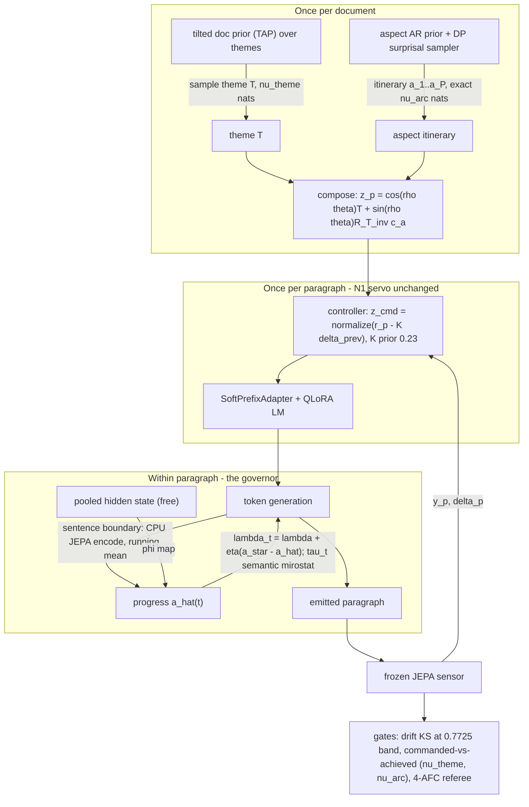

# Lucid Pivot — Last-Day Architecture Brainstorm: Beyond N1/N2/RC

Author: Fable 5. Date: 2026-08-09. Mode: plan-only; no source edited.
Grounding: `.hermes/plans/2026-08-08_110000-fable5-novelty-pivot.md` (N1 servo, N2 counterfactual novelty, RC objective), `.hermes/plans/2026-08-08_120000-fable5-rl-stage-b.md` (hybrid reward, GRPO), `.hermes/plans/2026-08-08_100000-fable5-reassessment.md`, `.hermes/plans/2026-08-08_090000-fable5-invention-metronome.md`, plus live repo artifacts read this session: `experiments/pivot/{adapter,train_stage_a,encode_bank,corpus_v2}.py`, `experiments/sentence_pred/heads.py`, `artifacts/corpus_v2/{zbank_meta.json,stats.json}`, `artifacts/pivot_stageA/train*.log`.

Honesty contract: same as the pivot plan. Every idea below is tagged with prior-art adjacency (external / in-house / new), a numeric kill probe, and a failure probability. In-house inventions (METRONOME TAP, the announced-rate dial A1, the drift gate E2, the h-transform leash C1, arc transport, the N1/N2/RC stack) are prior art here and are not re-claimed.

---

## 0. Repo-verified corrections and live facts (these constrain everything below)

1. **Corpus-v2's own drift constant is 0.7725 ± 0.146, not 0.705.** `artifacts/corpus_v2/zbank_meta.json`: 27,099 docs, 262,414 paragraphs, 235,315 consecutive pairs, drift_mean 0.7725, drift_std 0.1459 — *outside* the legacy band [0.655, 0.755] that the file still carries as `drift_band_expected`. Wiki articles are more topically persistent than the legacy mixed corpus. Every speed calibration (reference-path step, drift gate, foreshadow blend) must use v2's own constant; anything still wired to 0.705 is mis-calibrated by ~0.07 cos.
2. **The +0.118 order signal is MiniLM-space, sentence-scale** (`artifacts/corpus_v2/stats.json`: consecutive 0.3667 vs within-doc-shuffled 0.2486). It proves the *text substrate* now carries order. It does not show that JEPA space sees it (JEPA order-blindness is objective-structural and presumed to persist), and paragraph-scale *order* (as opposed to persistence, Δ+0.137) has never been tested in any space. Two probes below (§1, §5) test it for the first time.
3. **The actuator's command tolerance is already ≈0.70 cos wide.** Stage-A trains on z̃ ~ vMF(z, κ=700) (`fiber_corrupt`, `configs/pivot_step1.json`). By the Banerjee inversion κ ≈ R̄(d−R̄²)/(1−R̄²) with d=512, κ=700 gives mean resultant R̄ ≈ 0.70: the actuator is being trained to treat *any command within ~0.70 cos of a real fiber center* as in-distribution. Consequence used repeatedly below: any inference-time command scheme whose quantization/composition error stays inside that radius is a **zero-retraining bolt-on**.
4. **The prefix channel is live and wide, today.** `train2.log`/`train3.log`: conditional CE ≈ 2.40 vs `baseline_uncond_ce` 2.9056 at epoch 1 — ≈0.5 nats/token of realized conditioning, ×~150–250 target tokens ≈ **75–125 nats/paragraph**, vs the legacy MDN's 0.4 nats/paragraph. The RC capacity comparison is already winning by ~2.5 orders of magnitude mid-training. (Caveat: train loss, mid-run, grad-sanitizer active; G1 still decides.)
5. **Section headings are stripped from `data/corpus_v2.txt` but recoverable.** `corpus_v2.py` skips `== Section ==` lines when building paragraphs, but the raw parquet shards remain at `data/corpus_v2/wikitext-103-raw-v1/`. A probe-time re-parse can align every bank paragraph to its enclosing section title — **free ground-truth labels** for the aspect-code idea (§5) that no training run has consumed.

---

## 0.5 One free theorem first: the paragraph is the Kalman-optimal control interval

This is new, costs nothing, reframes asks 2 and 6, and belongs in the paper regardless of every other outcome.

Model the identified sentence-scale dynamics exactly as METRONOME measured them: along any tangent direction, topic coordinate x_{t+1} = x_t + w_t with drift step Var(w) = s², sensed per sentence with exchangeable residual noise Var(v) = σ², and s/σ = 0.265 (identified from the −0.4865 delta autocorrelation). The steady-state Kalman filter for this system, with r = s²/σ² = 0.0702:

    q = (r + sqrt(r² + 4r)) / 2 = 0.3024        (prior variance, units of σ²)
    K* = q / (1 + q) = 0.232                     (steady-state Kalman gain)
    τ  = −1 / ln(1 − K*) ≈ 3.8 sentences         (innovation-averaging time constant)

Read it off:

- **The optimal estimator of "where the topic is" averages ≈4 consecutive sentences.** G=5 pooling and paragraph-cadence control are not design taste; they are the optimal-filter consequence of the one identified dynamical constant. Any *sub*-paragraph latent-tracking loop is chasing measurement noise that the optimal filter would discard — a quantitative a-priori kill for "learned continuous z(t) tracking" (§6), sharper than the exchangeability argument alone.
- **N1's corrector gain grid gets a theory prior.** With white measurement noise the optimal between-paragraph gain sits near K* ≈ 0.23–0.30 (higher only if the disturbance is autocorrelated — exactly what P-N1 measures). Pre-register: "we expect best K near 0.25" — a falsifiable prediction from an identified constant, strengthening the servo claim either way.
- **The loophole that survives:** *cumulative* within-paragraph statistics have noise σ/√t, not σ — they dive under the noise floor as the paragraph grows. That loophole is the entire basis of §2.

Prior-art: control-theoretic analyses of LMs exist (prompt reachability, "What's the Magic Word"), but I am not aware of anyone deriving an optimal steering cadence for text from a measured drift-to-noise ratio. Flag for a literature check; claim as new-with-caveat.

---

## 1. Ask 1 — Topic-arc quantization: a VQ codebook over destinations

**Mechanism.** k-means (not learned VQ — nothing to collapse, no codebook loss engineering) over the 262k v2 paragraph centroids → M codes {c_m}. A document becomes a code sequence [q_1 … q_P]; a tiny AR prior p(q_p | q_{<p}) (bigram + smoothed, and a 2-layer transformer, both) is fit on 26.5k train docs. Sampling an arc = sampling a code chain; the LM is commanded per paragraph with the code center (plus fiber noise, see below).

**The critical geometric fact, stated before the sales pitch.** v2 consecutive-paragraph cos is 0.7725. Any codebook coarse enough to be AR-learnable (within-cluster cos ~0.70–0.75) will therefore assign *consecutive paragraphs of the same doc mostly to the same code*: code sequences are runs with occasional jumps, expected 2–4 distinct codes per doc. Two consequences: (a) the AR prior over absolute codes is mostly a self-transition model — the order information, if any, is concentrated in the rare jump transitions; (b) absolute-topic codes are the *wrong resolution* for arcs. The fix is §5's move: quantize *deviations from the document theme*, not absolute positions. I develop the machinery here and hand it to §5, which is where it pays.

**Why it could beat the current pivot (three distinct wins):**

1. **Order gets its honest paragraph-scale test.** The repo proved sentence-scale exchangeability and paragraph-scale *persistence*, but paragraph-scale *order* was never measured ("nothing anywhere shows p+1 vs p−1 decodability" — reassessment 1d). Discrete codes make the test trivial and exact: Δ_order = NLL_AR(shuffled-within-doc code sequences) − NLL_AR(true order), in nats/transition. This is the discrete replication of the delta-autocorr diagnostic one level up, and it is the cheapest possible instrument for it.
2. **Novelty arithmetic becomes exact.** N2's continuous laziness/corpus densities are MDN estimates with known pathologies in this repo (MDN samples eff-rank 456 vs 110 real). Over a codebook, arc surprisal S(q_1..q_P) = Σ −log p(q_p|q_{<p}) is *exact*. Better: **novelty can be commanded exactly, by dynamic programming.** Bucket cumulative surprisal; backward table Z_p(b) = Σ_suffix 1[remaining surprisal ∈ bucket b]; forward-sample conditioned on total S ∈ [S*, S*+δ]. O(P·M·B). "Sample me a 25±2-nat arc" is exact combinatorics, not density estimation. The commanded-vs-achieved curve at arc level (re-encode generated paragraphs → nearest codes → achieved S) has *no density-estimation error term in the command* — a strictly cleaner headline than the continuous β, at the price of quantization error in the verification leg.
3. **Compositional novelty becomes expressible.** A continuous sample is novel only metrically (low-density region). A code arc can be novel *combinatorially*: every code common, the sequence unprecedented. That distinction (rare state vs rare transition) is invisible to kNN-density tilts (TAP) and to ν(z|c) pointwise; the discrete AR factorization exposes it as separate terms.

**Sampling novelty: discrete vs continuous, honestly compared.** Continuous (N2): flexible, resolution-unlimited, but command precision is bounded by q̂_0 estimation error, and "plausible-but-unexpected" needs two fitted densities. Discrete: exact surprisal, exact constrained sampling, trivially auditable (you can print the arc), but resolution capped at the codebook (novelty *within* a cell is invisible) and vulnerable to the house-style failure below. They compose: sample the cell chain discretely (exact arc-level nats), then sample within-cell displacement from the fiber (vMF(c_m, κ≈700)) — which, by fact §0.3, the actuator is *already trained to accept*. **The codebook is an inference-time bolt-on requiring zero actuator retraining.** That is the single strongest engineering property of this idea.

**Failure modes.** (i) Within-doc code degeneracy (runs) — measured by distinct-codes-per-doc; if ≈1–2, absolute-code arcs are trivial (expected; §5 is the repair). (ii) Template collapse: sampling arcs from the AR prior reproduces wiki section grammar → generic "house arcs"; guard = the same tilted/DP-constrained sampling that commands surprisal (novelty command is the anti-template knob). (iii) Quantization erases the in-space human-grade leash (0.355 vs 0.336 was continuous); mitigated by code+fiber composition. (iv) Verification-side quantization noise: achieved-S is biased near cell boundaries; report with the continuous cos as co-measure.

**Probe (P-VQ, 1 day, CPU except one bank pass — the bank already exists).** On `zbank.npz`: k-means M ∈ {256, 1024, 4096}. Measure: (a) distortion curve median cos(z, c(z)) — need ≥ 0.70 at some M ≤ 4096 (else the space is too diffuse to quantize inside the fiber radius; kill); (b) distinct codes/doc distribution; (c) Δ_order nats/transition on held docs, true vs within-doc-shuffled. **Kill: Δ_order < 0.2 nats/transition at every M ⇒ no paragraph-scale order in absolute topic codes** (the arc prior is a bag sampler; the DP novelty machinery survives but order-claims die; §5's deviation codes get one further shot). (d) Bolt-on legibility rider (needs Phase-A checkpoint, free at next eval): command code centers vs raw bank z through the trained adapter; fed_vs_concept delta ≥ −0.02 = code commands are actuator-legal, as predicted by §0.3.

**Reuses.** `zbank.npz` (all fields), `MixtureVmfHead`/`sample_vmf` (within-cell fiber), Stage-A actuator unchanged, TAP tilt logic (as the continuous comparator).

**Prior art.** External: VQ-VAE/discrete latent planning; PQ/RepCONC codebooks over embeddings (retrieval); PLATO's discrete latent dialog acts (nearest neighbor in spirit: small discrete code selecting response intent); text outline planning (Plan-and-Write, Re3, DOC) — discrete plans as *text*; Time Control (continuous imposed dynamics). In-house: TAP (density tilt), arc transport. **Actually new:** codebook resolution set by an *identified* constant (the κ≈700 fiber radius) rather than a hyperparameter; exact DP-commanded arc surprisal with post-hoc re-encode verification in the same frozen space; the paragraph-scale discrete order test. **P(fail):** order test ~40–50% (absolute codes), bolt-on legibility ~15%, DP machinery ~5% (it is arithmetic). Even full mechanism failure yields a publishable number (Δ_order at paragraph scale, the missing cell in the project's order-anatomy table).

---

## 2. Ask 2 — Rate as the control parameter: the within-paragraph progress governor

This is my best new *mechanism* in the document. It survives the §0.5 theorem because it regulates a **scalar cumulative** quantity, not a vector setpoint sequence.

**The object.** Define the **approach curve** of a paragraph: a(t) = cos(Ē(x_{1:t}), z), where Ē(x_{1:t}) is the normalized running mean of the JEPA sentence vectors of the first t sentences and z the full-paragraph centroid (or, at generation time, z_cmd). It is a scalar progress coordinate along "how committed is the text so far to its destination." Its measurement noise shrinks as σ/√t (cumulative statistic) — by §0.5 this is the *only* within-paragraph quantity that clears the noise floor.

**The exchangeable null — the probe has a built-in theory.** If sentence placement within a paragraph is exchangeable (order carries nothing), the approach curve is forced by pooling arithmetic alone. With ρ̄ = mean within-paragraph sentence-pair cos and G sentences:

    a₀(t) = sqrt[ t · (1 + (G−1)ρ̄) / ( G · (1 + (t−1)ρ̄) ) ]

(derivation: E⟨u_t, u_G⟩ = (1+(G−1)ρ̄)/G, E|u_t|² = (1+(t−1)ρ̄)/t for partial means u_t; e.g. ρ̄=0.5, G=5 → a₀ = 0.775, 0.894, 0.949, 0.980, 1). Any *measured* deviation of human curves from a₀ — e.g. sentence 1 systematically closer to the centroid than a₀(1) predicts (the topic-sentence convention) — is order information at a granularity the delta-autocorrelation statistic is blind to (it is stationary; "sentence 1 is special" is positional). On v2, where text-level order provably exists (+0.118 MiniLM), this is the natural place it would surface in JEPA space. Both outcomes are informative; only one licenses the mechanism.

**The mechanism: a token/sentence-scale servo on a(t) — the governor.**

- Target: the human approach curve a*(t) (measured, per corpus, with bootstrap band).
- Sensor: at each generated sentence boundary, JEPA-encode the new sentence on CPU (the codec already runs on CPU inside `train_stage_a.py`; one sentence ≈ ms), update the running mean → â(t) *exactly in command units*. Token-granular upgrade: read the LM's own pooled hidden state (free at decode — §3) through a small calibration map φ fitted on Stage-A eval logs.
- Actuator, two interchangeable implementations, both zero-training:
  1. **Per-token CFG gain.** The 10% prefix-drop in Stage-A makes the unconditional branch available by construction. Guided logits ℓ_t = ℓ_t^∅ + λ_t(ℓ_t^z − ℓ_t^∅). Law: λ_t = clip(λ̄ + η·(a*(t) − â(t)), 0, λ_max), updated at sentence boundaries.
  2. **Prefix-attention bias.** Add a float bias b_t on attention logits toward the K=16 prefix key positions (additive attention mask manipulation; no weight edits): b_t = g·(a*(t) − â(t)). This is the literal "attention-rate control" asked for.
- Novelty coupling ("topic-conditioned temperature", ask 7 merged here): τ_t = τ̄ · exp(−η′(a*(t) − â(t))) — behind schedule ⇒ colder (commit), ahead/saturated ⇒ warmer (spend the slack on exploration). Novelty is bought where tracking is cheap, token by token. This is **semantic mirostat**: mirostat servos token surprisal to a target; this servos *semantic progress* to a corpus-calibrated curve.

**Why it beats the pivot.** The pivot controls only between paragraphs; within a paragraph the command is open-loop and the known failure signature (approach-curve sag: on-topic opening, drift by token 150) has no counter-measure except best-of-8. The governor closes the smallest loop that the measured physics permits, at zero training cost, using instruments (prefix-drop CFG, CPU codec, eval logs) that all already exist. It also *completes the rate ladder*: token (governor) → sentence (s/σ = 0.265, identified) → paragraph (drift 0.7725, v2) → document (§5). Each level's control state matches what the substrate carries: scalar within paragraph, one vector per paragraph, discrete codes per document. That sentence is the system's new identity claim.

**Commitment as a commanded scalar (the trainable extension, honestly demoted).** Append κ_cmd to the adapter input (z, κ_cmd), with training labels *free from the fiber geometry*: each training pair's own achieved cos(E(x_tgt), z̃) quantile. At inference you command looseness ("gesture at z" vs "nail z"). Adjacency: this is METRONOME A1's announced-rate dial (in-house prior art) transplanted to the pretrained actuator — claim as engineering, not novelty. The genuinely new part of ask 2 is the *within-paragraph closed loop with an identified human target curve*, not the per-paragraph scalar.

**Probe (P-RATE, 1–1.5 days).** Stage 1 (CPU, ~half day): approach curves + position-indexed cos(e_i, centroid) profiles on 5k held v2 paragraphs (re-encode sentences; zbank stores only centroids); fit ρ̄; compare to a₀ with bootstrap. **Kill: max_t |a_human(t) − a₀(t)| < 0.03 and sentence-1 effect CI includes 0 ⇒ JEPA sees no within-paragraph order; governor target degenerates to the null curve; mechanism demoted to "sag detector" (still useful for §4's architecture decision).** Stage 2 (inference, ~half day, needs Phase-A checkpoint): A/B constant-λ vs governed-λ on 128 held commands × 4 seeds; pass = fed_vs_concept +0.02 at judge Δ ≥ −0.02, or equal tracking at judge +0.03; measure the sag statistic Δ_late = a(T) − max_t a(t) both arms.

**Reuses.** Prefix-drop CFG (trained in), `JepaCodec` on CPU, `eval_samples_epoch*.jsonl` logs (φ map), Stage-B judge/gate machinery as guards, v2 bands.

**Prior art.** External: CFG for LLMs (Sanchez et al., constant scale); dynamic/scheduled CFG in image diffusion (heuristic schedules); mirostat (scalar servo on perplexity); FUDGE/PPLM (per-token attribute pressure, fixed weight); LLaMA-Adapter's zero-gated prefix attention (static learned gate — mechanically adjacent to implementation 2). In-house: A1 rate dial (per-paragraph scalar). **Actually new:** the approach curve as a measured object with an exchangeable-null; closed-loop per-token gain against a corpus-identified progress target; semantic-mirostat coupling of temperature to semantic slack. I am not aware of any published text system that closes a loop on a semantic progress coordinate during generation. **P(fail):** ~45% at stage 1 (the null is strong — wiki topic sentences may be exactly what pooling predicts); conditional on stage-1 pass, ~55% the governor beats constant-λ ⇒ net mechanism ~30%; the measurement (human approach curves + null) survives all branches and slots into Track A.

---

## 3. Ask 3 — The LM's own hidden states as topic/sensor space

**Verdict up front (opinionated): promote h-space to *second sensor*; do not move the command space this cycle.** The actuator is mid-training on JEPA z; every calibration constant is denominated in JEPA space; swapping command spaces now buys a re-run of Phase-0/Phase-A for an unmeasured gain. But as a *sensor*, h-space is free at decode time (the states are computed anyway), carries order by construction (causal integrals — the exact property JEPA provably lacks), and has no truncation problem (JEPA's max_tokens=128 forced the pooled-sentence workaround in `encode_bank.py`; Qwen reads whole paragraphs natively).

**The circularity worry, resolved precisely.** "Sensor = plant's own representation" sounds co-adaptive, but the channel between plant and sensor is **discrete text**: the only way the policy can move h(x̂) is by changing the words. Gaming h-space reduces to the same attack class as gaming JEPA (produce text whose pooled state sits near the target) — same kind, bounded the same way (saturating reward, surface-stat gates, judge leg). What *does* weaken is the external-calibration argument: JEPA's frozen-ness gives units meaning independent of the generator. Repair: anchor h-space against *human text* (recompute the human bands in h-space — the external meaning comes from the corpus, not the encoder's provenance), and never let h-space be the only arbiter in a reward (JEPA keeps the 0.6 leg; h joins the eval battery first).

**What h-space plausibly buys, mapped to existing components:**

- **N1's disturbance model:** d̂(z, c) currently regresses on JEPA features, which cannot see order or content detail. An h-space state estimator sees both → higher R² on the logged (z_cmd, c, y) triples = directly more disturbance rejection. This is the highest-value, lowest-cost insertion point.
- **The governor's token-granular sensor (§2):** pooled h at every token, φ-calibrated to JEPA progress units — zero-cost intra-sentence readings between the CPU re-encodes.
- **Paragraph-order decodability:** if a logistic probe can read p+1-vs-p−1 from (h_p, h_{p′}) where JEPA cannot, then "self-topic" space carries the one structure the pivot's space lacks — and doc-level direction (§5) gets a second, order-aware representation to plan in.
- **Novelty (N2) in h-space:** q̂_0 fitted on pushforwards of the LM's own rollouts *in its own representation* makes the laziness density and the unification hypothesis (disturbance = ∇ log laziness) more natural — the field lives where the dynamics live.

**Probe (P-SELF, 1 day: ~2 h GPU for encodes, rest CPU).** Encode 20k v2 paragraphs at layers L ∈ {14, 21} of the 4-bit backbone (mean-pool, then center+whiten with bank statistics — the repo's anisotropy discipline; LM states are notoriously anisotropic). Battery, JEPA vs h side by side: (i) consecutive-vs-cross-doc delta (persistence); (ii) **paragraph-order 2-AFC** (logistic probe, doc-disjoint) — JEPA's expected score is chance; (iii) sentence-scale delta autocorr (expect ≫ −0.5 for h — causality check); (iv) disturbance regression R² on Stage-A eval logs (already on disk); (v) partial-prefix progress correlation with JEPA a(t) (the φ map quality). **Decision rule: h wins ≥3 of 5 ⇒ adopt as second sensor (eval battery first, then N1's d̂ and §2's sensor); order-2-AFC ≥ 65% is individually sufficient to fund the §5 order tests in h-space too. Kill: h beats JEPA nowhere ⇒ drop, one paragraph in the paper ("the plant's own pooled states add no measurable structure over the frozen topic codec").**

**Reuses.** Backbone already resident (4-bit), zbank splits, eval logs, whitening/centering utilities, MDN machinery (h-space q̂_0 if promoted).

**Prior art.** External: activation steering / representation engineering (ActAdd, RepE, ITI) — the *write* side of LM states; probing literature — the *read* side; semantic-uncertainty work. **Actually new:** LM-state space as the *measurement* leg of a closed-loop paragraph servo, benchmarked head-to-head against a frozen external codec on an identical control-relevant battery. The space swap is not itself a paper claim; it is a probe-gated engineering upgrade that strengthens N1/N2 if it lands. **P(fail):** ~25% (anisotropy or syntax-domination could wash out topic signal; layer choice matters and two layers are cheap insurance).

---

## 4. Ask 4 — Conditioning architectures: prefix vs deep injection, decided by one measurement

**The enumeration, with verdicts:**

- **Soft prefix, K=16 (current).** Influence enters only through attention to 16 key positions; competes with growing context; expected failure signature = late-paragraph sag. Live evidence says it works at CE level (0.5 nats/token, §0.4). Verdict: keep unless the sag statistic (below) convicts it.
- **Text prefix (keywords from z via nearest-bank TF-IDF — the Stage-B judge's axis-B trick).** Maximally legible, zero params, no gradient path, lossy. Verdict: **mandatory embarrassing baseline.** If keyword prompting matches the 17M adapter on fed_vs_concept, the adapter is decoration and the paper must say so. One eval run; pre-register it.
- **Per-layer KV memory (Gisting/ICAE-class):** z → per-layer K/V slots. True deep injection; influence does not have to survive 28 layers of residual mixing. Cost: new params at every layer, mid-run retrain. Verdict: the *default repair* if sag is convicted.
- **Mid-layer additive steering (ActAdd-style):** h_l += αWz at layer l, no training (W from h-space bank regression, §3). Verdict: second mandatory baseline — zero-training topic steering is the null hypothesis for the whole actuator; measure it once.
- **Cross-attention adapter (Flamingo/LLaMA-Adapter-class):** gated zero-init cross-attn to latent tokens. Clean but heavy next to a 4-bit backbone. Verdict: only if KV memory fails.
- **Conditional-LoRA hypernetwork (the novel deep injector).** Keep the existing LoRA A_l B_l, add z-dependent per-layer, per-module scalar gates: W_l = W_0 + γ_{l,m}(z)·B_l A_l, with γ(·) a small MLP (28 layers × 7 modules ≈ 200 outputs, ~0.1M params). The command then modulates the *adapted weights themselves* at every depth — multiplicative, deep, and initializable at γ ≡ 1 to warm-start from the current checkpoint without forgetting. Adjacency: hypernetworks-for-PEFT / HyperLoRA condition on *task* embeddings; conditioning on a continuous topic vector under a frozen-sensor RC objective, with gain-profile identification (below), is the new use. Verdict: the most parameter-efficient deep repair; try before KV memory.
- **Attention-bias gain (§2's implementation 2).** Not a new channel — a *scheduler* on the existing prefix channel. Zero training. Verdict: adopt inside the governor.

**Which architecture most likely yields clean RC controllability?** Controllability (InfoNCE / 2-AFC) wants z→text injectivity maintained across the whole paragraph. Prefix-only injection has one structural weakness — attention dilution with depth and distance — and it has a *specific, cheap, already-logged signature*: the sag statistic Δ_late = a(T) − max_t a(t) over the approach curves of Stage-A eval generations (`eval_samples_epoch*.jsonl` + CPU re-encode). **Decision rule (pre-registered): median Δ_late < −0.05 with tracking otherwise ≥ G1 floors ⇒ deep injection is licensed; order of attack: conditional-LoRA gates (warm-startable) → per-layer KV → cross-attn. Δ_late ≈ 0 ⇒ prefix is sufficient; spend nothing here.** This converts an architecture debate into one number computable tonight from existing logs.

**Reuses.** Eval logs, adapter/LoRA checkpoints (warm start), `build_inputs_embeds` (extend for KV variant), Stage-B reward as the retrain objective if licensed.

**Prior art.** Prefix/prompt tuning, Gisting/ICAE, LLaMA-Adapter, Flamingo, HyperLoRA/hypernetworks, ActAdd/RepE. **Actually new:** the gain-profile/sag identification protocol in a frozen external space as the *decider* between conditioning architectures; z-conditioned LoRA gating for continuous topic control. **P:** ~50% that sag convicts the prefix (if not, this whole section costs one afternoon); conditional on conviction, ~65% the conditional-LoRA repair clears it (it attacks the named mechanism directly).

---

## 5. Ask 5 — Two-level arc: theme ⊗ transported aspect codes (the second scope, done right)

**Mechanism.** Hierarchical command with the codebook moved to where §1's geometry says it must live — the *tangent space*:

- **Theme (document level, static setpoint):** T = normalized mean of a doc's paragraph centroids. Sampled once per document from the tilted doc prior (TAP, in-house) — *never* dynamic, so no dead-order substrate is re-imported at doc scale.
- **Aspect (paragraph level, discrete):** each paragraph's deviation from its theme, log-mapped and parallel-transported to a common pole: θ_p = arccos⟨z_p, T⟩; u_p = (z_p − cosθ_p·T)/sinθ_p; û_p = R_T u_p, with R_T the rotation taking T → e₁ (closed form in span{T, e₁}). Aspect codebook = k-means over {û_p} (unit vectors in a 511-d tangent sphere), M ≈ 64–256.
- **Command composition (inference-time only):** z(T, a, ρ) = cos(ρθ̄_a)·T + sin(ρθ̄_a)·R_T⁻¹ĉ_a — theme, aspect code, and a radius dial ρ (aspect strength). By §0.3, composition error within the κ≈700 fiber ⇒ **actuator unchanged.**

**The hypothesis that makes this a headline rather than plumbing: aspects transport.** "The history paragraph," "the reception paragraph," "the geography paragraph" may be *the same tangent directions* across themes — a factorized topic manifold: theme (base point) × aspect (transported tangent code). If true:

1. **Document-level direction exists at last:** an arc is (T; a_1…a_P) — a theme plus an itinerary of aspects. The AR prior over aspect sequences is where paragraph-scale order gets its best shot (§1's absolute codes mostly self-transition; deviations resolve within-theme moves, and wiki section conventions — lead → history → … → reception — are exactly aspect order).
2. **Two commanded novelty dials, cleanly decomposed:** ν_theme = −log q̂_doc(T) (continuous, TAP machinery) and ν_arc = exact aspect-sequence surprisal (discrete, §1's DP). **Combinatorial novelty becomes commandable:** a familiar aspect applied to a theme where the corpus never applies it ("the discography structure of a volcano article") — plausible-but-unexpected as a *product structure*, not a density shell. No prior work I know of commands novelty as a factorized (theme, itinerary) pair with exact arithmetic on one factor.
3. **Free ground truth exists (§0.5 fact 5):** re-parse the raw parquet to recover each paragraph's `== Section ==` title; NMI(aspect code, section-title token) validates the codebook against labels no model consumed. A labeled-validation number is rare in this project; take it.

**How this avoids the dead sentence-order problem, explicitly.** Nothing at sentence scale changes. The theme is a static setpoint (no doc-scale dynamics to predict). The only new *sequence* object is the aspect chain at paragraph granularity — precisely the granularity where persistence is proven and order is untested-but-plausible, and it is gated by its own kill probe before anything is built on it. The reassessment's ≥5-nat gate for doc-conditioned paragraph priors applies to p(a_p | T-cluster) vs the unconditional aspect marginal: pre-register it.

**Probe (P-ASPECT, 1–2 days, CPU only — the decisive probe of this document).** From `zbank.npz`: (a) compute T per doc, deviations, transports (numpy, minutes); (b) fit M=64/128/256 aspect codebooks on half the *theme clusters* (k-means 50 clusters over doc centroids), measure held-theme-cluster distortion. **Kill 1 (transport): held/fit distortion ratio > 1.3 ⇒ aspects are theme-specific; the manifold does not factorize; demote to per-theme-cluster codebooks (weaker but usable).** Pass ≤ 1.15. (c) Aspect-order test: Δ_order nats/transition, true vs within-doc-shuffled aspect sequences, bigram and 2-layer AR. **Kill 2: Δ_order < 0.3 nats/transition ⇒ no learnable itinerary grammar; arcs demote to exchangeable aspect *sets* (coverage without order — still commands combinatorial novelty, loses progression claims).** (d) Section-label NMI ≥ 0.25 vs shuffled-label null (sanity, not a gate). (e) Doc-conditioning gate: NLL(a_p | theme-cluster) beats unconditional marginal by ≥ 5 nats/doc (the reassessment's own bar).

**Reuses.** zbank (has doc_id/para_idx — everything needed), doc-centroid MDN/TAP (theme sampling), §1's DP sampler (aspect-level), Stage-A actuator as-is, Stage-B reward unchanged (commands are still unit vectors), raw parquet for labels.

**Prior art.** External: hierarchical latent story generation (plan-and-write; hierarchical VAEs); aspect-based summarization; structural topic models (topics = background + aspect); Householder/transport tricks in geometry-aware embeddings; motion retargeting (the in-house arc-transport analogy, one level down). In-house: TAP, doc-theme deferral in pivot §2.6b (this design answers its gate rather than ignoring it). **Actually new:** parallel-transported *aspect codes* on a frozen calibrated sphere; factorized (theme ⊗ itinerary) commands with exact novelty on the discrete factor; labeled validation via recovered section headings. **P(fail):** transport ~35–40%; aspect-order ~40% (conditional on transport passing, better than §1's absolute-code odds because deviations remove the DC theme component that forces self-transitions); at least one publishable measurement from the probe ~90%.

---

## 6. Ask 6 — Continuous topic dynamics z(t): mostly killed by theory, two survivors

**The kill, sharpened (new math, §0.5).** A learned continuous latent trajectory that the LM tracks sub-paragraph requires a sensor at sub-paragraph cadence; the identified s/σ = 0.265 makes the optimal filter average ≈4 sentences — *any* consistent estimator effectively reconstructs the paragraph cadence the pivot already has. METRONOME's verdict ("a learnable advection field has nothing to learn from") was about the drift field; the Kalman argument closes the remaining loophole (maybe tracking would still help?) quantitatively: below ~4 sentences the innovations are ~95% noise by variance share (ρ ≈ 0.04). Learned continuous z(t): **do not build.** Discrete-per-paragraph setpoints + §2's scalar governor is the complete answer at this substrate.

**Survivor 1 — the governor (§2)** *is* the continuous-time control this ask wants, on the one coordinate whose noise floor admits it. Nothing more to add.

**Survivor 2 — transition foreshadowing (cheap, new, decode-only).** Human paragraphs often pivot in their final sentence toward the next topic. Test: b_fore = E[cos(E(s_last of p), z_{p+1}) − cos(E(s_mid of p), z_{p+1})] over v2 consecutive pairs (CPU, hours; sentence re-encodes of ~10k pairs). If b_fore > 0.02 with bootstrap CI excluding 0: implement command warping in the last quintile of each paragraph, z_cmd(t) = slerp(z_p, z_{p+1}, w(t)), w: 0 → w̄ ≈ 0.3, riding §2's CFG machinery (the blend is just a moving command for the conditional branch). Gate the A/B on the v2 drift-*distribution* KS (the pivot's §2.4 instrument, recalibrated to 0.7725 ± 0.146 per §0.1) plus flat judge. Prior art: prompt/latent interpolation mid-generation exists in image diffusion; imposing a *measured human foreshadow magnitude* on text paragraph transitions appears new (small claim, honestly small). **P(fail): ~50%** (wiki may not foreshadow; narrative corpora likely stronger — a register covariate for later).

**Also explicitly rejected:** neural-ODE/SDE topic flows (nothing identifiable beyond speed — in-house verdict, now Kalman-reinforced); Brownian-bridge retraining of the encoder (Time Control's move; breaks the frozen-sensor calibration that N1/N2 stand on).

---

## 7. Ask 7 — Structurally new objectives and instruments (three adopted, one folded, one noted)

### 7a. The referential-game reward: "write it so the referee can tell which order you were given" (top pick 3)

**Mechanism.** Stage-B's step batch is 4 prompts (distinct z) × k=8 rollouts. Add a matching leg to the reward: for rollout i belonging to prompt j, compute the 4-way identification log-likelihood under the frozen sensor,

    m_i = log [ exp(κ̃·cos(E(x̂_i), z_j)) / Σ_{j′=1..4} exp(κ̃·cos(E(x̂_i), z_{j′})) ]

and blend R = gate·[0.4·f(c_i) + 0.2·m̃_i + 0.4·J_coh] (m̃ = m rescaled to [0,1]; κ̃ set so bank-typical pairs at cos ≈ 0.57 give sensible margins). Sender = LM+adapter, message = paragraph, receiver = frozen JEPA encoder: a Lewis referential game where GRPO's group structure already provides the game rounds. Sample the 4 z per step at matched difficulty (pairwise cos 0.5–0.65, bank-typical) so chance is calibrated.

**Why it beats the current reward.** (i) It optimizes the *claimed metric directly*: G1's controllability gate is 2-AFC identification; f(cos) is only its proxy — a policy can raise cos uniformly without becoming more *discriminable* (e.g. by drifting toward the bank's dense center, where all commands get moderate cosine). The margin term pays only for *separation*. (ii) It attacks the one collapse mode per-group standardization cannot see: a small menu of generic on-manifold paragraphs scores decent f(c) for every command but loses every 4-AFC — the game punishes across-prompt collapse *inside the reward*, complementing the self-BLEU tripwire (which only detects, post hoc). (iii) It is anti-gamed by the same logic as the rest of Stage-B: softmax margins saturate; the judge leg and hard gate stay untouched.

**Probe / kill (free, before adoption).** On Phase-B0's RAFT logs (32k rollouts, already planned): compute rank correlation between m_i and f(c_i) per group. **ρ > 0.95 ⇒ the margin is redundant with raw cosine at current policy quality; defer the leg (re-check after 300 GRPO steps).** ρ ≤ 0.9 ⇒ adopt. Also pre-register: 4-AFC on the probe set must rise ≥ +3 points over B0 for the leg to be credited.

**Reuses.** `reward_stage_b.py` (one new function), rollout logging as specced, MDN negatives unneeded (the batch provides them). **Prior art.** Emergent-communication referential games (Lazaridou et al.); contrastive/retrieval rewards in RL captioning (CLIP-reward — closest external neighbor); InfoNCE-as-reward. **Actually new:** the game round = GRPO group structure; the referee = a frozen self-trained topic codec whose units carry the paper's calibration; identification-margin reward for *paragraph-latent* control. **P(fail): ~30%** (redundancy is the realistic risk; the probe is free).

### 7b. The guidance–novelty equation of state (measurement, essentially free)

With prefix-drop CFG, sampling at scale λ draws from p_λ(x) ∝ p(x|z)^λ · p(x|∅)^{1−λ}, and p(x|∅) *is* the laziness distribution p_0. So decode-time guidance and N2's latent-space novelty command are the same tilt viewed in two spaces. Measure the bridge: sweep λ ∈ {0.5, 1, 1.5, 2, 3}, generate, re-encode, compute achieved ν = −log q̂_0(E(x̂)|c) (N2's meter). Deliverable: the ν(λ) curve with CIs — "one unit of guidance buys X nats of counterfactual novelty, until it saturates at λ*." Connects the practitioner's knob to the paper's calibrated scale; flags where guidance stops buying novelty (expected saturation as text degenerates — the gate/judge mark the usable range). One inference afternoon after P-N2's q̂_0 exists. Prior art: CFG-for-LLMs papers report quality/adherence vs λ; a *calibrated semantic-novelty* vs λ curve in a frozen space with generator-conditional units appears new. **P(fail): ~15%** (pure measurement; risk is q̂_0 quality, shared with N2).

### 7c. Anytime-valid calibration monitoring (small, real, one paragraph)

The commanded-vs-achieved claims (N2's β; §1/§5's discrete achieved-S) will be probed repeatedly across checkpoints — a garden of forking paths. Replace fixed-n tests with confidence sequences / e-processes on the calibration residuals so "monitor after every checkpoint, stop when significant" is statistically licit by construction. This hardens the project's already-good anti-mirage discipline at zero compute. Prior art: e-values/confidence-sequences literature (standard); their use as pre-registered *steering-calibration* monitors is housekeeping-grade novelty — claim nothing, just do it.

### 7d. Folded and noted

- **Topic-conditioned temperature** — folded into §2 as semantic mirostat (the governor owns it).
- **Laziness-canceling decode** (logit bias along −∇log q̂_0) — noted and shelved: per-candidate encoding at decode time is expensive, and 7b shows plain CFG already implements the tilt to first order; revisit only if the ν(λ) curve saturates far below commanded shells.

---

## 8. The picks: what I would actually build, and how it plugs in

**Pick 1 — Theme ⊗ transported-aspect arcs (§5, absorbing §1's machinery).** Highest headline ceiling: document-level direction, factorized commanded novelty with an exact discrete factor, labeled validation, and the whole thing is inference-time — the mid-training actuator is untouched (fiber-radius argument, §0.3). Risk is concentrated in one cheap CPU probe.

**Pick 2 — The progress governor + rate ladder (§2, absorbing §4's attention-bias and §6's survivors, licensed by §0.5's theorem).** Newest *mechanism* class: a closed loop at token scale on the one coordinate the measured physics permits, zero training, and its instrumentation (approach curves, null curve, sag statistic) doubles as the decider for the §4 architecture question and as Track-A material.

**Pick 3 — The referential-game reward (§7a).** One-function change to the already-specced Stage-B, directly optimizes the gated controllability metric, kills the across-prompt collapse mode inside the reward, and its adoption is gated by a free redundancy check on B0 logs.

Cross-cutting: **P-SELF (§3)** runs early because its output (order-decodability in h-space, disturbance R²) upgrades both N1's corrector and Pick 2's sensor at near-zero cost.

**Integration, file/API level (all new code under `experiments/pivot/`, nothing existing modified):**

- `aspects.py` — theme extraction, log-map/transport (closed-form rotation), aspect k-means, transfer + order + NMI tests (P-ASPECT). Inputs: `artifacts/corpus_v2/zbank.npz` (paragraph_z, doc_id, para_idx, splits), raw parquet at `data/corpus_v2/wikitext-103-raw-v1/` for section labels. Outputs: `artifacts/corpus_v2/aspects.npz` (codebook, per-para code, angles), `aspect_report.json`.
- `sample_hier.py` — theme sampling via refit `MixtureVmfHead` over doc centroids (minutes; `experiments/sentence_pred/heads.py` verbatim), aspect-chain DP sampler with commanded total surprisal, command composition; emits the same (z_cmd, context) tuples the Stage-B prompt sampler consumes — drop-in for the 25% MDN-novel slice in `rollout_stage_b.py`.
- `progress.py` — approach curves + exchangeable null + sag statistic (P-RATE stage 1) from held v2 paragraphs and from `artifacts/pivot_stageA/eval_samples_epoch*.jsonl`; `JepaCodec(device="cpu")` exactly as the trainer does.
- `govern_decode.py` — sentence-boundary governed decoding: two-branch CFG using the trained prefix-drop (uncond branch = zeroed prefix via the existing `drop_mask` path in `build_inputs_embeds`), λ_t and τ_t laws, optional prefix-attention float bias; A/B harness (P-RATE stage 2). Reuses `SoftPrefixAdapter`, Phase-A checkpoints, Stage-B judge for guards.
- `probe_self.py` — h-space battery (P-SELF): layer-14/21 pooled states of the resident 4-bit backbone, center+whiten, five tests vs JEPA; feeds a `sensor: {jepa|jepa+h}` switch in the planned `probe_servo.py` d̂ regression.
- `reward_stage_b.py` (planned file, one addition) — `match_margin(z_batch, y_batch, kappa_tilde)` implementing §7a; adoption gated by the B0-log redundancy check inside `raft_stage_b.py`'s scoring pass.
- `eqstate.py` — the ν(λ) sweep (§7b), after `probe_laziness.py` delivers q̂_0.
- Tests for pure math (transport rotation, null curve, DP sampler, margin) under `tests/`, per repo policy.

**Probe budget (all pre-G1-compatible except the decode A/Bs):** P-VQ 1 day CPU; P-ASPECT 1–2 days CPU; P-RATE 0.5 day CPU + 0.5 day inference; P-SELF ~2 h GPU + CPU; sag statistic ~1 h CPU on existing logs; referee redundancy check free inside B0; foreshadow 0.5 day CPU; equation of state 0.5 day inference post-P-N2. Total ≈ 5 probe-days, ≤ 6 GPU-h, fully parallel to the Stage-A/B track and inside the pivot's ≤60 GPU-h envelope.

---

## 9. Risk register (honest)

| Idea | Claim at stake | Kill probe cost | P(fail) |
|---|---|---|---|
| §0.5 Kalman cadence | paragraph = optimal interval; K prior 0.23 | free (arithmetic) | ~10% (lit-check risk only) |
| §1 absolute-code order | paragraph-order in topic codes | 1 day CPU | ~40–50% |
| §1 DP-commanded arc surprisal | exact novelty command | rides §1/§5 | ~5% mechanism, inherits codebook risk |
| §2 approach curve ≠ null | within-para order visible to JEPA | 0.5 day CPU | ~45% |
| §2 governor beats constant λ | closed inner loop helps | 0.5 day inference | ~55% conditional ⇒ ~30% net |
| §3 h-space wins battery | second sensor / order decodability | 1 day | ~25% |
| §4 sag convicts prefix | deep injection needed | 1 h on existing logs | ~50% either way (both outcomes actionable) |
| §5 aspect transport | manifold factorizes | 1–2 days CPU | ~35–40% |
| §5 aspect-order grammar | itinerary is learnable | inside P-ASPECT | ~40% conditional |
| §6 foreshadow | human transition pivot exists | 0.5 day CPU | ~50% |
| §7a referee reward non-redundant | margin ⊄ cosine | free on B0 logs | ~30% |
| §7b ν(λ) curve | guidance–novelty bridge | 0.5 day inference | ~15% |

Compound: probability that **at least one of the three picks lands as a defensible addition to the pivot's claim set** (conditional on G1 passing, same conditioning as the pivot plan): **~75%** — driven by the picks' independence (representation / mechanism / objective) and by every kill branch still emitting a publishable measurement (the paragraph-order cell, the approach-curve anatomy, the sag profile, the transport null).

The one-sentence extension of the pivot's identity, if the picks land: **the frozen space stops being only where destinations are sampled and errors are sensed — it becomes a factorized atlas (theme ⊗ aspect) whose discrete factor makes novelty exactly billable, while control runs closed-loop at every timescale the physics permits: a scalar governor within the paragraph, a vector servo between paragraphs, an itinerary over the document.**

DELIVERABLE ENDS.
