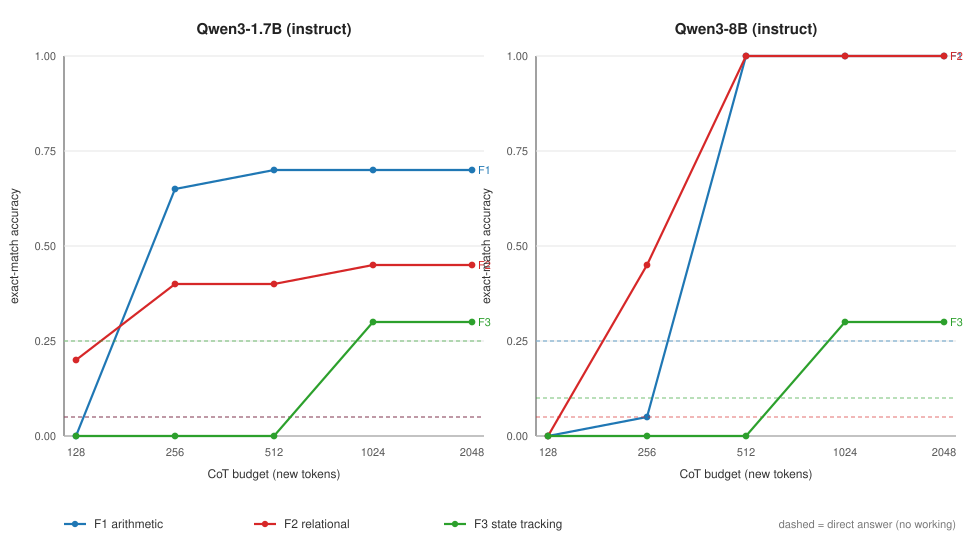

# Protocol — the 2026-11 confirmatory programme

**Status: locked for review, not yet run.** This file is the pre-registration. It
changes only by a dated amendment in §14, written *before* the affected run — never
after seeing its result.

Read [WALLS.md](WALLS.md) for the constraints, [FINDINGS.md](FINDINGS.md) for what
is already known, [CORPUS.md](CORPUS.md) for the data stage, and
[EXPERIMENTS.md](EXPERIMENTS.md) for the run manifests.

---

## 0. The claims

Three confirmatory claims, two assay stages, one 3090.

| ID | Claim | Tested by | Family |
|---|---|---|---|
| **C1** | A block trained with a JEPA-style objective, inserted mid-depth in a pretrained LM, is **load-bearing**: context gain beats its isotype, and ablating the block removes the gain. | E1 | F-A (latent necessity) |
| **C2** | At paragraph scale, a **draft is necessary** for a trained refiner: the true draft beats a shuffled draft, and a refiner trained without a draft channel cannot match. | E4-S2 | F-A (latent necessity) |
| **C3** | A learned **latent emission path beats matched-FLOP text chain-of-thought** at equal output length. | E2 | F-B (compute allocation) |

E1 and E4-S2 are a fixed sequence: E4-S2 is tested only if E1 passes. E2 is an
independent family with its own endpoint, corpus (none) and model state.

**Stated prior.** P(C1) ≈ 0.20, P(C2) ≈ 0.25, P(C3) ≈ 0.20. A null is the
expected result on all three. This is written down so that a null cannot later be
reframed as "needed more tuning". Every surviving mechanism in this repo (W1, W2,
W3) says the same thing: an auxiliary channel gets ignored, cancelled, or
out-competed by the path that receives exact per-token credit.

---

## 1. The four non-negotiables

These are not gates that can be argued past. If one is missing, the run is void.

| | Requirement | Why it cannot be bought |
|---|---|---|
| **N1** | **Independent endpoint.** The scorer must not share a mechanism with the treatment. | More *n* makes a circular estimate more precisely wrong. |
| **N2** | **A null that varies.** The null arm must resample items and decode seeds. Never an identical greedy pair. | A null with zero variance has a zero-width CI at any *n*. |
| **N3** | **Pre-registered MPID.** The smallest effect worth acting on, fixed before the treatment contrast is seen. PASS requires the CI **lower bound to exceed the MPID** — not merely to exclude zero. | With enough *n*, every trivial effect becomes "significant". |
| **N4** | **Sealed confirmatory split.** One look, one analysis script, frozen key. | The repo already has the cautionary number: an 8-seed sweep at +0.132 became +0.013 under a 20-seed confirm. |

Operationally, N1 means: the E4 endpoints are **target-only entity/keyword recall**
and **paired retrieval win-rate**, with MiniLM cosine to the leave-one-out document
centroid as a supporting continuous measure. The cosine is valid **as a paired
difference** — the 0.445 unsteered null cancels — and invalid as an **absolute
gate**, because 0.445 > 0.40. That absolute gate is deleted.

---

## 2. Analysis plan and multiplicity

Two families, Bonferroni at **α = 0.025** each, one-sided.

```
F-A  latent necessity      E1  ──pass──►  E4-S2        (fixed sequence, α = 0.025)
F-B  compute allocation    E2                          (α = 0.025, independent)
```

- **Fixed sequence inside F-A.** E4-S2 is analysed only if E1 rejects. The gate
  procedure controls FWER ≤ 0.025 across the chain without a further correction.
- **E2 costs nothing from the α split.** E2 is bimodality-limited, not
  *n*-limited: at *n* = 12 per arm per family it detects ≈ 0.011 absolute
  accuracy against an MPID of 0.05.
- **No interim look at any treatment contrast.** One futility look is permitted,
  and only at G1, and only at *variance* — never at the arm difference.
- **Analysis code is frozen before unblinding.** Hash the analysis script into
  the run manifest.

Everything not listed as a confirmatory endpoint is **exploratory** and is
reported with a CI and labelled as such. Exploratory results never promote a
claim, never gate a subsequent stage, and never appear in an abstract without the
word "exploratory".

---

## 3. Gate ladder and run order

```
G-1  corpus build  ──►  G0  E0 assay  ──►  G3  E4-S1  ──►  G1  E1 pilot
                                                              │
                                                              ▼
                                                        G2  E1 main
                                                              │
                                        ┌─────────────────────┴──────────┐
                                        ▼                                ▼
                                  G4  E4-S2                        G2b  E2
                                  (only if G2 PASS)               (independent)
                                        │                                │
                                        └───────────►  G5  OLMo  ◄───────┘
                                                          │
                                                          ▼
                                                   G6  dose curves
                                                   (only if G2 PASS)

E3 : cut permanently. Not a gate. Deleted from the programme.
```

**Why E4-S1 runs third.** It costs ~16 GPU-hours and answers the largest open
question in the repo — Q1, *is an injected latent necessary at all?* If necessity
≈ 0, it saves E2's ~290 h and E4-S2's ~190 h before they are spent.

| Gate | Content | GO criterion | NO-GO action |
|---|---|---|---|
| **G-1** | Corpus construction | see [CORPUS.md](CORPUS.md) §5 | no corpus, no run |
| **G0** | E0 assay validation (Qwen) | null half-width ≤ 0.015; dose monotone; 100-vs-0 LB > 0.03; text-prefix LB > 0.03; zero NaN/Inf | fix the endpoint or stop. Cost: half a day |
| **G3** | E4-S1 interface | necessity LB > MPID on both endpoints; fidelity ≥ 0.40 | necessity ≈ 0 ⇒ latent line dead; Q1 answered; stop |
| **G1** | E1 pilot, 10 seeds on A and B | SD_pilot ≤ 0.020; block not collapsed (std_z, effective rank); convergence met on all arms | SD > 0.020 ⇒ shared trunk or MPID 1%; SD > 0.030 ⇒ **pipeline is broken — fix it, do not buy *n*** |
| **G2** | E1 main | P1 LB > MPID **and** P3 necessity LB > 0 | block decorative ⇒ write the wall, close the line, no tuning of Δ / depth / EMA |
| **G4** | E4-S2 refiner | necessity LB > MPID at 10 seeds; no-draft arm does not match; fidelity ≥ 0.40 | interface does not survive joint training ⇒ stop |
| **G2b** | E2 | A − B_text LB > 0 at matched FLOPs; responders ≥ 0.60; necessity ≥ 50% | text CoT wins ⇒ the latent-thought line closes |
| **G5** | OLMo replication | same sign, CI overlaps Qwen | backbone-specific: report as such, never pool |
| **G6** | Dose curves (conditional) | mechanism mapping only | — |

**VOID is not FAIL.** A void means the instrument was broken and no answer exists.
Fix the instrument and re-ask. Never record a void as a result.

**Programme abandonment rule.** If G2 and G3 both fail, the programme stops and
writes two walls rather than opening G2b and G5. Pre-registered here so that the
queue cannot keep running after the question has been answered.

---

## 4. G0 — E0: assay validation

Purpose: prove the instrument can detect an effect known to exist before asking it
a question whose answer is unknown.

Backbone Qwen3-1.7B-Base, existing Phase-A adapter, corpus from
[CORPUS.md](CORPUS.md). Items are drawn one per document.

| Arm | Role | *n* |
|---|---|---|
| true latent | treatment | 256 items × 3 decodes |
| shuffled latent (cross-document) | necessity control | 256 |
| no latent (zero prefix) | format control | 256 |
| slerp 0 / 50 / 100 % | **dose positive control** | 256 each |
| text-prefix true vs random | **readout positive control** | 128 each |
| same arm, fresh decode seed + disjoint items | **noise floor** | 256 |

**Endpoint.** Paired margin `cos(ŷ, z_true) − cos(ŷ, z_shuf)`, plus entity recall.

**Gate.** Null half-width ≤ 0.015; dose monotone with 100-vs-0 LB > 0.03;
text-prefix LB > 0.03; no NaN/Inf; judge anchor drift < 0.02.

**Deliberate circularity, declared.** E0's margin is measured in the codec's own
space, because its job is to calibrate *that instrument*. It is not evidence for
C1–C3 and is never cited as such. No confirmatory endpoint uses it.

Cost ≈ 11 GPU-hours.

---

## 5. G1–G2 — E1: is a JEPA block load-bearing?

### 5.1 Design

A 2 × 2 factorial over **architecture** (block present / absent) and **objective**
(JEPA loss on / off), with the controls attached.

| Cell | Block | JEPA loss | Role | *n* |
|---|---|---|---|---|
| **A** | yes | on | **Treatment** — tests C1 | 32 |
| **B** | yes, bit-identical modules and init | weight 0 | **Isotype** — same construct, active ingredient removed | 32 |
| **A′** | none; parameter-matched head on the trunk's own hidden state | on | Secondary: the objective without the architecture | 32 |
| **B′** | head present | weight 0 | Isotype for A′ | 32 |
| **E** | as A | targets permuted across the batch each step | **Scrambled-target specificity** | 12 |
| **D** | none | — | **Vehicle** — absolute reference only, not a contrast | 6 |
| **N** | frozen random block | — | **Nuisance estimate** — never cited as a control | 3 |
| **PC** | LoRA `lr = 1e-4` vs `0`, 2M tokens | — | **Positive control** | 3 + 3 |
| **Dose** | Δ ∈ {1, 64}; EMA ∈ {100, 10k}; depth ∈ {3 blocks, L18} | on | Mechanism curves, **G6 only** | 16 each = 48 |

Why C is demoted to N: a frozen random block has an outcome space of {slightly
worse than vehicle, much worse than vehicle}. Neither branch updates any conclusion
about the objective. Informativeness is a property of the estimand, not the price.

### 5.2 The variance lever

Train **one LoRA trunk per seed**, then fit A, B, A′, B′ on top of that *same
frozen trunk*. The arm contrast becomes within-trunk, so the dominant run variance
cancels. Pre-register a joint-training confirmation at *n* = 8 as the generalisation
check, because a block fitted to a frozen trunk cannot co-adapt.

Planning effect: if σ_diff falls from ~0.020 to ~0.008, *n* drops from 32 to ~12
per cell. If it does not fall, the joint-training design is the primary and *n*
stays at 32.

### 5.3 Endpoints

- **P1 (primary).** Paired **context gain** = `NLL(doc-shuffled context) −
  NLL(true context)`, nats/token, on the sealed test split. Context gain isolates
  *use of context* from raw knowledge and is immune to the "+54 nats" confound.
- **P3 (co-primary, near-free).** **Necessity** — zero the block output at
  evaluation on A's own checkpoints and re-measure P1. No extra training.
- **Secondary.** Plain held-out bits/token with the contamination screen;
  A′ − B′; A − E; cross-register context gain (FDA labels); compute-matched AUC as
  a curve; block-output RMS as a fraction of residual RMS (the washout diagnostic —
  if < 1 %, a null means "washed out", not "unhelpful", and those are different
  mechanistic claims).

**PASS** iff P1 CI lower > MPID **and** P3 CI lower > 0. Conjunctive; the
intersection–union test needs no α adjustment.

### 5.4 Sample size

MPID = **0.5 % relative NLL**. Planning value **0.0112 nats/token** at a 2.238 nat
baseline; the absolute value is fixed at G1 as `0.005 × NLL_vehicle` and written
into the frozen analysis script before any treatment arm is unblinded.

```
n_main = ceil( 10.5 × (1.29 · SD_pilot / MPID)² )     clipped to [24, 64]
```

- constant 10.5 = (z₀.₉₇₅ + z₀.₉₀)² = (1.960 + 1.282)², i.e. two-sided α 0.025
  and power 0.90. No extra t-inflation is applied here because the pilot SD
  factor below already inflates the numerator;
- 1.29 = the 80 % upper confidence factor on an SD estimated from **10** seeds
  (a 3-seed pilot gives 2.1× and would under-size the study by ~4.4×);
- floor 24 is adequate at 80 % power; the cap 64 is where a larger *n* stops
  buying anything and the pipeline becomes the suspect.

| SD_pilot | n_main |
|---|---|
| 0.008 | 24 (floored) |
| 0.010 | 24 (floored) |
| 0.015 | 32 |
| 0.020 | 56 |
| 0.025 | 64 (capped) |
| > 0.030 | **do not run** — fix the pipeline |

The table is generated by `experiments.protocol.stats.required_n` and asserted in
`tests/test_protocol_stats.py`; the 0.015 row is the planning case and gives 32,
which is the E1 default in §5.1.

### 5.5 Blocking and reproducibility

- **Seed is the block.** Analysis is on the per-seed paired difference A − B, then
  averaged across seeds. Between-seed variance cancels.
- Independent spawn-keyed RNG streams: `(seed,"data")`, `(seed,"lora_init")`,
  `(seed,"block_init")`, `(seed,"head_init")`, `(seed,"dropout")`.
- **One fixed test set** for all runs.
- Token stream pinned by SHA-256 and asserted identical across arms.
- **Zero-init** every block output projection and every head, so A/B/E are
  bit-identical functions at step 0.

### 5.6 Training budget

30M tokens per run. Pre-registered extension rule: if the val context-gain slope
exceeds 0.2 × MPID per 1M tokens at the endpoint, extend **all** runs by 30M.
Applying it to all arms or none is what keeps it from becoming optional stopping.

Convergence criterion, applied to every arm: held-out NLL improvement < 0.5 % over
the last 20 % of steps, or 2 full epochs. F20 is the warning here — the scratch
writer was stopped mid-descent and the comparison was between two partial
solutions.

---

## 6. G2b — E2: latent emission versus matched-FLOP text CoT

### 6.1 Why this one has the only fully independent endpoint

Exact-match accuracy on generated, verifiable tasks. No embedding, no judge, no
codec. Chance is known and a degenerate model scores at chance.

### 6.2 Task families

Generated with fixed generator seeds: train from seeds 0–99, test from 100–199;
2,000 test items per family. Primary endpoint is the **unweighted mean across all
three**. A win in one family only is a **FAIL** for the general claim and is
reported as a family-specific finding.

| Family | Task | Known CoT effect |
|---|---|---|
| **F1** arithmetic | 3-digit × 3-digit | +0.2 to +0.5 exact match |
| **F2** relational | k-hop reachability, k = 3–6, random DAG | +0.1 to +0.3 |
| **F3** state tracking | composition of k permutations | +0.1 to +0.3 |

### 6.3 Arms

**Backbone: Qwen3-1.7B instruct (primary; matches E1's scale), Qwen3-8B instruct
(scale replication).** The 1.7B **Base** checkpoint is excluded: given the CoT
prompt as raw text it emits EOS, and with a chat template it degenerates into a
`.waitKey` repetition loop instead of working the problem (F44). On the same
2-digit task Base scores 0.90 direct but 0.10 with explicit CoT — an
instruction-following failure, not a difficulty result. The capability screen in
§6.3.1 is a **precondition**: an E2 arm is not trained until its backbone clears
it. 0.6B is dropped as too small for a capacity-mediated null.

#### 6.3.1 Capability screen (precondition, not a result)

Direct answer versus **explicit text CoT**, same weights, thinking disabled,
n = 20 per family, exact match. A backbone is usable iff the unweighted mean
CoT−direct gain is **≥ 0.10**.

| Backbone | F1 | F2 | F3 | Mean | Gate |
|---|---|---|---|---|---|
| Qwen3-1.7B **Base** | 0.00 | +0.15 | +0.05 | +0.067 | **VOID** — CoT degenerates |
| Qwen3-1.7B **instruct** | **+0.65** | **+0.40** | +0.05 | **+0.37** | **PASS** |
| Qwen3-8B **instruct** | +0.75 | +0.95 | +0.20 | **+0.63** | **PASS** |

The CoT budget is **1024 new tokens for every family**; 2048 adds nothing
(F48). A budget below 1024 is not neutral: at 512 every F3 trace truncates and
scores 0, and at 256 even 8B truncates F1. The observed effects saturate by 1024,
so F3's small effect at both scales is a capability result, not a truncation
artifact. The screen measures the comparator, not the treatment; it never
substitutes for the trained E2 arm.



*Figure 1. Explicit-CoT accuracy as a function of output budget, with the direct
answer as a dashed baseline. F1 saturates at 256–512, F2 at 256–512, and F3 only
at 1024; nothing improves at 2048. Generated by
`experiments/e2/plot_budget.py` from the artifacts cited in F48.*

The chat template is applied to every prompt and **reported**, because a raw
completion baseline mostly measures format compliance (F43).

| Arm | Role | Construction | *n* / family |
|---|---|---|---|
| **E** | Vehicle | direct answer, no extra compute | 12 |
| **A** | **Treatment** | discrete top-1 gate with capacity cap; latent emission at a position instead of a token; λ charged in the objective, fixed a priori | 12 |
| **B_text** | Positive control **and** scientific comparator | text CoT at matched FLOPs (within 5 %), then answer | 12 |
| **B_depth** | Engineering control | same positions, same output length, extra block applications at matched FLOPs | 12 |
| **C** | Fault detection | λ = 0, free latent — expected to be ignored (F24) | 3 |
| **Dose** | Mechanism | λ ∈ {low, mid, high}; VQ ∈ {1, 8, 16} bits | 6 each, F1 only |

### 6.4 Endpoints and decision

- **Primary.** Paired A − B_text in exact match, mean over families, two-level
  bootstrap CI (items within run, then runs).
- **Responder co-primary.** A seed is a responder iff (i) emission rate ≥ 10 % of
  positions **and** (ii) zeroing latents at emission sites removes ≥ 25 % of that
  seed's own A − E effect. PASS requires the **lower bound of the responder
  proportion ≥ 0.60**. A method working in 4 of 12 seeds is not a method, and a
  mean hides that.
- **MPID.** +0.05 absolute accuracy.

**PASS** iff A − B_text LB > 0 at matched FLOPs **and** responders ≥ 0.60 **and**
necessity ≥ 50 %. **VOID** if the backbone fails the §6.3.1 capability screen
(mean CoT−direct < 0.10), if B_text − E < 0.10 (the assay cannot see a
46 × MPID effect), if FLOP mismatch > 5 %, or if C is *not* ignored.

The capability screen is run and reported **before** the trained arm. It is a
fault check on the comparator, not a test of the hypothesis; its n is not pooled
with the E2 n. The observed screen values (1.7B instruct +0.35, 8B +0.63) are
recorded in [FINDINGS.md](FINDINGS.md) F45.

**No family is added after the first result.** A "one more family" decision after
seeing F1 is the exact failure mode unlimited compute invites.

---

## 7. G3–G4 — E4: is a draft necessary?

### 7.1 G3, the interface test (frozen refiner, fitted adapter)

192 items, **one per document** — the cheapest variance control available, since it
makes the document-cluster design effect ≈ 1. × 3 adapter fits (with one fit the
CI ignores the projection-training component entirely).

| Arm | Role | *n* |
|---|---|---|
| true draft | treatment | 192 × 3 |
| shuffled draft (cross-document) | necessity control | 192 × 3 |
| no draft (zero prefix) | format control | 192 × 3 |
| 50 % slerp | dose | 192 × 3 |
| text-prefix true vs random | positive control | 96 × 3 |
| null pair (fresh decode, disjoint items) | noise floor | 192 × 2 |

### 7.2 G4, the refiner test (QLoRA)

| Arm | Role | *n* |
|---|---|---|
| true draft, within refiner | treatment | 128 items × **10 seeds** |
| shuffled draft, within refiner | necessity control | same |
| no draft | format control | same |
| refiner trained **without** a draft channel | **training-time control** | 10 seeds |

Two distinct claims, both needed: "true beats shuffled *on one model*" and
"a draft-conditioned model beats a draft-blind model".

### 7.3 Endpoints

- **Primary (N1).** Paired necessity on **target-only entity/keyword recall**, and
  on **paired retrieval win-rate**.
- **Supporting continuous.** MiniLM cosine to the leave-one-out document centroid,
  used **only as a paired difference**. No absolute gate at 0.40.
- **Fidelity gate.** ≥ 0.40 — the output must contain content at all before asking
  whether the draft caused it.

**MPID** fixed at G3 from the measured null width: planning values **+0.05 absolute
recall** and **+0.03 cosine**. If G0 shows a null half-width exceeding half the
MPID, the item count is widened before any treatment contrast is seen.

**PASS** iff necessity LB > MPID **and** the no-draft arm does not match.

### 7.4 Why 10 seeds

`SE(necessity) ≈ sqrt( σ_item²/(R·I) + σ_run²/R )`, σ_item = 0.09, σ_run = 0.03,
I = 128:

| R | SE | 80 % MDE |
|---|---|---|
| 8 | 0.0140 | 0.039 |
| **10** | **0.0124** | **0.0275** |
| 12 | 0.0114 | 0.032 (α=0.025: 0.036) |

At α = 0.025 the 10-seed MDE is 0.0275 < MPID 0.03. Eight seeds would not clear it.

---

## 8. G5 — OLMo-2-1B: the contamination arm

Criterion: **same sign, and the OLMo CI overlaps the Qwen CI.** Not "significant on
both". A sign flip is a finding about the backbone and is reported as such; the
arms are never pooled.

| Stage | *n* on OLMo |
|---|---|
| E0 assay repeat | 3 adapter fits × 128 items |
| E1 | 16 seeds per cell |
| E4-S1 | 3 adapter fits × 128 items |
| E4-S2 | 5 refiner seeds × 128 items |

OLMo-2-1B is chosen over a larger Qwen because its training data are **fully open**,
which is the only way to test the contamination confound that Qwen's opacity
prevents. 4B is a scale replication after OLMo, not a substitute for it. 7–8B is
not recommended; 14B does not fit 24 GB with any margin.

---

## 9. G6 — conditional dose curves

Run **only if G2 passes**. At *n* = 8 per level they are not powered to distinguish
"flat" from "small effect", so a flat curve after a null adds nothing to the null.
After a positive they are the strongest mechanistic evidence short of ablation.

| Axis | Levels | What it removes |
|---|---|---|
| Target horizon Δ | 1, **8 (primary)**, 64 | The F1 "target undefined" forking path |
| EMA half-life | 100, **1,000 (primary)**, 10,000 | The single most tunable knob |
| Block depth / position | 1 block @ L9 (primary), 3 blocks, L18 | The "one block at 1/3 depth" arbitrariness |

Analyse each **as a curve** (test for monotonicity). Never report a sweep maximum.

---

## 10. Pipeline qualification — a VOID gate, not an aspiration

Runs before G1 and re-checked at every stage. If any item fails, the experiment does
not start.

| Check | Threshold |
|---|---|
| Sanitised microbatches over 500 qualification steps | **zero** |
| Throughput at 1.7B, ctx 512–1024 | **≥ 2,000 tok/s** |
| Micro-batch | ≥ 4 |
| Step-0 loss across A / B / E after zero-init | **bit-identical** |
| Token-stream SHA-256 across arms | identical |
| NaN / Inf in any eval metric | none |
| Arm NaN-sanitise rates | differ by ≤ 2 pp |

The batching requirement is a **power** requirement, not a speed one: `n ∝ σ²`, and
micro-batch-1 gradient variance inflates σ. Cutting σ from 0.030 to 0.010 cuts *n*
by 9×.

Evidence this is not optional: `train2.log` records `grad_nan_skips = 102` after 15
steps (~10.6 %). An arm-dependent sanitisation rate confounds the treatment with
the harness, and 30M tokens gives ~3,000 steps of opportunity for the rates to
diverge.

---

## 11. Scale and calendar

Planning estimates from **measured** throughput on the actual backbone, not from
assumed numbers. **Non-gating** — no decision rule depends on time.

Measured on this card with `experiments/runner/` (Qwen3-1.7B-Base, ctx 512,
micro-batch 4, LoRA r=16, gradient checkpointing):

| Path | Throughput | Peak VRAM |
|---|---|---|
| Train, bf16 | **4,029 tok/s** | 7.59 GB |
| Train, 4-bit NF4 (QLoRA) | 2,589 tok/s | 7.02 GB |
| Decode, bf16, greedy (batch 4, 128 new tokens) | **397 tok/s** | 3.26 GB |

Two consequences, both recorded in FINDINGS:

- **bf16 is the training path.** 4-bit is 36 % *slower* and saves only 0.57 GB at
  1.7B. QLoRA buys nothing below ~4B and is dropped for the primary arm.
- The old 810–857 tok/s figure was ~4.8× pessimistic. Training-bound stages divide
  by ~4.75; generation-bound stages benefited more still (decode is ~16× the old
  implied rate). The table below is the measured-throughput revision.

| Stage | Class | GPU-hours (revised) |
|---|---|---|
| G0 assay | generation | ~3 |
| G3 E4-S1 | generation | ~4 |
| G1 pilot (20 runs) | training | ~21 |
| G2 E1 core (shared trunk + controls + joint confirmation) | training | ~127 |
| G2b E2 | generation | ~55 |
| G4 E4-S2 | training | ~40 |
| G5 OLMo | training | ~57 |
| **Core total** | | **~250–350 h ≈ 2–3 weeks serial** |
| G6 dose curves (conditional) | training | +50 |

Serialisation and review, not GPU-hours, are now clearly the binding constraint:
one card, one run at a time, six analysis freezes, and six sealed looks that one
analyst must supervise. Throughput is no longer the reason to trim the design.

---

## 12. Deliberately not in the programme

| Item | Why |
|---|---|
| **E3 — reconstruction-reward distillation** | Re-enters W1, W3 and W5 simultaneously. The reward is a cosine in the JEPA space, the endpoint would be a 2-AFC in the same space, and F29 is the local proof that this loop hacks itself (train judge 0.235→0.333, held-out flat). The oracle arm is a **ceiling**, not a control. More compute makes it worse: a stronger optimiser finds the codec's blind spot faster. |
| **7–8B backbone** | 4.6× the wall-clock of 1.7B for a sign check that 4B already delivers, and it fits only at 16–20 GB with no fragmentation margin. |
| **14B** | 22–26 GB modelled; does not fit reliably on 24 GB. |
| **Per-seed evaluation sets** | One fixed test set for all runs. |
| **Cosine-to-a-latent as a confirmatory endpoint** | W5. |

---

## 13. What a reader should be able to say afterwards

For each claim, exactly one of:

- **PASS** — the CI lower bound exceeds the pre-registered MPID, under all void
  checks, on the sealed split.
- **FAIL** — the CI is entirely below the MPID, or the necessity endpoint is ≈ 0.
- **INCONCLUSIVE** — the CI straddles the MPID. Reported as such; the same
  mechanism is not re-run.
- **VOID** — a qualification check failed. No answer exists.

Two FAILs on the same wall ⇒ write the wall into [WALLS.md](WALLS.md). The third
attempt at that wall needs a **new mechanism**, not a new hyperparameter.

---

## 14. Amendments

None yet. Amendments are appended with a date, the reason, and the stage they
affect. An amendment after data has been seen on the affected contrast is a
protocol deviation and is reported as one.

---

## 15. Doc map

| File | Purpose |
|---|---|
| [WALLS.md](WALLS.md) | The five measured constraints. Read first. |
| [FINDINGS.md](FINDINGS.md) | Every claim, number and verdict. Append, don't rewrite. |
| [IDEAS.md](IDEAS.md) | The live bets, each mapped to the walls. |
| **PROTOCOL.md** | This file — the confirmatory programme. |
| [CORPUS.md](CORPUS.md) | G-1: data sources, licences, splits, contamination screen. |
| [EXPERIMENTS.md](EXPERIMENTS.md) | Run manifests, spawn keys, run order. |
| [EXPLAINER.md](EXPLAINER.md) | The vocabulary and diagrams, for readers new to the terms. |
| [ARCHITECTURE.md](ARCHITECTURE.md) | How the surviving code fits together. |
| [LIMITATIONS.md](LIMITATIONS.md) | Honest account of scope. |
